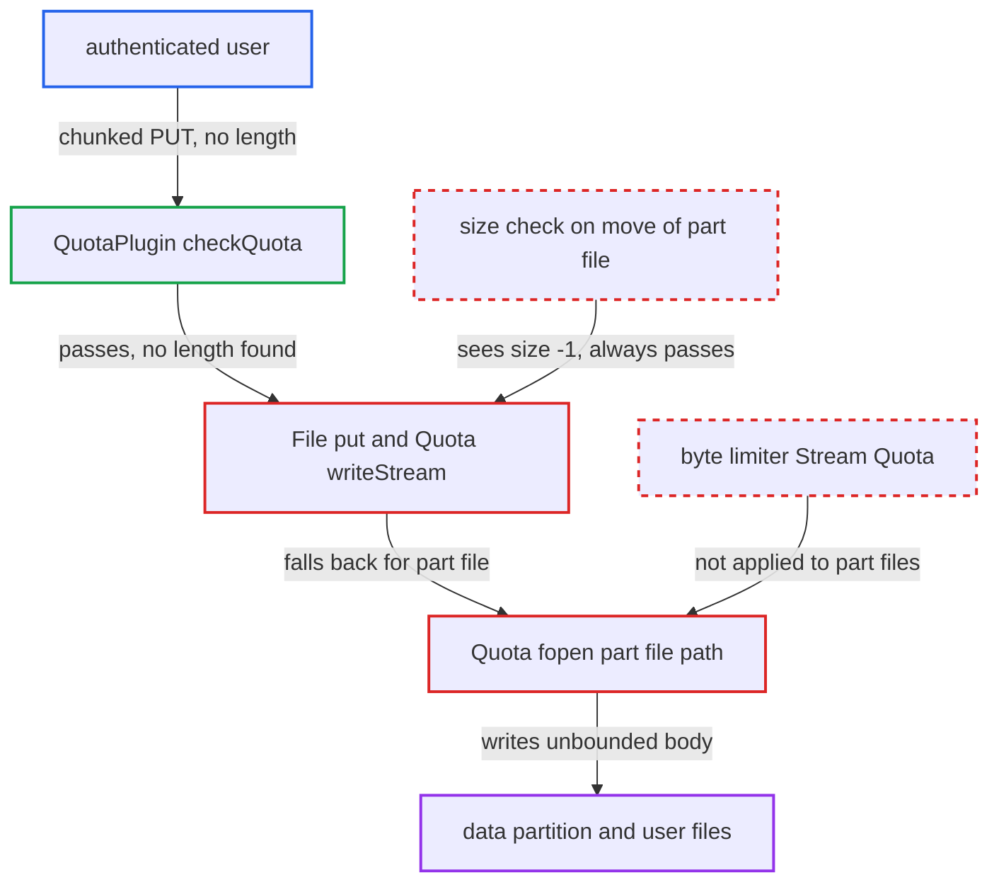

# Quota wrapper skips .part files, so PUT without length bypasses user quota

| Field | Value |
|---|---|
| ID | `find_01JqSmWYVmxdwtrA33JQiPiZ` |
| Severity | **Medium** |
| Status | open |
| CWE | CWE-770 — Resource allocation without limits |
| Created | 2026-10-27T21:25:06.754892Z |
| Claude Security | https://claude.ai/security/findings/find_01JqSmWYVmxdwtrA33JQiPiZ |

## Description

A logged-in user with an admin-set quota and some free space left can store far more data than the quota allows. Parallel uploads can fill the server's data partition, which stops uploads and writes for every user. It works when the web server passes a chunked `PUT` with no length header, as Apache with mod_php does. The cause is that `Quota::fopen()` skips the byte limiter for `.part` files, and `QuotaPlugin::checkQuota()` accepts requests with no length.

1. **authenticated user** sends a chunked `PUT` with no length headers. The request goes to `/remote.php/dav/files/<uid>/big.bin` with `Transfer-Encoding: chunked`. Under Apache with mod_php the body reaches PHP with no `CONTENT_LENGTH`.
2. **`QuotaPlugin::checkQuota()`** lets the request through. It reads only `X-Expected-Entity-Length`, `Content-Length` and `OC-Total-Length`, and returns true when none is numeric. ([`apps/dav/lib/Connector/Sabre/QuotaPlugin.php:242-298`](https://github.com/cx-benchmark/server/blob/6b6317280f8ed50277369c33cee070a643d29654/apps/dav/lib/Connector/Sabre/QuotaPlugin.php#L242-L298))
3. **`File::put`** writes the body to a `.ocTransferId<N>.part` path with size `null`. A home storage always uses a part file first. `$expected` stays `null` without a `content-length` and is passed to `$partStorage->writeStream()` as the size. ([`apps/dav/lib/Connector/Sabre/File.php:136-232`](https://github.com/cx-benchmark/server/blob/6b6317280f8ed50277369c33cee070a643d29654/apps/dav/lib/Connector/Sabre/File.php#L136-L232))
4. **`Quota::writeStream()`** falls back to `Quota::fopen()` because no size was given. Only a free space of exactly 0 is rejected up front. `writeStreamFallback()` then calls `$this->fopen($path, 'w')` and copies the whole body. ([`lib/private/Files/Storage/Wrapper/Quota.php:229-254`](https://github.com/cx-benchmark/server/blob/6b6317280f8ed50277369c33cee070a643d29654/lib/private/Files/Storage/Wrapper/Quota.php#L229-L254))
5. **`Quota::fopen()`** returns the raw stream for the `.part` path. `isPartFile($path)` is true, so the `OC\Files\Stream\Quota` byte limiter is never attached and the copy has no byte limit. ([`lib/private/Files/Storage/Wrapper/Quota.php:125-161`](https://github.com/cx-benchmark/server/blob/6b6317280f8ed50277369c33cee070a643d29654/lib/private/Files/Storage/Wrapper/Quota.php#L125-L161))
6. **`Quota::moveFromStorage()`** publishes the part file without a size check. The uncached `.part` source reports `SPACE_NOT_COMPUTED` (-1), so `-1 < $free` always passes. `finalizeUpload()` then records the full size. ([`lib/private/Files/Storage/Wrapper/Quota.php:184-194`](https://github.com/cx-benchmark/server/blob/6b6317280f8ed50277369c33cee070a643d29654/lib/private/Files/Storage/Wrapper/Quota.php#L184-L194))

## Assessment

The attacker is any authenticated user who has an admin-set quota and some free space left. The attack needs a front end that forwards chunked request bodies without `CONTENT_LENGTH`, which is Apache with mod_php, the deployment the shipped `.htaccess` targets. Behind nginx the report says chunked bodies are buffered and the length is assumed to be available, so the header check would fire there. Concurrent uploads started while any free space remains each get past the quota. The report assumes sabre/dav 4.x `CorePlugin::httpPut` passes the body on without asking for a length, and could not check this because `3rdparty/` is an uninitialised submodule.

Impact: The attacker can store far more than their quota. Each request is bounded only by the web server's body limit, such as `LimitRequestBody`. Parallel requests can fill the data partition, which stops uploads and writes for every user. Other users' data is not disclosed or altered.

## Recommendation

(1) `Quota::fopen()` exempts every `*.part` path from the `Stream\Quota` byte limiter. `Quota::writeStream()` relies on that `fopen()` when no size is given, so part-file uploads are unbounded at the storage layer.

Fix criteria: On a quota-limited storage, a write under `files/` is bounded by the remaining free space, whatever the file extension and whether or not a size is supplied. A chunked `PUT` with no length headers from a user near their quota fails. No stored file pushes usage past `getQuotaBytes()`.

(2) `QuotaPlugin::checkQuota()` treats a missing numeric length header as enough space. Moving the part file to its final name does not check the written size, because the uncached `.part` file reports -1.

Fix criteria: When the client sends no trustworthy length, the quota is still enforced on the bytes actually received, either while writing or before the part file is published. Leaving out every length header does not let the final stored size exceed the remaining quota.

## Evidence

**https://github.com/cx-benchmark/server**

- [`lib/private/Files/Storage/Wrapper/Quota.php:125-161`](https://github.com/cx-benchmark/server/blob/6b6317280f8ed50277369c33cee070a643d29654/lib/private/Files/Storage/Wrapper/Quota.php#L125-L161)
- [`lib/private/Files/Storage/Wrapper/Quota.php:229-254`](https://github.com/cx-benchmark/server/blob/6b6317280f8ed50277369c33cee070a643d29654/lib/private/Files/Storage/Wrapper/Quota.php#L229-L254)
- [`lib/private/Files/Storage/Wrapper/Wrapper.php:402-416`](https://github.com/cx-benchmark/server/blob/6b6317280f8ed50277369c33cee070a643d29654/lib/private/Files/Storage/Wrapper/Wrapper.php#L402-L416)
- [`apps/dav/lib/Connector/Sabre/File.php:136-232`](https://github.com/cx-benchmark/server/blob/6b6317280f8ed50277369c33cee070a643d29654/apps/dav/lib/Connector/Sabre/File.php#L136-L232)
- [`apps/dav/lib/Connector/Sabre/QuotaPlugin.php:242-298`](https://github.com/cx-benchmark/server/blob/6b6317280f8ed50277369c33cee070a643d29654/apps/dav/lib/Connector/Sabre/QuotaPlugin.php#L242-L298)
- [`lib/private/Files/Storage/Wrapper/Quota.php:184-194`](https://github.com/cx-benchmark/server/blob/6b6317280f8ed50277369c33cee070a643d29654/lib/private/Files/Storage/Wrapper/Quota.php#L184-L194)
- [`apps/dav/lib/Connector/Sabre/File.php:326-330`](https://github.com/cx-benchmark/server/blob/6b6317280f8ed50277369c33cee070a643d29654/apps/dav/lib/Connector/Sabre/File.php#L326-L330)
- [`lib/private/Files/SetupManager.php:236-247`](https://github.com/cx-benchmark/server/blob/6b6317280f8ed50277369c33cee070a643d29654/lib/private/Files/SetupManager.php#L236-L247)

