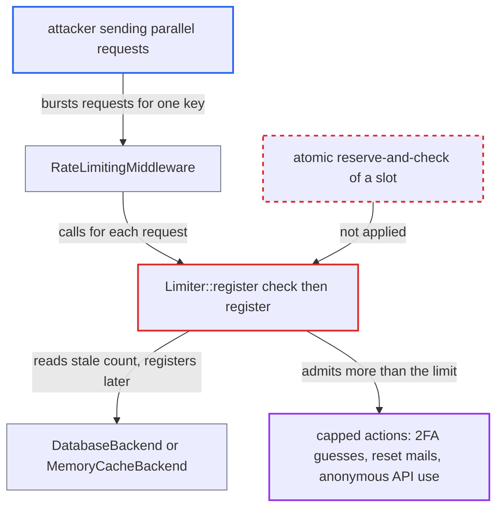

# Rate limiter check-then-register race lets concurrent requests exceed configured limits

| Field | Value |
|---|---|
| ID | `find_01S12czrKor2kSGVs73PXDTT` |
| Severity | **Medium** |
| Status | open |
| CWE | CWE-367 — Race condition |
| Created | 2026-10-27T22:02:29.047466Z |
| Claude Security | https://claude.ai/security/findings/find_01S12czrKor2kSGVs73PXDTT |

## Description

An anonymous client, or someone who holds a victim's password, can send a parallel burst of requests and get more attempts than a rate limit allows. This affects 2FA code guesses, password-reset mails and anonymous translation and text-processing calls. The overrun is a concurrency-bounded multiple of the limit, not unlimited. The cause is `Limiter::register()`, which reads the count and registers the attempt in two separate steps.

1. **attacker** sends many parallel requests for one rate-limit key. The key can be a victim's 2FA challenge, a victim's password-reset mails, or an anonymous endpoint. Several sessions or subnets can be used where a per-subnet check also applies.
2. **`RateLimitingMiddleware`** calls `registerUserRequest` or `registerAnonRequest` before the controller runs. This is the only protection for attribute-based limits, and nothing re-checks after the controller. ([`lib/private/AppFramework/Middleware/Security/RateLimitingMiddleware.php:101-131`](https://github.com/cx-benchmark/server/blob/6b6317280f8ed50277369c33cee070a643d29654/lib/private/AppFramework/Middleware/Security/RateLimitingMiddleware.php#L101-L131))
3. **`Limiter::register()`** reads the count with `getAttempts()` and throws only if it is already at or above `$limit`. Every request that reads the count before enough others have committed sees a stale value below the limit and is admitted. ([`lib/private/Security/RateLimiting/Limiter.php:30-47`](https://github.com/cx-benchmark/server/blob/6b6317280f8ed50277369c33cee070a643d29654/lib/private/Security/RateLimiting/Limiter.php#L30-L47))
4. **`DatabaseBackend`** counts attempts with a plain `SELECT COUNT(*)` after a DELETE of expired rows. Each statement is auto-committed, with no transaction or row lock. ([`lib/private/Security/RateLimiting/Backend/DatabaseBackend.php:38-62`](https://github.com/cx-benchmark/server/blob/6b6317280f8ed50277369c33cee070a643d29654/lib/private/Security/RateLimiting/Backend/DatabaseBackend.php#L38-L62))
5. **`DatabaseBackend`** inserts the attempt in a separate later statement. Nothing ties this INSERT to the earlier count, so the slot is not reserved when the check passes. ([`lib/private/Security/RateLimiting/Backend/DatabaseBackend.php:80-101`](https://github.com/cx-benchmark/server/blob/6b6317280f8ed50277369c33cee070a643d29654/lib/private/Security/RateLimiting/Backend/DatabaseBackend.php#L80-L101))
6. **`MemoryCacheBackend::registerAttempt()`** re-reads a JSON list, appends in PHP and overwrites it with `cache->set()` when `memcache.distributed` is `\OC\Memcache\Redis`. There is no `cas()` or `inc()`, so colliding writes lose increments on top of the check-then-register race. ([`lib/private/Security/RateLimiting/Backend/MemoryCacheBackend.php:81-106`](https://github.com/cx-benchmark/server/blob/6b6317280f8ed50277369c33cee070a643d29654/lib/private/Security/RateLimiting/Backend/MemoryCacheBackend.php#L81-L106))
7. **the requests** run concurrently without a session lock. The session is closed at `lib/OC.php:503`, and `SessionMiddleware` is registered after `RateLimitingMiddleware`, so nothing serializes the requests. ([`lib/private/AppFramework/DependencyInjection/DIContainer.php:212-233`](https://github.com/cx-benchmark/server/blob/6b6317280f8ed50277369c33cee070a643d29654/lib/private/AppFramework/DependencyInjection/DIContainer.php#L212-L233))

## Assessment

The attacker is an anonymous internet client, or someone who holds a victim's password and opens several sessions pending 2FA. No victim action is needed. The attacker needs only to send requests concurrently for one rate-limit key, from several subnets where a per-subnet brute-force check also applies. Both backends are affected: `DatabaseBackend` is the default, and `MemoryCacheBackend` is used when `memcache.distributed` is `\OC\Memcache\Redis`. It matters most where the limiter is the only per-target cap. One case is `TwoFactorChallengeController::solveChallenge`, with `#[UserRateLimit(5, 100)]` per account, where `#[BruteForceProtection]` is only per attacker subnet and core has no further 2FA lockout. Another is the cap of 5 `lostpasswordemail` mails per 30 minutes in `LostController::sendEmail`. Anonymous endpoints such as `TranslationApiController::translate` and `TextProcessingApiController::schedule` are also affected.

Impact: The attacker gets more attempts per period than the limit allows. That means more 2FA code guesses against one account, more password-reset mails to a victim, and more anonymous use of translation and LLM providers. The gain is a concurrency-bounded multiple of the limit, not an unlimited bypass. Account compromise still needs a guessable code.

## Recommendation

`Limiter::register()` separates the limit check from the attempt registration, so concurrent requests are admitted on a stale count. `MemoryCacheBackend` also loses increments through an unsynchronised read-modify-write.

Fix criteria: Reserving a slot and checking the limit is one atomic operation per key. For example, the backend returns the post-increment count (a Redis `INCR` or `cas()` loop, or a DB increment with a row lock or unique counter), and the caller rejects when that count exceeds the limit. Firing N greater than the limit truly simultaneous requests for one key against both backends admits at most `limit` per period. The stored count equals the number of requests served.

## Evidence

**https://github.com/cx-benchmark/server**

- [`lib/private/Security/RateLimiting/Limiter.php:30-47`](https://github.com/cx-benchmark/server/blob/6b6317280f8ed50277369c33cee070a643d29654/lib/private/Security/RateLimiting/Limiter.php#L30-L47)
- [`lib/private/Security/RateLimiting/Backend/DatabaseBackend.php:38-62`](https://github.com/cx-benchmark/server/blob/6b6317280f8ed50277369c33cee070a643d29654/lib/private/Security/RateLimiting/Backend/DatabaseBackend.php#L38-L62)
- [`lib/private/Security/RateLimiting/Backend/DatabaseBackend.php:80-101`](https://github.com/cx-benchmark/server/blob/6b6317280f8ed50277369c33cee070a643d29654/lib/private/Security/RateLimiting/Backend/DatabaseBackend.php#L80-L101)
- [`lib/private/Security/RateLimiting/Backend/MemoryCacheBackend.php:81-106`](https://github.com/cx-benchmark/server/blob/6b6317280f8ed50277369c33cee070a643d29654/lib/private/Security/RateLimiting/Backend/MemoryCacheBackend.php#L81-L106)
- [`lib/private/Server.php:610-627`](https://github.com/cx-benchmark/server/blob/6b6317280f8ed50277369c33cee070a643d29654/lib/private/Server.php#L610-L627)
- [`lib/private/AppFramework/Middleware/Security/RateLimitingMiddleware.php:101-131`](https://github.com/cx-benchmark/server/blob/6b6317280f8ed50277369c33cee070a643d29654/lib/private/AppFramework/Middleware/Security/RateLimitingMiddleware.php#L101-L131)
- [`lib/private/AppFramework/DependencyInjection/DIContainer.php:212-233`](https://github.com/cx-benchmark/server/blob/6b6317280f8ed50277369c33cee070a643d29654/lib/private/AppFramework/DependencyInjection/DIContainer.php#L212-L233)
- [`core/Controller/TwoFactorChallengeController.php:144-146`](https://github.com/cx-benchmark/server/blob/6b6317280f8ed50277369c33cee070a643d29654/core/Controller/TwoFactorChallengeController.php#L144-L146)
- [`core/Controller/LostController.php:242-246`](https://github.com/cx-benchmark/server/blob/6b6317280f8ed50277369c33cee070a643d29654/core/Controller/LostController.php#L242-L246)

