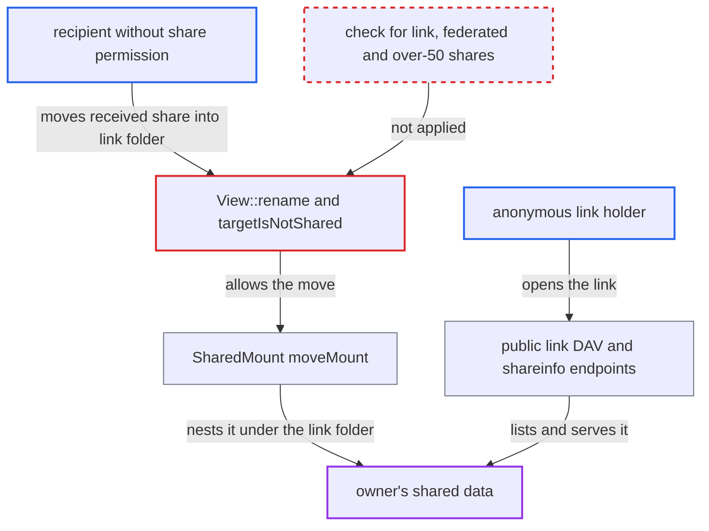

# Received share can be moved into a link- or federated-shared folder, bypassing reshare permission

| Field | Value |
|---|---|
| ID | `find_015wcTRTx93oxwMBJ4bgou9d` |
| Severity | **Medium** |
| Status | open |
| CWE | CWE-863 — Incorrect authorization |
| Created | 2026-10-27T21:37:51.394748Z |
| Claude Security | https://claude.ai/security/findings/find_015wcTRTx93oxwMBJ4bgou9d |

## Description

A user who received a share without share permission can expose the owner's data to anyone holding a public link, or to a federated server. If the received share is writable, anonymous users can also change that data. The attacker only needs an account and a folder of their own with a link on it, and access is capped at the recipient's own permissions. The cause is `View::targetIsNotShared()`, which ignores link and federated shares and checks only the first 50 shares of each type.

1. **recipient** creates an empty folder `P` and a public link on it. Links are allowed by default (`shareapi_allow_links` is yes), and an empty folder passes the check that forbids sharing a folder containing a received share.
2. **recipient** sends a WebDAV MOVE of the received share into `/P/<received>`. The WebDAV code always lets a user move a movable mount root when the destination folder is creatable, and the user's own folder is. ([`apps/dav/lib/Connector/Sabre/Directory.php:423-459`](https://github.com/cx-benchmark/server/blob/6b6317280f8ed50277369c33cee070a643d29654/apps/dav/lib/Connector/Sabre/Directory.php#L423-L459))
3. **the method `View::rename()`** guards the mount move only with `validateMountMove(..., !$this->targetIsNotShared(...))`. This is the only guard on moving a received mount into another folder. ([`lib/private/Files/View.php:807-816`](https://github.com/cx-benchmark/server/blob/6b6317280f8ed50277369c33cee070a643d29654/lib/private/Files/View.php#L807-L816))
4. **the method `View::targetIsNotShared()`** reports the link-shared folder as not shared. It lists only the mover's `TYPE_USER`, `TYPE_GROUP`, `TYPE_EMAIL`, `TYPE_CIRCLE`, `TYPE_ROOM` and `TYPE_DECK` shares, never `TYPE_LINK`, `TYPE_REMOTE` or `TYPE_REMOTE_GROUP`. ([`lib/private/Files/View.php:1901-1935`](https://github.com/cx-benchmark/server/blob/6b6317280f8ed50277369c33cee070a643d29654/lib/private/Files/View.php#L1901-L1935))
5. **the method `validateMountMove()`** lets the move through. It throws 'Moving a share into a shared folder is not allowed' only when the target counts as shared. ([`lib/private/Files/View.php:885-930`](https://github.com/cx-benchmark/server/blob/6b6317280f8ed50277369c33cee070a643d29654/lib/private/Files/View.php#L885-L930))
6. **the class `SharedMount`** rewrites the share target to the new location. `moveMount()` and `updateFileTarget()` go through `Manager::moveShare()`, which validates the recipient but not whether the new location is shared. ([`apps/files_sharing/lib/SharedMount.php:63-124`](https://github.com/cx-benchmark/server/blob/6b6317280f8ed50277369c33cee070a643d29654/apps/files_sharing/lib/SharedMount.php#L63-L124))
7. **anonymous link holder** opens the public link and lists the folder. The public DAV endpoint resolves the link's node in the sharer's user folder, and `View::getDirectoryContent()` adds nested mounts, so the moved-in share is listed and readable. ([`apps/dav/appinfo/v2/publicremote.php:154-180`](https://github.com/cx-benchmark/server/blob/6b6317280f8ed50277369c33cee070a643d29654/apps/dav/appinfo/v2/publicremote.php#L154-L180))
8. **anonymous link holder** reads the owner's data through `ShareInfoController::info()`. `info()` is a public page that recursively lists the node's directory, which includes the moved-in received share. ([`apps/files_sharing/lib/Controller/ShareInfoController.php:86-130`](https://github.com/cx-benchmark/server/blob/6b6317280f8ed50277369c33cee070a643d29654/apps/files_sharing/lib/Controller/ShareInfoController.php#L86-L130))

## Assessment

The attacker is an authenticated user who received a file or folder without share permission. They create an empty folder and a public link on it, which is allowed by default (`shareapi_allow_links` is yes). Then they move the received share into that folder. No non-default setting and no victim action are needed. A federated share (`TYPE_REMOTE`) of the target folder works too, because the legacy public WebDAV endpoint serves it the same way. A target folder shared by email (`TYPE_EMAIL`) is also a way in, because only the first 50 shares of each type are compared. That limit matters only for token-accessed `TYPE_EMAIL` targets. User and group recipients do not see nested mounts, because `SharedStorage` is a jail on the owner's storage.

Impact: Anonymous link holders or a federated server get a live view of the owner's shared data, which follows the owner's later changes. This goes against the owner's refusal of resharing, and the owner's sharing view of the node does not show it. If the received share grants write access, an editable link also lets anonymous users modify that data. Access is capped at the recipient's own permissions on the share, and availability is not affected.

## Recommendation

`View::targetIsNotShared()` checks an incomplete set of the mover's outgoing shares. Link and federated types are missing, and each type is capped at 50 results. A received mount can therefore be moved into a folder exposed by a public link, an email share or a federated share.

Fix criteria: Moving any movable mount into a folder that is, or lies inside, any outgoing share of the mover is refused with the existing `ForbiddenException`. This holds for every share type, including `TYPE_LINK`, `TYPE_EMAIL`, `TYPE_REMOTE` and `TYPE_REMOTE_GROUP`, and for any number of shares the user has. To verify, create a link share on a folder, try to MOVE a received read-only share into it, and confirm the move fails and the link does not list the share. Repeat with more than 50 email shares.

## Evidence

**https://github.com/cx-benchmark/server**

- [`lib/private/Files/View.php:1901-1935`](https://github.com/cx-benchmark/server/blob/6b6317280f8ed50277369c33cee070a643d29654/lib/private/Files/View.php#L1901-L1935)
- [`lib/private/Files/View.php:807-816`](https://github.com/cx-benchmark/server/blob/6b6317280f8ed50277369c33cee070a643d29654/lib/private/Files/View.php#L807-L816)
- [`lib/private/Files/View.php:885-930`](https://github.com/cx-benchmark/server/blob/6b6317280f8ed50277369c33cee070a643d29654/lib/private/Files/View.php#L885-L930)
- [`apps/files_sharing/lib/SharedMount.php:63-124`](https://github.com/cx-benchmark/server/blob/6b6317280f8ed50277369c33cee070a643d29654/apps/files_sharing/lib/SharedMount.php#L63-L124)
- [`apps/dav/lib/Connector/Sabre/Directory.php:423-459`](https://github.com/cx-benchmark/server/blob/6b6317280f8ed50277369c33cee070a643d29654/apps/dav/lib/Connector/Sabre/Directory.php#L423-L459)
- [`lib/private/Share20/Manager.php:497-510`](https://github.com/cx-benchmark/server/blob/6b6317280f8ed50277369c33cee070a643d29654/lib/private/Share20/Manager.php#L497-L510)
- [`apps/dav/appinfo/v2/publicremote.php:154-180`](https://github.com/cx-benchmark/server/blob/6b6317280f8ed50277369c33cee070a643d29654/apps/dav/appinfo/v2/publicremote.php#L154-L180)
- [`apps/dav/appinfo/v1/publicwebdav.php:128-157`](https://github.com/cx-benchmark/server/blob/6b6317280f8ed50277369c33cee070a643d29654/apps/dav/appinfo/v1/publicwebdav.php#L128-L157)
- [`apps/files_sharing/lib/Controller/ShareInfoController.php:86-130`](https://github.com/cx-benchmark/server/blob/6b6317280f8ed50277369c33cee070a643d29654/apps/files_sharing/lib/Controller/ShareInfoController.php#L86-L130)

