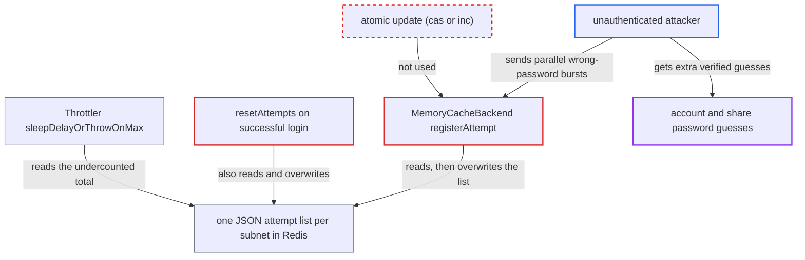

# Redis brute-force attempt store loses concurrent registrations, undercounting failed attempts

| Field | Value |
|---|---|
| ID | `find_01DqBuskQBoK7qP8ooqnNK1V` |
| Severity | **Medium** |
| Status | open |
| CWE | CWE-362 — Race condition |
| Created | 2026-10-27T21:57:55.405248Z |
| Claude Security | https://claude.ai/security/findings/find_01DqBuskQBoK7qP8ooqnNK1V |

## Description

An unauthenticated attacker can get more password guesses than the brute-force limit allows, against account passwords, share passwords, password confirmation and 2FA codes. It needs an instance where `memcache.distributed` is `\OC\Memcache\Redis` and `auth.bruteforce.protection.force.database` is at its default `false`, and it depends on winning a race. The backend `MemoryCacheBackend` updates one stored attempt list with an unprotected read-then-write, so concurrent failed attempts overwrite each other and go uncounted.

1. **attacker** sends a synchronized burst of wrong-password requests from one IP or subnet. The requests go to web `POST /login`, Basic auth on `remote.php/dav` or a public-share password. All of them pass the check while the stored count is 10 or less. ([`lib/private/AppFramework/Middleware/Security/BruteForceMiddleware.php:49-117`](https://github.com/cx-benchmark/server/blob/6b6317280f8ed50277369c33cee070a643d29654/lib/private/AppFramework/Middleware/Security/BruteForceMiddleware.php#L49-L117))
2. **the brute-force store** is bound to `MemoryCacheBackend` for this configuration. This happens when `memcache.distributed` is Redis and `auth.bruteforce.protection.force.database` is `false`, which is the default. ([`lib/private/Server.php:708-718`](https://github.com/cx-benchmark/server/blob/6b6317280f8ed50277369c33cee070a643d29654/lib/private/Server.php#L708-L718))
3. **the workers in `registerAttempt`** each read the subnet's whole attempt list, append their entry in PHP and write the list back. The read is a plain `cache->get` and the write is `cache->set`, an unconditional `SETEX`. No lock, `cas()` or `inc()` is used. ([`lib/private/Security/Bruteforce/Backend/MemoryCacheBackend.php:123-147`](https://github.com/cx-benchmark/server/blob/6b6317280f8ed50277369c33cee070a643d29654/lib/private/Security/Bruteforce/Backend/MemoryCacheBackend.php#L123-L147))
4. **the later writer** overwrites the list with a copy that lacks the other worker's entry. When two get-to-set windows overlap, the later write was built from an older snapshot, so one attempt is lost. A slow writer can even make the list shorter. ([`lib/private/Memcache/Redis.php:72-80`](https://github.com/cx-benchmark/server/blob/6b6317280f8ed50277369c33cee070a643d29654/lib/private/Memcache/Redis.php#L72-L80))
5. **a successful login from the same subnet** triggers `resetAttempts` through the `postLogin` hook. `resetAttempts` is a second read-modify-write of the same key, so a valid login racing failed attempts can also wipe their entries. ([`lib/private/Security/Bruteforce/Backend/MemoryCacheBackend.php:86-117`](https://github.com/cx-benchmark/server/blob/6b6317280f8ed50277369c33cee070a643d29654/lib/private/Security/Bruteforce/Backend/MemoryCacheBackend.php#L86-L117))
6. **`Throttler::sleepDelayOrThrowOnMax()`** reads the undercounted total and blocks only once more than 10 attempts are stored. The method returns the delay without sleeping in this checkout, so that cap is the only limit. Each lost registration is therefore one extra verified guess. ([`lib/private/Security/Bruteforce/Throttler.php:229-256`](https://github.com/cx-benchmark/server/blob/6b6317280f8ed50277369c33cee070a643d29654/lib/private/Security/Bruteforce/Throttler.php#L229-L256))
7. **attacker** reads the stored count from the `X-Nextcloud-Bruteforce-Throttled` header and repeats bursts while the count stays at or below 10. The delay is 100 ms x 2^count, so the header shows how much of each burst was recorded and lets the attacker tune the next one. ([`lib/private/AppFramework/Middleware/Security/BruteForceMiddleware.php:49-117`](https://github.com/cx-benchmark/server/blob/6b6317280f8ed50277369c33cee070a643d29654/lib/private/AppFramework/Middleware/Security/BruteForceMiddleware.php#L49-L117))

## Assessment

The attacker is unauthenticated and works over the network from one IP or subnet. The instance must use Redis as `memcache.distributed` and leave `auth.bruteforce.protection.force.database` at `false`. The attacker sends synchronized bursts of wrong-password requests to web `POST /login`, to Basic auth on `remote.php/dav` or to a public-share password. A valid login from the same subnet that races failed attempts can also erase entries, through `resetAttempts`. The rate-limiting backend `lib/private/Security/RateLimiting/Backend/MemoryCacheBackend.php` uses the same pattern. Winning the race is probabilistic and becomes more likely with concurrency, Redis round-trip time and CPU contention.

Impact: The attacker gets more verified guesses per 30-minute window than `auth.bruteforce.max-attempts` (10) allows. The extra guesses grow with the number of registrations that collide. A compromise still needs a guessable secret, and availability is not affected.

## Recommendation

(1) `MemoryCacheBackend::registerAttempt` and `resetAttempts` update one JSON value per subnet with a non-atomic get, modify and set. Concurrent writers overwrite each other, so the throttler counts fewer failures than really happened.

Fix criteria: Every completed `registerAttempt` call shows up in later `getAttempts` results, whatever else runs at the same time, including concurrent `resetAttempts` calls for other metadata. To verify, register N attempts from N parallel processes, optionally alongside concurrent resets for an unrelated user, and assert that `getAttempts` returns N.

(2) `registerAttempt` in `lib/private/Security/RateLimiting/Backend/MemoryCacheBackend.php` uses the same non-atomic read-modify-write. Concurrent requests can therefore undercount rate-limit hits.

Fix criteria: Rate-limit registrations are counted exactly under concurrency. To verify, run N parallel registrations for one method and user and confirm the count is N.

## Evidence

**https://github.com/cx-benchmark/server**

- [`lib/private/Security/Bruteforce/Backend/MemoryCacheBackend.php:123-147`](https://github.com/cx-benchmark/server/blob/6b6317280f8ed50277369c33cee070a643d29654/lib/private/Security/Bruteforce/Backend/MemoryCacheBackend.php#L123-L147)
- [`lib/private/Security/Bruteforce/Backend/MemoryCacheBackend.php:38-50`](https://github.com/cx-benchmark/server/blob/6b6317280f8ed50277369c33cee070a643d29654/lib/private/Security/Bruteforce/Backend/MemoryCacheBackend.php#L38-L50)
- [`lib/private/Security/Bruteforce/Backend/MemoryCacheBackend.php:86-117`](https://github.com/cx-benchmark/server/blob/6b6317280f8ed50277369c33cee070a643d29654/lib/private/Security/Bruteforce/Backend/MemoryCacheBackend.php#L86-L117)
- [`lib/private/Memcache/Redis.php:72-80`](https://github.com/cx-benchmark/server/blob/6b6317280f8ed50277369c33cee070a643d29654/lib/private/Memcache/Redis.php#L72-L80)
- [`lib/private/Server.php:708-718`](https://github.com/cx-benchmark/server/blob/6b6317280f8ed50277369c33cee070a643d29654/lib/private/Server.php#L708-L718)
- [`lib/private/Security/Bruteforce/Throttler.php:229-256`](https://github.com/cx-benchmark/server/blob/6b6317280f8ed50277369c33cee070a643d29654/lib/private/Security/Bruteforce/Throttler.php#L229-L256)
- [`lib/OC.php:1039-1046`](https://github.com/cx-benchmark/server/blob/6b6317280f8ed50277369c33cee070a643d29654/lib/OC.php#L1039-L1046)
- [`lib/private/AppFramework/Middleware/Security/BruteForceMiddleware.php:49-117`](https://github.com/cx-benchmark/server/blob/6b6317280f8ed50277369c33cee070a643d29654/lib/private/AppFramework/Middleware/Security/BruteForceMiddleware.php#L49-L117)

