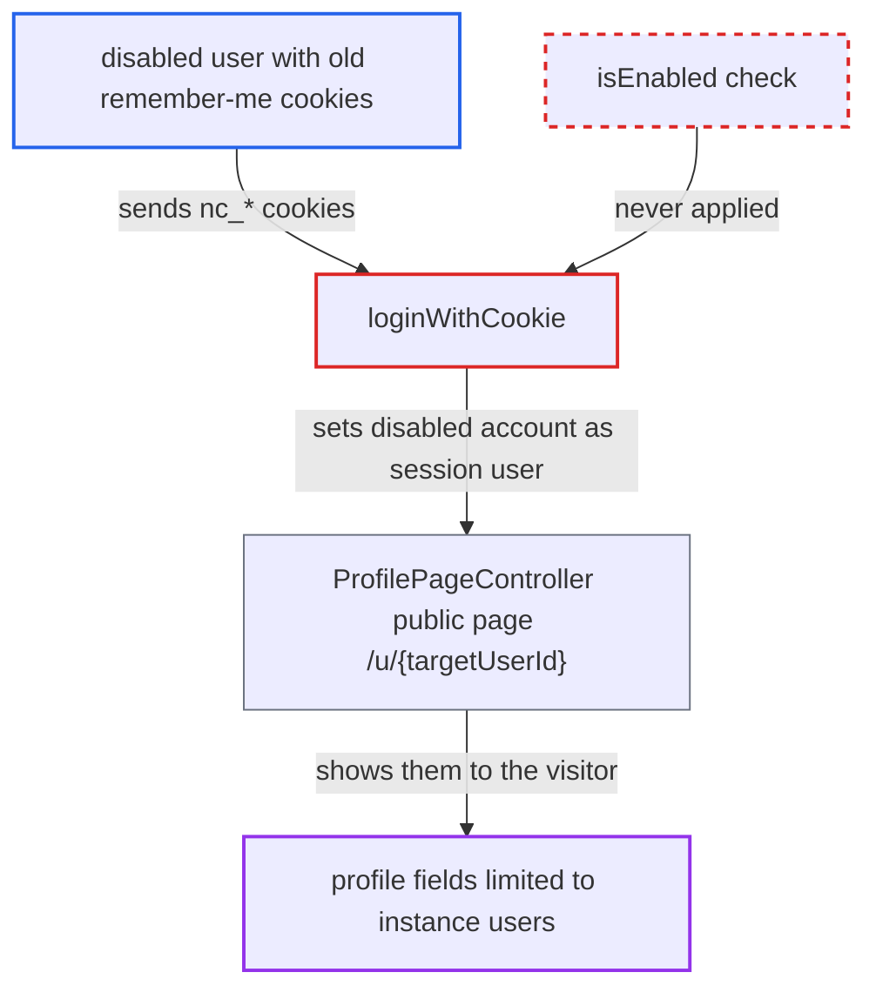

# Remember-me cookie login keeps disabled accounts authenticated on public-page routes

| Field | Value |
|---|---|
| ID | `find_01Atog1gPUqCVjfr856NuVkh` |
| Severity | **Medium** |
| Status | open |
| CWE | CWE-613 — Insufficient session expiration |
| Created | 2026-10-27T21:36:18.490501Z |
| Claude Security | https://claude.ai/security/findings/find_01Atog1gPUqCVjfr856NuVkh |

## Description

A user whose account an admin has disabled can keep using old remember-me cookies. They are treated as a logged-in visitor on public pages and can read profile fields meant only for instance users (address, email and phone by default), and see user enumeration results. Disclosure is limited, and normal logged-in routes stay blocked. The cause is `loginWithCookie()`, which never checks `isEnabled()`.

1. **Admin** disables the user's account with `setEnabled(false)`. This only writes the flag and fires an event. The user's `login_token` values and session tokens are left in place. ([`lib/private/User/User.php:479-505`](https://github.com/cx-benchmark/server/blob/6b6317280f8ed50277369c33cee070a643d29654/lib/private/User/User.php#L479-L505))
2. **Disabled user** sends a request with only the `nc_username`, `nc_token` and `nc_session_id` cookies. `handleLogin()` passes these cookies to `loginWithCookie()` when the request has no session and no bearer token. ([`lib/OC.php:1291-1314`](https://github.com/cx-benchmark/server/blob/6b6317280f8ed50277369c33cee070a643d29654/lib/OC.php#L1291-L1314))
3. **the method `loginWithCookie()`** accepts the cookies, rotates both tokens and sets the user in the session. It checks the cookie token and the old session token, then calls `setUser($user)`, `setToken()` and `updateLastLoginTimestamp()`. It never calls `isEnabled()` or `validateToken()`, which would have invalidated the tokens. ([`lib/private/User/Session.php:908-999`](https://github.com/cx-benchmark/server/blob/6b6317280f8ed50277369c33cee070a643d29654/lib/private/User/Session.php#L908-L999))
4. **the method `completeLogin()`** is not used on this path. That method throws `DisabledUserException` for disabled accounts, so the refusal never happens for a remember-me login. ([`lib/private/User/Session.php:341-347`](https://github.com/cx-benchmark/server/blob/6b6317280f8ed50277369c33cee070a643d29654/lib/private/User/Session.php#L341-L347))
5. **the session code** returns the disabled account from `getUser()` and as the injected `userId`. `getUser()` does not check `isEnabled()`, and `userId` is read from the session `user_id`. Only `isLoggedIn()` checks it, so non-public routes stay blocked. ([`lib/private/User/Session.php:176-192`](https://github.com/cx-benchmark/server/blob/6b6317280f8ed50277369c33cee070a643d29654/lib/private/User/Session.php#L176-L192))
6. **the controller `ProfilePageController`** treats the disabled account as a logged-in visitor on the `#[PublicPage]` route `/u/{targetUserId}`. `$visitingUser = getUser()` drives the enumeration check and `getProfileFields()`. ([`apps/profile/lib/Controller/ProfilePageController.php:72-99`](https://github.com/cx-benchmark/server/blob/6b6317280f8ed50277369c33cee070a643d29654/apps/profile/lib/Controller/ProfilePageController.php#L72-L99))
7. **the class `ProfileManager`** returns fields with `VISIBILITY_SHOW_USERS_ONLY` visibility. These fields are shown whenever `$visitingUser !== null`. By default they are address, email and phone. ([`lib/private/Profile/ProfileManager.php:192-230`](https://github.com/cx-benchmark/server/blob/6b6317280f8ed50277369c33cee070a643d29654/lib/private/Profile/ProfileManager.php#L192-L230))
8. **Disabled user** repeats the request with the new cookies from each response. Each use renews the session token and the remember-me token, so token cleanup never removes them and access can continue indefinitely.

## Assessment

The attacker is a user who logged in with remember-me and was later disabled by an admin. They keep the `nc_username`, `nc_token` and `nc_session_id` values and send requests with only those cookies, with no session cookie. No victim is involved. They then call `#[PublicPage]` routes such as `/u/{user}`. Each response gives new cookies, so they can repeat this indefinitely.

Impact: The disabled account keeps logged-in-visitor visibility on public-page code that uses `getUser()` or `userId`. It can see other users' profile fields restricted to instance users (address, email and phone by default). It is also treated as logged in for enumeration under group- or phone-limited settings. The disclosure is limited. Ordinary authenticated routes stay blocked because `isLoggedIn()` checks `isEnabled()`. The only state that changes is the attacker's own tokens and login timestamps, and availability is not affected.

## Recommendation

(1) `loginWithCookie()` sets up a session for the user named in the remember-me cookie without checking that the account is enabled, unlike `completeLogin()` and the login chain.

Fix criteria: A remember-me login for a disabled account fails before any session state is set or tokens are rotated. It also invalidates the remember-me and session tokens it was given. Check: with a disabled account's valid cookies, `getUser()` and `userId` stay null for the request. The `login_token` entry is not renewed. `/u/{other}` shows only fields visible to anonymous visitors.

(2) Disabling an account leaves its `login_token` values and session tokens in place, so old credentials outlive the disablement.

Fix criteria: When an account is disabled, its remember-me tokens and session tokens are revoked, or every login path rejects them on their next use. Check: after disabling, no stored remember-me token for the user is still accepted.

## Evidence

**https://github.com/cx-benchmark/server**

- [`lib/private/User/Session.php:908-999`](https://github.com/cx-benchmark/server/blob/6b6317280f8ed50277369c33cee070a643d29654/lib/private/User/Session.php#L908-L999)
- [`lib/private/User/Session.php:341-347`](https://github.com/cx-benchmark/server/blob/6b6317280f8ed50277369c33cee070a643d29654/lib/private/User/Session.php#L341-L347)
- [`lib/private/User/Session.php:711-760`](https://github.com/cx-benchmark/server/blob/6b6317280f8ed50277369c33cee070a643d29654/lib/private/User/Session.php#L711-L760)
- [`lib/private/User/User.php:479-505`](https://github.com/cx-benchmark/server/blob/6b6317280f8ed50277369c33cee070a643d29654/lib/private/User/User.php#L479-L505)
- [`lib/OC.php:1291-1314`](https://github.com/cx-benchmark/server/blob/6b6317280f8ed50277369c33cee070a643d29654/lib/OC.php#L1291-L1314)
- [`lib/private/User/Session.php:176-192`](https://github.com/cx-benchmark/server/blob/6b6317280f8ed50277369c33cee070a643d29654/lib/private/User/Session.php#L176-L192)
- [`lib/private/AppFramework/DependencyInjection/DIContainer.php:134-136`](https://github.com/cx-benchmark/server/blob/6b6317280f8ed50277369c33cee070a643d29654/lib/private/AppFramework/DependencyInjection/DIContainer.php#L134-L136)
- [`apps/profile/lib/Controller/ProfilePageController.php:72-99`](https://github.com/cx-benchmark/server/blob/6b6317280f8ed50277369c33cee070a643d29654/apps/profile/lib/Controller/ProfilePageController.php#L72-L99)
- [`lib/private/Profile/ProfileManager.php:192-230`](https://github.com/cx-benchmark/server/blob/6b6317280f8ed50277369c33cee070a643d29654/lib/private/Profile/ProfileManager.php#L192-L230)

