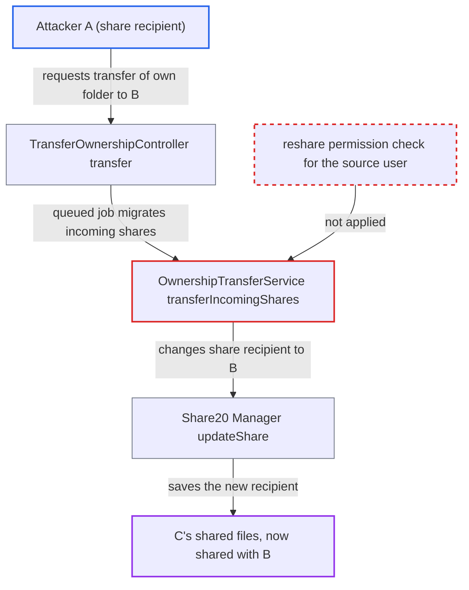

# Self-service ownership transfer hands received shares to another user without reshare permission

| Field | Value |
|---|---|
| ID | `find_01B2yYM9ZoRybf5BpNtwUpaw` |
| Severity | **Medium** |
| Status | open |
| CWE | CWE-863 — Incorrect authorization |
| Created | 2026-10-27T21:22:05.453814Z |
| Claude Security | https://claude.ai/security/findings/find_01B2yYM9ZoRybf5BpNtwUpaw |

## Description

A user who received a share from someone else can hand that share to any other account, even without permission to reshare it. The original owner is never asked, and the new account gets the original permissions, including write and delete if they were granted. The attacker needs a login and a second account or accomplice. The cause is that the self-service transfer reuses the admin transfer routine, `transferIncomingShares()`, which re-targets received shares without checking that the requesting user may reshare them.

1. **Attacker A (a user with a received share from C)** moves the received share's mount point into an own folder `/X`, or uses the whole home folder. A recipient can freely move a received share's mount point into any non-shared folder of their own home, so the share ends up under a path A owns.
2. **Attacker A** requests a transfer of `/X` to B through `TransferOwnershipController::transfer()`. The only checks are that A owns the node and that it is on `IHomeStorage` (line 73); share mounts nested inside the folder are not considered. ([`apps/files/lib/Controller/TransferOwnershipController.php:56-98`](https://github.com/cx-benchmark/server/blob/6b6317280f8ed50277369c33cee070a643d29654/apps/files/lib/Controller/TransferOwnershipController.php#L56-L98))
3. **Recipient B (accomplice or A's second account)** accepts the transfer through `accept()`. Accepting queues the `TransferOwnership` job. ([`apps/files/lib/Controller/TransferOwnershipController.php:111-133`](https://github.com/cx-benchmark/server/blob/6b6317280f8ed50277369c33cee070a643d29654/apps/files/lib/Controller/TransferOwnershipController.php#L111-L133))
4. **the cron job `TransferOwnership`** calls `OwnershipTransferService::transfer()` on the next cron run. `transfer()` always migrates incoming shares, for user-initiated transfers as well as for `occ`. ([`apps/files/lib/BackgroundJob/TransferOwnership.php:44-101`](https://github.com/cx-benchmark/server/blob/6b6317280f8ed50277369c33cee070a643d29654/apps/files/lib/BackgroundJob/TransferOwnership.php#L44-L101))
5. **`collectIncomingShares()`** selects every `TYPE_USER` share received by A whose target lies under the transferred path. A controls that location, so the received share from C is included. ([`apps/files/lib/Service/OwnershipTransferService.php:405-444`](https://github.com/cx-benchmark/server/blob/6b6317280f8ed50277369c33cee070a643d29654/apps/files/lib/Service/OwnershipTransferService.php#L405-L444))
6. **`transferIncomingShares()`** sets the share recipient to B with `setSharedWith($destinationUid)` and calls `updateShare()`. It never checks whether A holds `PERMISSION_SHARE` on the share or whether resharing is allowed. ([`apps/files/lib/Service/OwnershipTransferService.php:605-668`](https://github.com/cx-benchmark/server/blob/6b6317280f8ed50277369c33cee070a643d29654/apps/files/lib/Service/OwnershipTransferService.php#L605-L668))
7. **`Share20\Manager::updateShare()`** saves the new recipient. Its `generalChecks()` tests `PERMISSION_SHARE` only for the share owner and initiator, not for A, so the change passes. ([`lib/private/Share20/Manager.php:667-693`](https://github.com/cx-benchmark/server/blob/6b6317280f8ed50277369c33cee070a643d29654/lib/private/Share20/Manager.php#L667-L693))

## Assessment

The attacker is an authenticated user who received a user share from another user C without share permission. The same applies on an instance with resharing disabled (`shareapi_allow_resharing`) or when the attacker is excluded from sharing. The attacker moves the share mount into their own folder `/X`, or transfers the whole home folder. They then call `POST /ocs/v2.php/apps/files/api/v1/transferownership` with `recipient=B` and `path=/X`. B, an accomplice or the attacker's second account, accepts via `POST .../transferownership/{id}`. The share changes on the next cron run.

Impact: An account that C never shared with gets live, persistent access to the files C shared with A. It has the original share's permissions: read, and write or delete if they were granted. This bypasses the owner's withheld reshare permission, the global resharing policy and sharing exclusions. It is limited to data C shared with A, and A loses access in the process. The report names no availability impact.

## Recommendation

The user-initiated transfer reuses `OwnershipTransferService`, whose incoming-share migration changes a share's recipient without checking that the source user may reshare it. `updateShare()` checks sharing permission only for the share owner and initiator.

Fix criteria: A user-initiated transfer does not re-target a received share unless the requesting user holds `PERMISSION_SHARE` on it and may share under the instance policy. Otherwise the share is skipped or the request is refused. After a self-service transfer of a folder containing a non-resharable received share, its `share_with` is unchanged. The operator command `occ files:transfer-ownership` behaves as before.

## Evidence

**https://github.com/cx-benchmark/server**

- [`apps/files/lib/Service/OwnershipTransferService.php:605-668`](https://github.com/cx-benchmark/server/blob/6b6317280f8ed50277369c33cee070a643d29654/apps/files/lib/Service/OwnershipTransferService.php#L605-L668)
- [`apps/files/lib/Service/OwnershipTransferService.php:196-216`](https://github.com/cx-benchmark/server/blob/6b6317280f8ed50277369c33cee070a643d29654/apps/files/lib/Service/OwnershipTransferService.php#L196-L216)
- [`apps/files/lib/Service/OwnershipTransferService.php:405-444`](https://github.com/cx-benchmark/server/blob/6b6317280f8ed50277369c33cee070a643d29654/apps/files/lib/Service/OwnershipTransferService.php#L405-L444)
- [`apps/files/lib/Controller/TransferOwnershipController.php:56-98`](https://github.com/cx-benchmark/server/blob/6b6317280f8ed50277369c33cee070a643d29654/apps/files/lib/Controller/TransferOwnershipController.php#L56-L98)
- [`apps/files/lib/Controller/TransferOwnershipController.php:111-133`](https://github.com/cx-benchmark/server/blob/6b6317280f8ed50277369c33cee070a643d29654/apps/files/lib/Controller/TransferOwnershipController.php#L111-L133)
- [`apps/files/lib/BackgroundJob/TransferOwnership.php:44-101`](https://github.com/cx-benchmark/server/blob/6b6317280f8ed50277369c33cee070a643d29654/apps/files/lib/BackgroundJob/TransferOwnership.php#L44-L101)
- [`lib/private/Share20/Manager.php:667-693`](https://github.com/cx-benchmark/server/blob/6b6317280f8ed50277369c33cee070a643d29654/lib/private/Share20/Manager.php#L667-L693)
- [`apps/files_sharing/lib/Controller/ShareAPIController.php:1595-1620`](https://github.com/cx-benchmark/server/blob/6b6317280f8ed50277369c33cee070a643d29654/apps/files_sharing/lib/Controller/ShareAPIController.php#L1595-L1620)

