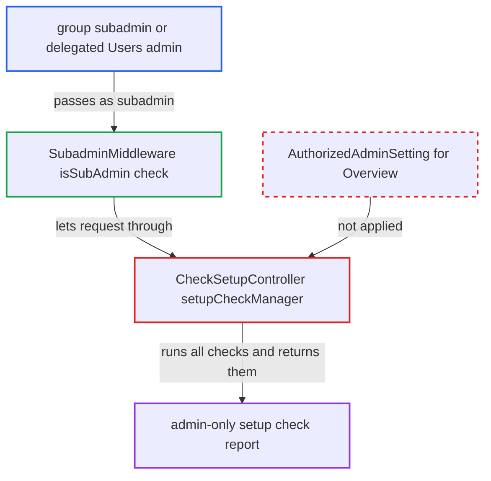

# Setup check results exposed to subadmins via NoAdminRequired on setupCheckManager

| Field | Value |
|---|---|
| ID | `find_01A36jGcHfKGHsHdLUM1fq7k` |
| Severity | **Medium** |
| Status | open |
| CWE | CWE-862 — Missing authorization |
| Created | 2026-10-27T21:23:45.624652Z |
| Claude Security | https://claude.ai/security/findings/find_01A36jGcHfKGHsHdLUM1fq7k |

## Description

Any group subadmin or delegated Users admin can read the admin-only setup check report. It lists PHP and database versions, absolute paths, the web server account name and URL and proxy settings. The handler `CheckSetupController::setupCheckManager()` is marked `#[NoAdminRequired]` instead of `#[AuthorizedAdminSetting(settings: Overview::class)]`, so the admin check and the `allowed_admin_ranges` IP check are skipped.

1. **authenticated subadmin** sends GET `/index.php/settings/setupcheck` with their session. The route maps to `CheckSetup#setupCheckManager`, and no CSRF token is needed because of `#[NoCSRFRequired]`. ([`apps/settings/appinfo/routes.php:32`](https://github.com/cx-benchmark/server/blob/6b6317280f8ed50277369c33cee070a643d29654/apps/settings/appinfo/routes.php#L32))
2. **`SecurityMiddleware`** lets the request through with only a login check. Because `#[NoAdminRequired]` is present, both the admin check and the `allowed_admin_ranges` IP check are skipped. ([`lib/private/AppFramework/Middleware/Security/SecurityMiddleware.php:172-187`](https://github.com/cx-benchmark/server/blob/6b6317280f8ed50277369c33cee070a643d29654/lib/private/AppFramework/Middleware/Security/SecurityMiddleware.php#L172-L187))
3. **`SubadminMiddleware`** accepts the caller as the only remaining gate. The method has neither `NoSubAdminRequired` nor `AuthorizedAdminSetting`, and `ISubAdmin::isSubAdmin()` is true for every group subadmin and delegated Users admin. ([`lib/private/SubAdmin.php:194-217`](https://github.com/cx-benchmark/server/blob/6b6317280f8ed50277369c33cee070a643d29654/lib/private/SubAdmin.php#L194-L217))
4. **the handler `setupCheckManager()`** runs every registered setup check and returns the result. It returns the full output of `ISetupCheckManager::runAll()`, the same data the admin-only `check()` returns. ([`apps/settings/lib/Controller/CheckSetupController.php:41-45`](https://github.com/cx-benchmark/server/blob/6b6317280f8ed50277369c33cee070a643d29654/apps/settings/lib/Controller/CheckSetupController.php#L41-L45))
5. **setup checks** cause side effects on the server for each request. A full `runInstanceVerification()` runs when no cached result exists, and the network checks make the server send HTTP requests to its own configured hosts. ([`apps/settings/lib/SetupChecks/CodeIntegrity.php:37-45`](https://github.com/cx-benchmark/server/blob/6b6317280f8ed50277369c33cee070a643d29654/apps/settings/lib/SetupChecks/CodeIntegrity.php#L37-L45))

## Assessment

The attacker is an authenticated group subadmin or a delegated Users admin. They need only their own session, and no CSRF token is required. The request can come from any IP address, because the `allowed_admin_ranges` check is not enforced on this route. The threat model places controller APIs on the internet-facing web UI.

Impact: The attacker reads reconnaissance data meant for admins. This includes the exact PHP version, the DB vendor and version, absolute app directory paths, the web server account name, temp paths and free space, `overwrite.cli.url`, proxy and IP-resolution status, cache state, missing DB indices, cron errors, 2FA enforcement state and data-directory exposure. The report rates this as a limited loss of confidentiality. No data is modified, and each request triggers only a fixed amount of work.

## Recommendation

`CheckSetupController::setupCheckManager()` uses `#[NoAdminRequired]` instead of the delegated-admin gate used by the rest of the controller. Any subadmin can therefore read the admin-only report, and the admin IP range check is bypassed.

Fix criteria: Only full admins and users delegated the `OCA\Settings\Settings\Admin\Overview` setting, and passing `allowed_admin_ranges`, can get a response from `GET /settings/setupcheck`. A group subadmin or delegated Users admin receives a 403, and no setup check runs on their behalf. To verify, request the route as a subadmin and confirm a 403 with no integrity scan and no outbound requests.

## Evidence

**https://github.com/cx-benchmark/server**

- [`apps/settings/lib/Controller/CheckSetupController.php:41-45`](https://github.com/cx-benchmark/server/blob/6b6317280f8ed50277369c33cee070a643d29654/apps/settings/lib/Controller/CheckSetupController.php#L41-L45)
- [`lib/private/AppFramework/Middleware/Security/SecurityMiddleware.php:172-187`](https://github.com/cx-benchmark/server/blob/6b6317280f8ed50277369c33cee070a643d29654/lib/private/AppFramework/Middleware/Security/SecurityMiddleware.php#L172-L187)
- [`apps/settings/lib/Middleware/SubadminMiddleware.php:48-54`](https://github.com/cx-benchmark/server/blob/6b6317280f8ed50277369c33cee070a643d29654/apps/settings/lib/Middleware/SubadminMiddleware.php#L48-L54)
- [`lib/private/SubAdmin.php:194-217`](https://github.com/cx-benchmark/server/blob/6b6317280f8ed50277369c33cee070a643d29654/lib/private/SubAdmin.php#L194-L217)
- [`apps/settings/appinfo/routes.php:32`](https://github.com/cx-benchmark/server/blob/6b6317280f8ed50277369c33cee070a643d29654/apps/settings/appinfo/routes.php#L32)
- [`apps/settings/lib/SetupChecks/AppDirsWithDifferentOwner.php:79-90`](https://github.com/cx-benchmark/server/blob/6b6317280f8ed50277369c33cee070a643d29654/apps/settings/lib/SetupChecks/AppDirsWithDifferentOwner.php#L79-L90)
- [`apps/settings/lib/SetupChecks/PhpOutdated.php:48`](https://github.com/cx-benchmark/server/blob/6b6317280f8ed50277369c33cee070a643d29654/apps/settings/lib/SetupChecks/PhpOutdated.php#L48)
- [`apps/settings/lib/SetupChecks/CodeIntegrity.php:37-45`](https://github.com/cx-benchmark/server/blob/6b6317280f8ed50277369c33cee070a643d29654/apps/settings/lib/SetupChecks/CodeIntegrity.php#L37-L45)

