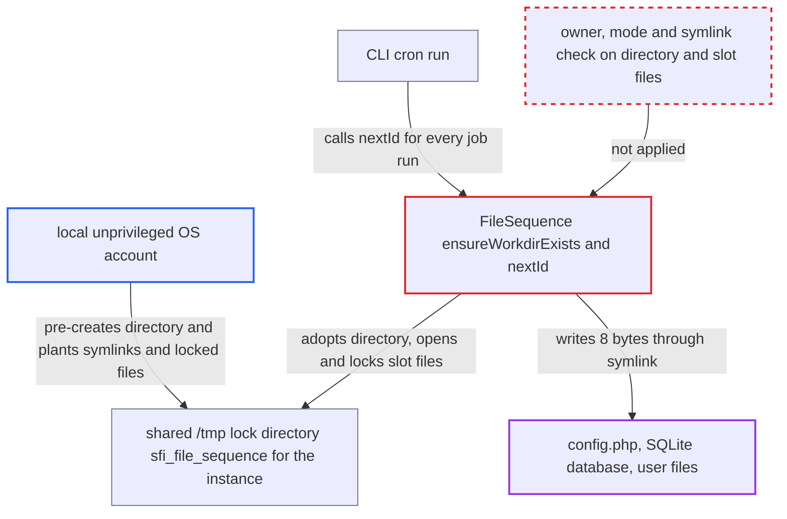

# Snowflake FileSequence adopts pre-created shared-temp directory and writes through planted symlinks

| Field | Value |
|---|---|
| ID | `find_012HYwJaBhAqMZfyxW3aams5` |
| Severity | **Medium** |
| Status | open |
| CWE | CWE-59 — Link following |
| Created | 2026-10-27T22:05:05.858787Z |
| Claude Security | https://claude.ai/security/findings/find_012HYwJaBhAqMZfyxW3aams5 |

## Description

A local, unprivileged user on the Nextcloud host can make the web-server or cron user overwrite 8 bytes at chosen places in any file it can write, such as `config/config.php`. The same user can also hang every cron run. The attack needs the lock directory in the default shared `/tmp` to be missing, so the attacker creates it first. The cause is `ensureWorkdirExists()` in `FileSequence`, which adopts an existing directory without checking its owner, mode or links, and `nextId()` then opens the slot files through symlinks.

1. **local attacker** reads the instance id from the session cookie name. The cookie name is the `instanceid`, which gives the predictable directory name `sfi_file_sequence_<instanceid>`. It also shows in the `/tmp` listing once the directory has existed. ([`lib/OC.php:462-473`](https://github.com/cx-benchmark/server/blob/6b6317280f8ed50277369c33cee070a643d29654/lib/OC.php#L462-L473))
2. **local attacker** creates the directory in `/tmp` as mode `0777` and fills it with planted `seq-000.slots` to `seq-019.slots` entries. This works while the directory does not exist, for example after `/tmp` is emptied at boot. With `tempdirectory` unset, the temp base is `sys_get_temp_dir()`, which is the host-wide, world-writable `/tmp`. Each planted entry is a symlink to a target file, or a file the attacker owns and locks. ([`lib/private/TempManager.php:162-199`](https://github.com/cx-benchmark/server/blob/6b6317280f8ed50277369c33cee070a643d29654/lib/private/TempManager.php#L162-L199))
3. **`ensureWorkdirExists()`** adopts the attacker's directory. It only runs `is_dir()` and `is_writable()` and ignores a failed `mkdir` because the directory exists. It never checks owner, mode or link status. ([`lib/private/Snowflake/FileSequence.php:46-68`](https://github.com/cx-benchmark/server/blob/6b6317280f8ed50277369c33cee070a643d29654/lib/private/Snowflake/FileSequence.php#L46-L68))
4. **CLI cron** calls `nextId()` for every background job run. Each job run calls `JobRuns::started()`, which reaches `FileSequence::nextId()`. CLI cron only runs as the user that owns `config/config.php`, so that user can write the files the links point to. ([`core/Service/CronService.php:201-202`](https://github.com/cx-benchmark/server/blob/6b6317280f8ed50277369c33cee070a643d29654/core/Service/CronService.php#L201-L202))
5. **`FileSequence::nextId()`** opens each slot file with `fopen(..., 'c+')`, takes a blocking `flock(LOCK_EX)` and writes 8 bytes. The open follows symlinks and creates missing files, and the lock has no `LOCK_NB`. The write lands at offset `slot*8` (0 to 11992), so it goes into the symlink target, or blocks forever if the attacker holds the lock. ([`lib/private/Snowflake/FileSequence.php:76-106`](https://github.com/cx-benchmark/server/blob/6b6317280f8ed50277369c33cee070a643d29654/lib/private/Snowflake/FileSequence.php#L76-L106))
6. **`SnowflakeGenerator::nextId()`** loops without end when a planted slot holds a sequence value above `0xFFF`. It sleeps 1 ms and calls itself again with no bound. Planted slot contents can also force duplicate IDs. ([`lib/private/Snowflake/SnowflakeGenerator.php:47-52`](https://github.com/cx-benchmark/server/blob/6b6317280f8ed50277369c33cee070a643d29654/lib/private/Snowflake/SnowflakeGenerator.php#L47-L52))

## Assessment

The attacker is any unprivileged local OS account on the Nextcloud host. It does not need a Nextcloud login. The attack works only while the directory `sfi_file_sequence_<instanceid>` does not exist in the temp base. That happens on a fresh install, or after `/tmp` is emptied at boot (tmpfs, or `D /tmp` in tmpfiles.d). The attacker could, for example, run an `@reboot` crontab entry to plant the directory. The default setup is affected, because `tempdirectory` is unset and the temp base is `/tmp`. The first CLI cron run after that adopts the directory. CLI processes always use `FileSequence`, and web requests use it whenever APCu is not enabled. The settings `fs.protected_symlinks` and `fs.protected_regular` do not stop this, because the planted entries sit in a non-sticky directory owned by the same account that owns the links. Once Nextcloud has created its own `0700` directory, the attack is closed until that directory disappears again.

Impact: The PHP user overwrites 8 bytes at offsets 0 to 11992 of any file it can write, repeatedly. The attacker chooses the file but not the bytes. This can corrupt `config/config.php`, which takes the instance down, or damage an SQLite database or user files at known paths. Held locks or forced sequence values above `0xFFF` hang every cron run and every non-APCu web request that generates an ID. Nothing is disclosed, because the slot files hold only counters.

## Recommendation

(1) The lock directory has a predictable name in the shared, world-writable temp directory. `ensureWorkdirExists()` adopts it if it already exists, so another local account can own it and control every entry in it.

Fix criteria: Nextcloud only uses a lock directory that no other account can have created or can write. It either keeps the directory under a location only the PHP user controls, or refuses an existing directory that is a link, is not owned by the effective uid, or has a mode other than `0700`. Test: pre-create the directory as another user. Nextcloud must then refuse it or replace it rather than use it.

(2) `FileSequence::nextId()` opens the fixed slot file names with link-following create-or-open semantics and takes a blocking lock. A planted symlink or a foreign-owned file therefore decides where the writes land and whether the process ever continues.

Fix criteria: Slot files are opened without following symbolic links and are rejected unless they are regular files owned by the PHP user. Lock waits are bounded. Test: symlink `seq-000.slots` to a test file, and the test file must stay untouched. Test: hold a lock from outside, and cron must not hang indefinitely.

## Evidence

**https://github.com/cx-benchmark/server**

- [`lib/private/Snowflake/FileSequence.php:46-68`](https://github.com/cx-benchmark/server/blob/6b6317280f8ed50277369c33cee070a643d29654/lib/private/Snowflake/FileSequence.php#L46-L68)
- [`lib/private/Snowflake/FileSequence.php:76-106`](https://github.com/cx-benchmark/server/blob/6b6317280f8ed50277369c33cee070a643d29654/lib/private/Snowflake/FileSequence.php#L76-L106)
- [`lib/private/TempManager.php:162-199`](https://github.com/cx-benchmark/server/blob/6b6317280f8ed50277369c33cee070a643d29654/lib/private/TempManager.php#L162-L199)
- [`lib/private/Server.php:1098-1107`](https://github.com/cx-benchmark/server/blob/6b6317280f8ed50277369c33cee070a643d29654/lib/private/Server.php#L1098-L1107)
- [`core/Service/CronService.php:201-202`](https://github.com/cx-benchmark/server/blob/6b6317280f8ed50277369c33cee070a643d29654/core/Service/CronService.php#L201-L202)
- [`core/Service/CronService.php:131-135`](https://github.com/cx-benchmark/server/blob/6b6317280f8ed50277369c33cee070a643d29654/core/Service/CronService.php#L131-L135)
- [`lib/private/Snowflake/SnowflakeGenerator.php:47-52`](https://github.com/cx-benchmark/server/blob/6b6317280f8ed50277369c33cee070a643d29654/lib/private/Snowflake/SnowflakeGenerator.php#L47-L52)
- [`lib/OC.php:462-473`](https://github.com/cx-benchmark/server/blob/6b6317280f8ed50277369c33cee070a643d29654/lib/OC.php#L462-L473)

