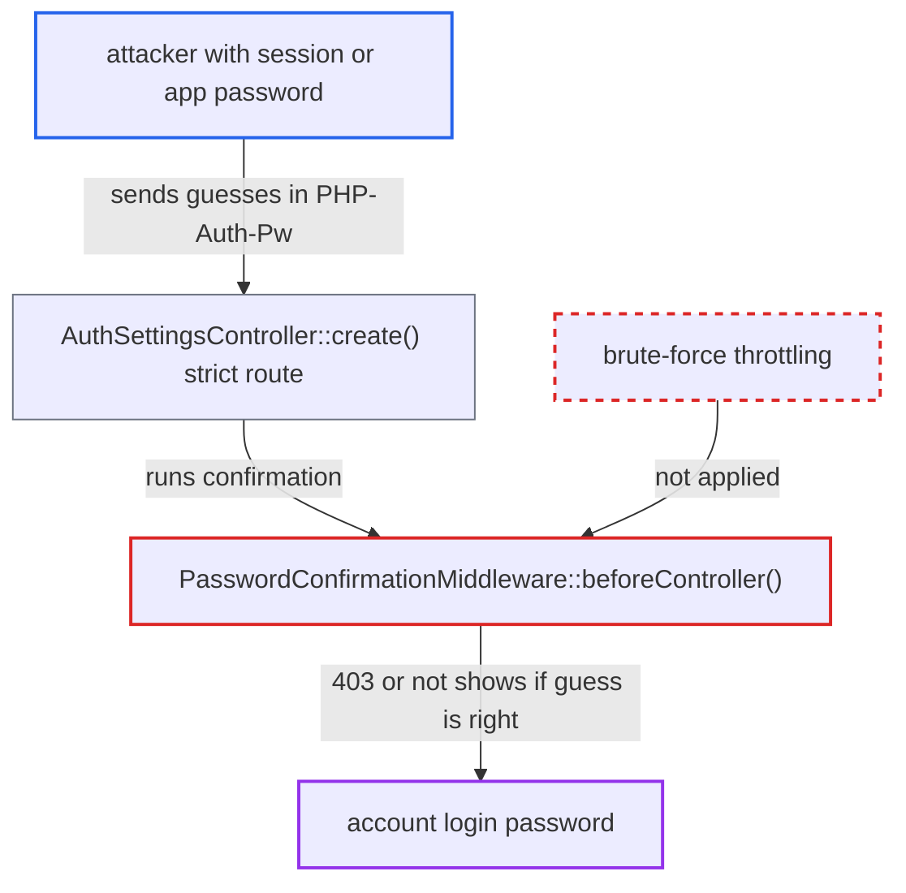

# Strict password confirmation is an unthrottled login-password oracle

| Field | Value |
|---|---|
| ID | `find_01BZbG3bRTmUmxD37bxij8h2` |
| Severity | **Medium** |
| Status | open |
| CWE | CWE-307 — Improper restriction of authentication attempts |
| Created | 2026-10-27T21:51:29.982425Z |
| Claude Security | https://claude.ai/security/findings/find_01BZbG3bRTmUmxD37bxij8h2 |

## Description

A person who holds a session or app password for an account can guess that account's login password without limit. A wrong guess returns 403 and a right guess returns something else. This works through routes marked `#[PasswordConfirmationRequired(strict: true)]`, such as `POST /settings/personal/authtokens`. `PasswordConfirmationMiddleware::beforeController()` checks the password but never counts or delays failed guesses, and it runs before `BruteForceMiddleware`.

1. **attacker** sends a request to `POST /index.php/settings/personal/authtokens` with a guessed password. The request carries the victim's session cookie, or Basic/Bearer app-password auth with `OCS-APIRequest: true`. The guess goes in the `PHP-Auth-Pw` header. ([`apps/settings/lib/Controller/AuthSettingsController.php:63-76`](https://github.com/cx-benchmark/server/blob/6b6317280f8ed50277369c33cee070a643d29654/apps/settings/lib/Controller/AuthSettingsController.php#L63-L76))
2. **`Request::getHeader()`** returns the client-sent `PHP-Auth-Pw` header as the password. The client-sent header is read before the Basic-auth password, so the caller picks the guess on every request. ([`lib/private/AppFramework/Http/Request.php:280-301`](https://github.com/cx-benchmark/server/blob/6b6317280f8ed50277369c33cee070a643d29654/lib/private/AppFramework/Http/Request.php#L280-L301))
3. **the `OCS-APIRequest` header** lets an app-password holder skip the CSRF and same-site cookie checks. Any request with this header passes the CSRF check, so the app-password holder needs no CSRF token. ([`lib/private/AppFramework/Http/Request.php:427-438`](https://github.com/cx-benchmark/server/blob/6b6317280f8ed50277369c33cee070a643d29654/lib/private/AppFramework/Http/Request.php#L427-L438))
4. **the middleware `PasswordConfirmationMiddleware`** checks the guess against the session's `loginname` with `checkPassword()`. On a wrong guess it throws `NotConfirmedException`. It never calls the throttler, and `checkPassword()` only logs a warning. ([`lib/private/AppFramework/Middleware/Security/PasswordConfirmationMiddleware.php:82-96`](https://github.com/cx-benchmark/server/blob/6b6317280f8ed50277369c33cee070a643d29654/lib/private/AppFramework/Middleware/Security/PasswordConfirmationMiddleware.php#L82-L96))
5. **`SecurityMiddleware::afterException()`** turns the exception into a plain 403 with `X-NC-Auth-NotConfirmed`. No failed attempt is registered. `BruteForceMiddleware` is registered after the confirmation middleware, so it cannot act before the exception is thrown. ([`lib/private/AppFramework/Middleware/Security/SecurityMiddleware.php:257-296`](https://github.com/cx-benchmark/server/blob/6b6317280f8ed50277369c33cee070a643d29654/lib/private/AppFramework/Middleware/Security/SecurityMiddleware.php#L257-L296))
6. **attacker** repeats guesses and reads the status code. A 403 means the guess was wrong. A 200 (browser session) or a 503 from `checkAppToken()` (app-password session) means it was right. ([`apps/settings/lib/Controller/AuthSettingsController.php:63-76`](https://github.com/cx-benchmark/server/blob/6b6317280f8ed50277369c33cee070a643d29654/apps/settings/lib/Controller/AuthSettingsController.php#L63-L76))

## Assessment

The attacker already holds one of the victim's app passwords (for example a leaked device token) or the victim's browser session, but does not know the login password. The easiest route is `AuthSettingsController::create()` (`POST /settings/personal/authtokens`). It is `#[NoAdminRequired]` and in the always-enabled settings app. Other strict routes give the same oracle: `destroy`, `update` and `destroyOthers` in the same controller, files_external user storages, and admin-only routes in appstore, oauth2, provisioning_api and `TwoFactorApiController`. The report notes that instances are often internet-facing and that the attacker is a low-privilege authenticated user.

Impact: If the password is guessable, the attacker recovers the account's cleartext login password at network speed. This turns a revocable session or app token into the full credential. With it they can pass strict and `sudo` confirmation, create new app passwords, change the password and e-mail, and log in again after their token is revoked. The impact is limited to the one account whose session or token the attacker already holds.

## Recommendation

Strict password confirmation in `PasswordConfirmationMiddleware` checks the login password without going through the brute-force throttler, and it runs before `BruteForceMiddleware`. Failed guesses are never counted or delayed.

Fix criteria: A failed strict confirmation is recorded and throttled the same way as the `sudo` action, per remote address and login name, with growing delays and then refusal. A successful confirmation may reset the delay. Sending a series of wrong `PHP-Auth-Pw` values to `POST /settings/personal/authtokens` meets increasing delays and then 429 responses, as `POST /login/confirm` does.

## Evidence

**https://github.com/cx-benchmark/server**

- [`lib/private/AppFramework/Middleware/Security/PasswordConfirmationMiddleware.php:82-96`](https://github.com/cx-benchmark/server/blob/6b6317280f8ed50277369c33cee070a643d29654/lib/private/AppFramework/Middleware/Security/PasswordConfirmationMiddleware.php#L82-L96)
- [`lib/private/AppFramework/DependencyInjection/DIContainer.php:211-214`](https://github.com/cx-benchmark/server/blob/6b6317280f8ed50277369c33cee070a643d29654/lib/private/AppFramework/DependencyInjection/DIContainer.php#L211-L214)
- [`lib/private/AppFramework/Middleware/Security/SecurityMiddleware.php:257-296`](https://github.com/cx-benchmark/server/blob/6b6317280f8ed50277369c33cee070a643d29654/lib/private/AppFramework/Middleware/Security/SecurityMiddleware.php#L257-L296)
- [`lib/private/User/Manager.php:228-237`](https://github.com/cx-benchmark/server/blob/6b6317280f8ed50277369c33cee070a643d29654/lib/private/User/Manager.php#L228-L237)
- [`core/Controller/LoginController.php:408-430`](https://github.com/cx-benchmark/server/blob/6b6317280f8ed50277369c33cee070a643d29654/core/Controller/LoginController.php#L408-L430)
- [`core/Controller/AppPasswordController.php:194-211`](https://github.com/cx-benchmark/server/blob/6b6317280f8ed50277369c33cee070a643d29654/core/Controller/AppPasswordController.php#L194-L211)
- [`apps/settings/lib/Controller/AuthSettingsController.php:63-76`](https://github.com/cx-benchmark/server/blob/6b6317280f8ed50277369c33cee070a643d29654/apps/settings/lib/Controller/AuthSettingsController.php#L63-L76)
- [`lib/private/AppFramework/Http/Request.php:280-301`](https://github.com/cx-benchmark/server/blob/6b6317280f8ed50277369c33cee070a643d29654/lib/private/AppFramework/Http/Request.php#L280-L301)
- [`lib/private/AppFramework/Http/Request.php:427-438`](https://github.com/cx-benchmark/server/blob/6b6317280f8ed50277369c33cee070a643d29654/lib/private/AppFramework/Http/Request.php#L427-L438)
- [`lib/OC.php:1291-1313`](https://github.com/cx-benchmark/server/blob/6b6317280f8ed50277369c33cee070a643d29654/lib/OC.php#L1291-L1313)

