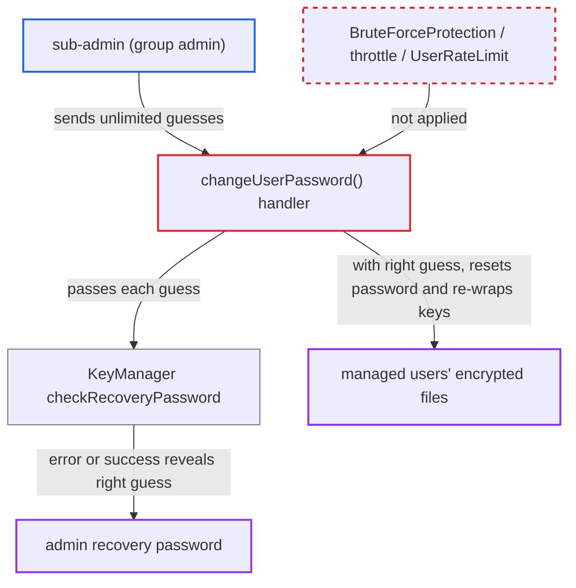

# Sub-admin can brute-force the admin encryption recovery password without throttling

| Field | Value |
|---|---|
| ID | `find_01GA1fMgRW6R8ZHyr1CmBkws` |
| Severity | **Medium** |
| Status | open |
| CWE | CWE-307 — Brute force |
| Created | 2026-10-27T21:47:45.236734Z |
| Claude Security | https://claude.ai/security/findings/find_01GA1fMgRW6R8ZHyr1CmBkws |

## Description

A sub-admin (group admin) can guess the administrator's encryption recovery password online, with no limit on attempts. Once the sub-admin finds it, they can reset a managed user's password and read that user's encrypted files. This works only when server-side encryption uses per-user keys (`encryption.useMasterKey=false`) and the recovery key is enabled (`recoveryAdminEnabled`). The cause is that `changeUserPassword()` checks the recovery password with no brute-force protection or rate limit.

1. **sub-admin** confirms their own password. `changeUserPassword()` carries `#[PasswordConfirmationRequired]`, which asks for the sub-admin's own password once per 30 minutes, so this is a one-time cost. ([`apps/settings/lib/Controller/ChangePasswordController.php:92-165`](https://github.com/cx-benchmark/server/blob/6b6317280f8ed50277369c33cee070a643d29654/apps/settings/lib/Controller/ChangePasswordController.php#L92-L165))
2. **sub-admin** posts a guessed recovery password for a managed user. The request goes to `POST /settings/users/changepassword` with `username` set to a managed user, any `password`, and the guess in `recoveryPassword`. ([`apps/settings/lib/Controller/ChangePasswordController.php:92-165`](https://github.com/cx-benchmark/server/blob/6b6317280f8ed50277369c33cee070a643d29654/apps/settings/lib/Controller/ChangePasswordController.php#L92-L165))
3. **the handler `changeUserPassword()`** passes the guess to `KeyManager::checkRecoveryPassword()`. This happens on every request when the recovery key is enabled, and the method has no `#[BruteForceProtection]`, no `throttle()` and no `#[UserRateLimit]`. ([`apps/settings/lib/Controller/ChangePasswordController.php:92-165`](https://github.com/cx-benchmark/server/blob/6b6317280f8ed50277369c33cee070a643d29654/apps/settings/lib/Controller/ChangePasswordController.php#L92-L165))
4. **`checkRecoveryPassword()`** tries to decrypt the system recovery private key with the guess. A wrong password makes `Crypt::checkSignature` throw `GenericEncryptionException('Bad Signature')`, which nothing catches, so the sub-admin sees an error response. ([`apps/encryption/lib/Crypto/Crypt.php:482-500`](https://github.com/cx-benchmark/server/blob/6b6317280f8ed50277369c33cee070a643d29654/apps/encryption/lib/Crypto/Crypt.php#L482-L500))
5. **sub-admin** repeats with new guesses until one does not fail. A right guess lets the request continue to `setPassword()` and return `status: success`, so the response tells right from wrong. Each guess costs the server one PBKDF2-SHA256 derivation with 600k iterations, about 0.3-0.5 s of CPU. ([`apps/encryption/lib/KeyManager.php:174-185`](https://github.com/cx-benchmark/server/blob/6b6317280f8ed50277369c33cee070a643d29654/apps/encryption/lib/KeyManager.php#L174-L185))
6. **`setPassphraseForUser`** re-keys the target user and re-wraps their file keys. With the correct recovery password, `Recovery::recoverUsersFiles` re-wraps all file keys of an opted-in user to the new key pair. Without it this branch throws. ([`apps/encryption/lib/Services/PassphraseService.php:96-137`](https://github.com/cx-benchmark/server/blob/6b6317280f8ed50277369c33cee070a643d29654/apps/encryption/lib/Services/PassphraseService.php#L96-L137))
7. **sub-admin** logs in as the managed user with the password they set. The new key pair now unlocks every encrypted file of that user.

## Assessment

The attacker is an authenticated sub-admin of at least one group with a managed member. The report also notes that sub-admins may pull any non-admin user into their group. The attacker needs the non-default per-user-key encryption mode (`encryption.useMasterKey=false`) with the recovery key enabled (`recoveryAdminEnabled`). They confirm their own password once, then send repeated requests to `POST /settings/users/changepassword`. The sibling method `changePersonalPassword()` in the same class does throttle, but `changeUserPassword()` does not. The recovery password is an administrator-only secret, because the encryption admin section is a plain `ISettings` and cannot be delegated. The report does not give a success rate, since that depends on how strong the password is.

Impact: The sub-admin can run an unlimited online dictionary attack against the admin recovery password. After finding it, they can reset the password of any managed user who opted into recovery, with files preserved, and log in as that user to read all of that user's encrypted files. The encryption layer was meant to withhold those files from sub-admins. The guesses also load the server's CPU, but the report names no other availability impact.

## Recommendation

(1) `changeUserPassword()` checks a high-value admin secret (`recoveryPassword`) for a lower-privileged caller with no brute-force protection. Right and wrong guesses can be sampled without limit, and the `GenericEncryptionException` from `checkRecoveryPassword` is not caught.

Fix criteria: Failed recovery-password checks on this endpoint are counted and throttled per client or user, for example with `#[BruteForceProtection(action: ...)]` plus `throttle()` on the failure response, or a strict `#[UserRateLimit]`. The `GenericEncryptionException` from `checkRecoveryPassword` is caught so failures take the throttled path. Repeated wrong `recoveryPassword` values sent as a sub-admin are delayed or blocked by the throttler, and the attempts are logged.

(2) Sub-admins, who are not administrators, can submit the admin recovery password at all, although the recovery key is an administrator-only credential.

Fix criteria: Only users for whom `isAdmin()` holds can trigger the recovery-password check. Sub-admin requests that carry a `recoveryPassword` are rejected before `checkRecoveryPassword` is called, or the recovery flow is moved to an admin-only endpoint. A sub-admin request with any `recoveryPassword` returns the same response whether or not the value is correct.

## Evidence

**https://github.com/cx-benchmark/server**

- [`apps/settings/lib/Controller/ChangePasswordController.php:92-165`](https://github.com/cx-benchmark/server/blob/6b6317280f8ed50277369c33cee070a643d29654/apps/settings/lib/Controller/ChangePasswordController.php#L92-L165)
- [`apps/encryption/lib/KeyManager.php:174-185`](https://github.com/cx-benchmark/server/blob/6b6317280f8ed50277369c33cee070a643d29654/apps/encryption/lib/KeyManager.php#L174-L185)
- [`apps/encryption/lib/Crypto/Crypt.php:482-500`](https://github.com/cx-benchmark/server/blob/6b6317280f8ed50277369c33cee070a643d29654/apps/encryption/lib/Crypto/Crypt.php#L482-L500)
- [`apps/encryption/lib/Services/PassphraseService.php:96-137`](https://github.com/cx-benchmark/server/blob/6b6317280f8ed50277369c33cee070a643d29654/apps/encryption/lib/Services/PassphraseService.php#L96-L137)
- [`apps/encryption/lib/Settings/Admin.php:30`](https://github.com/cx-benchmark/server/blob/6b6317280f8ed50277369c33cee070a643d29654/apps/encryption/lib/Settings/Admin.php#L30)

