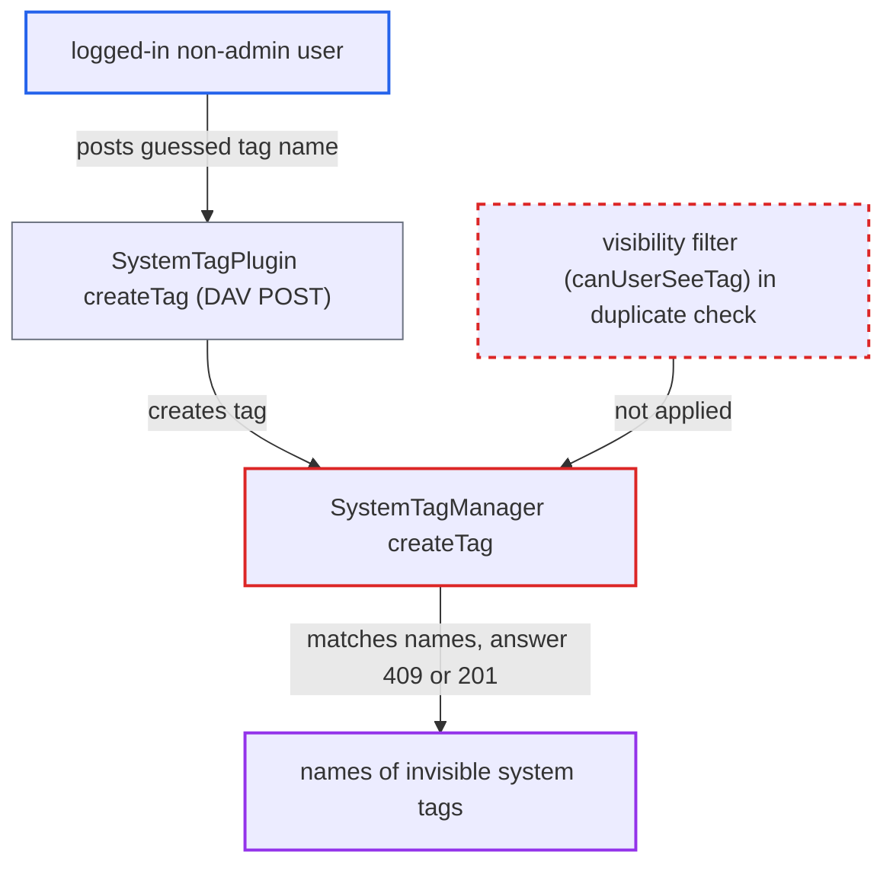

# Tag creation conflict check matches invisible tags, letting non-admins confirm hidden tag names

| Field | Value |
|---|---|
| ID | `find_012NY2afN2tp5SuHUSY3M3cT` |
| Severity | **Medium** |
| Status | open |
| CWE | CWE-203 — Observable discrepancy |
| Created | 2026-10-27T21:28:06.229650Z |
| Claude Security | https://claude.ai/security/findings/find_012NY2afN2tp5SuHUSY3M3cT |

## Description

Any logged-in non-admin user can confirm whether an admin-only invisible system tag with a guessed name exists. Invisible tags are meant to stay hidden from non-admins. The attack works on the default setting, where `systemtags.restrict_creation_to_admin` is false. The cause is `SystemTagManager::createTag()`, whose duplicate-name check ignores tag visibility, so a name collision shows up as a 409 response.

1. **Non-admin attacker** sends a POST with a guessed tag name to the DAV endpoint. The request goes to `/remote.php/dav/systemtags/` with `Content-Type: application/json` and a body like `{"name":"<guess>"}`. ([`apps/dav/lib/SystemTag/SystemTagPlugin.php:156-204`](https://github.com/cx-benchmark/server/blob/6b6317280f8ed50277369c33cee070a643d29654/apps/dav/lib/SystemTag/SystemTagPlugin.php#L156-L204))
2. **`canUserCreateTag()`** allows the request. It returns true for every logged-in user unless `systemtags.restrict_creation_to_admin` is set, and that setting defaults to false. ([`lib/private/SystemTag/SystemTagManager.php:391-402`](https://github.com/cx-benchmark/server/blob/6b6317280f8ed50277369c33cee070a643d29654/lib/private/SystemTag/SystemTagManager.php#L391-L402))
3. **`SystemTagManager::createTag()`** looks up existing tags with `getAllTags(null, $tagName)`. Passing `null` means no visibility filter, so invisible tags (`visibility = 0`) are searched too. ([`lib/private/SystemTag/SystemTagManager.php:171-186`](https://github.com/cx-benchmark/server/blob/6b6317280f8ed50277369c33cee070a643d29654/lib/private/SystemTag/SystemTagManager.php#L171-L186))
4. **`SystemTagManager::createTag()`** throws `TagAlreadyExistsException` when any tag matches the name. The match is case-insensitive and exact, and it includes tags the caller is not allowed to see. ([`lib/private/SystemTag/SystemTagManager.php:171-186`](https://github.com/cx-benchmark/server/blob/6b6317280f8ed50277369c33cee070a643d29654/lib/private/SystemTag/SystemTagManager.php#L171-L186))
5. **the DAV handler `SystemTagPlugin::createTag()`** turns the outcome into different HTTP statuses. The exception becomes `409 Conflict`. A name that collides with nothing creates a public tag and returns `201 Created`. ([`apps/dav/lib/SystemTag/SystemTagPlugin.php:156-204`](https://github.com/cx-benchmark/server/blob/6b6317280f8ed50277369c33cee070a643d29654/apps/dav/lib/SystemTag/SystemTagPlugin.php#L156-L204))
6. **Non-admin attacker** repeats the request for each name in a wordlist. Every 409 confirms that a hidden tag with that name exists.

## Assessment

The attacker is any authenticated non-admin user who can reach the DAV endpoint. The instance must allow tag creation by ordinary users, which is the default because `systemtags.restrict_creation_to_admin` is false. The attacker needs a guess at the tag name, such as a classification, retention or workflow label. The only route the report gives is the DAV POST to `/remote.php/dav/systemtags/`. `updateTag()` has the same unfiltered check, but DAV lets only admins update tags (`SystemTagNode.php:106`), so non-admins cannot use it.

Impact: The attacker can confirm that a hidden tag exists and learn its exact name, matched case-insensitively. This is limited metadata. The check is an exact match, so it reveals no substrings. Tag assignments, files and other data are not exposed. Each probe with a free name also leaves a stray public tag behind, which is a minor nuisance.

## Recommendation

`SystemTagManager::createTag()` checks for duplicate names across all tags, whatever the caller can see, and reports a collision as a distinct error. Non-admins can therefore detect invisible tags.

Fix criteria: A non-admin's tag creation no longer reveals invisible tags. Either the duplicate check for non-admins covers only tags they can see (`canUserSeeTag`), or a hidden-name collision gets a response indistinguishable from success or another failure. With an invisible tag `Secret`, a non-admin POST to `systemtags/` with `name=Secret` returns the same status and body as for a non-existent name. Admins still get the conflict.

## Evidence

**https://github.com/cx-benchmark/server**

- [`lib/private/SystemTag/SystemTagManager.php:171-186`](https://github.com/cx-benchmark/server/blob/6b6317280f8ed50277369c33cee070a643d29654/lib/private/SystemTag/SystemTagManager.php#L171-L186)
- [`apps/dav/lib/SystemTag/SystemTagPlugin.php:156-204`](https://github.com/cx-benchmark/server/blob/6b6317280f8ed50277369c33cee070a643d29654/apps/dav/lib/SystemTag/SystemTagPlugin.php#L156-L204)
- [`lib/private/SystemTag/SystemTagManager.php:391-402`](https://github.com/cx-benchmark/server/blob/6b6317280f8ed50277369c33cee070a643d29654/lib/private/SystemTag/SystemTagManager.php#L391-L402)
- [`lib/private/SystemTag/SystemTagManager.php:411-431`](https://github.com/cx-benchmark/server/blob/6b6317280f8ed50277369c33cee070a643d29654/lib/private/SystemTag/SystemTagManager.php#L411-L431)
- [`apps/dav/lib/SystemTag/SystemTagsByIdCollection.php:81-112`](https://github.com/cx-benchmark/server/blob/6b6317280f8ed50277369c33cee070a643d29654/apps/dav/lib/SystemTag/SystemTagsByIdCollection.php#L81-L112)
- [`lib/private/Files/Cache/QuerySearchHelper.php:104-107`](https://github.com/cx-benchmark/server/blob/6b6317280f8ed50277369c33cee070a643d29654/lib/private/Files/Cache/QuerySearchHelper.php#L104-L107)

