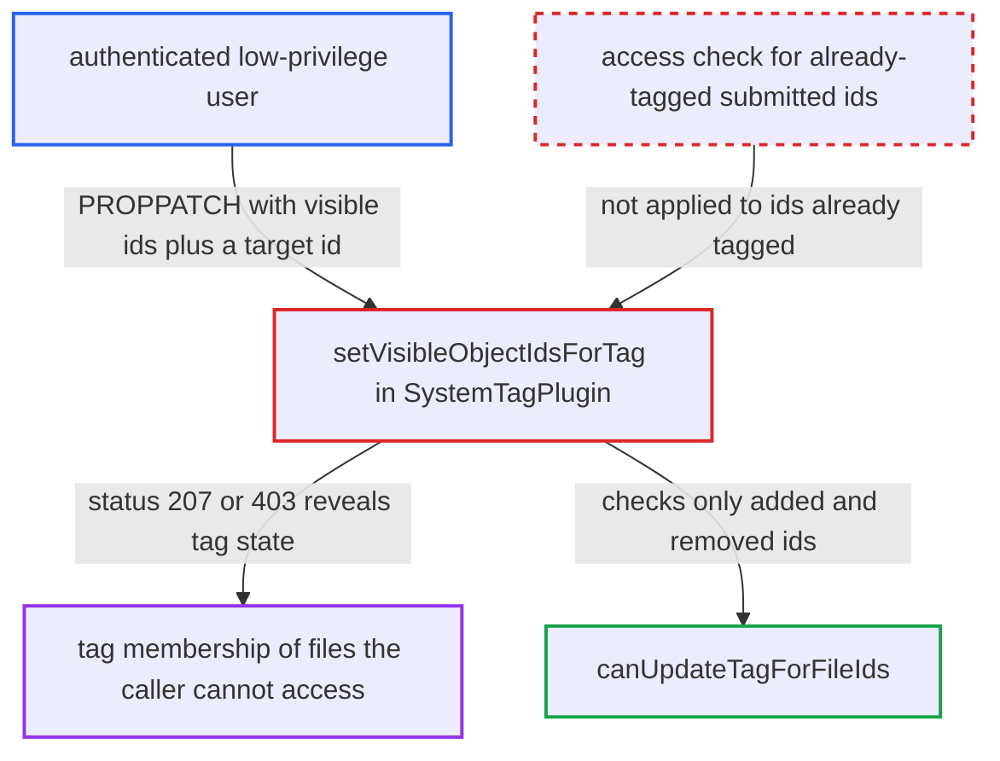

# Tag object-ids PROPPATCH status reveals whether inaccessible files carry a system tag

| Field | Value |
|---|---|
| ID | `find_016djGSsoyj4umYsPUCZwFcn` |
| Severity | **Medium** |
| Status | open |
| CWE | CWE-204 — Observable response discrepancy |
| Created | 2026-10-27T21:56:08.576358Z |
| Claude Security | https://claude.ai/security/findings/find_016djGSsoyj4umYsPUCZwFcn |

## Description

Any logged-in user can learn whether a file they cannot access carries a given user-visible system tag, such as `Confidential`. Names, owners and contents are not disclosed. The cause is `setVisibleObjectIdsForTag()`, which handles the `object-ids` PROPPATCH. It checks access only for ids that change the tag, so the response status (207 or 403) depends on the hidden file's tag state.

1. **attacker** reads the visible tagged ids with a PROPFIND of `nc:object-ids`. The PROPFIND on `systemtags/<tagId>/files` returns only files the caller can resolve. This gives the attacker the set `V`, which they need later to keep the removal list empty. ([`apps/dav/lib/SystemTag/SystemTagPlugin.php:330-348`](https://github.com/cx-benchmark/server/blob/6b6317280f8ed50277369c33cee070a643d29654/apps/dav/lib/SystemTag/SystemTagPlugin.php#L330-L348))
2. **attacker** sends a PROPPATCH of `nc:object-ids` with `V` plus a target file id `X`. The handler needs only a logged-in user, and any tag the user can see can be targeted. `X` is a file id the attacker cannot access. ([`apps/dav/lib/SystemTag/SystemTagPlugin.php:414-451`](https://github.com/cx-benchmark/server/blob/6b6317280f8ed50277369c33cee070a643d29654/apps/dav/lib/SystemTag/SystemTagPlugin.php#L414-L451))
3. **the handler `setVisibleObjectIdsForTag()`** computes the added and removed ids against the instance-wide set of tagged files. `$addedObjects = array_diff($objectIds, $taggedObjects)` drops any submitted id that already carries the tag, so only the delta goes on to the access check. ([`apps/dav/lib/SystemTag/SystemTagPlugin.php:534-551`](https://github.com/cx-benchmark/server/blob/6b6317280f8ed50277369c33cee070a643d29654/apps/dav/lib/SystemTag/SystemTagPlugin.php#L534-L551))
4. **the handler `setVisibleObjectIdsForTag()`** accepts the request with 207 when `X` already carries the tag. The delta is empty, so `canUpdateTagForFileIds()` is never run for `X`. The write `array_merge($objectIds, $hiddenObjects)` leaves the mapping unchanged. ([`apps/dav/lib/SystemTag/SystemTagPlugin.php:534-551`](https://github.com/cx-benchmark/server/blob/6b6317280f8ed50277369c33cee070a643d29654/apps/dav/lib/SystemTag/SystemTagPlugin.php#L534-L551))
5. **the method `canUpdateTagForFileIds()`** refuses the request with 403 when `X` does not carry the tag. `X` is then in the added ids. `getById()` cannot resolve it in the caller's folder, so the method returns false and a `Forbidden` is raised. ([`apps/dav/lib/SystemTag/SystemTagPlugin.php:559-581`](https://github.com/cx-benchmark/server/blob/6b6317280f8ed50277369c33cee070a643d29654/apps/dav/lib/SystemTag/SystemTagPlugin.php#L559-L581))
6. **attacker** reads the response status as a yes or no answer. 207 means `X` carries the tag and 403 means it does not. The attacker repeats this for other ids, which are small sequential integers.

## Assessment

The attacker is any authenticated user. No victim action or special configuration is needed. They PROPFIND `nc:object-ids` on `remote.php/dav/systemtags/<tagId>/files` for a visible tag to get `V`. For each target id `X`, they PROPPATCH the same node with `V` plus `X` and read the status. They can enumerate tagged ids, or watch a known id, such as one from a former share or an `/f/<id>` link.

Impact: The attacker learns, for file ids outside their access, whether each carries a given visible tag, for example `Confidential` or a legal hold. This defeats the visibility filter on the PROPFIND. Names, owners and contents are not disclosed. A probe leaves tag assignments unchanged and only bumps the tag's etag.

## Recommendation

`setVisibleObjectIdsForTag()` authorizes only the delta between the submitted ids and the instance-wide tagged set. Inaccessible ids that already carry the tag are accepted, and ones that do not are refused, so the response reveals tag membership.

Fix criteria: The response to an `object-ids` PROPPATCH does not depend on the tag state of file ids the caller cannot resolve. Every such submitted id is treated the same way, always refused or always ignored, whether or not it is tagged. Submitting `V` plus an inaccessible tagged id and `V` plus an inaccessible untagged id gives identical responses. Tags on hidden files are still kept.

## Evidence

**https://github.com/cx-benchmark/server**

- [`apps/dav/lib/SystemTag/SystemTagPlugin.php:534-551`](https://github.com/cx-benchmark/server/blob/6b6317280f8ed50277369c33cee070a643d29654/apps/dav/lib/SystemTag/SystemTagPlugin.php#L534-L551)
- [`apps/dav/lib/SystemTag/SystemTagPlugin.php:559-581`](https://github.com/cx-benchmark/server/blob/6b6317280f8ed50277369c33cee070a643d29654/apps/dav/lib/SystemTag/SystemTagPlugin.php#L559-L581)
- [`apps/dav/lib/SystemTag/SystemTagPlugin.php:414-451`](https://github.com/cx-benchmark/server/blob/6b6317280f8ed50277369c33cee070a643d29654/apps/dav/lib/SystemTag/SystemTagPlugin.php#L414-L451)
- [`apps/dav/lib/SystemTag/SystemTagsByIdCollection.php:81-94`](https://github.com/cx-benchmark/server/blob/6b6317280f8ed50277369c33cee070a643d29654/apps/dav/lib/SystemTag/SystemTagsByIdCollection.php#L81-L94)
- [`apps/dav/lib/SystemTag/SystemTagPlugin.php:330-348`](https://github.com/cx-benchmark/server/blob/6b6317280f8ed50277369c33cee070a643d29654/apps/dav/lib/SystemTag/SystemTagPlugin.php#L330-L348)
- [`apps/dav/lib/SystemTag/SystemTagsRelationsCollection.php:40-48`](https://github.com/cx-benchmark/server/blob/6b6317280f8ed50277369c33cee070a643d29654/apps/dav/lib/SystemTag/SystemTagsRelationsCollection.php#L40-L48)
- [`apps/dav/tests/unit/SystemTag/SystemTagPluginTest.php:359-398`](https://github.com/cx-benchmark/server/blob/6b6317280f8ed50277369c33cee070a643d29654/apps/dav/tests/unit/SystemTag/SystemTagPluginTest.php#L359-L398)

