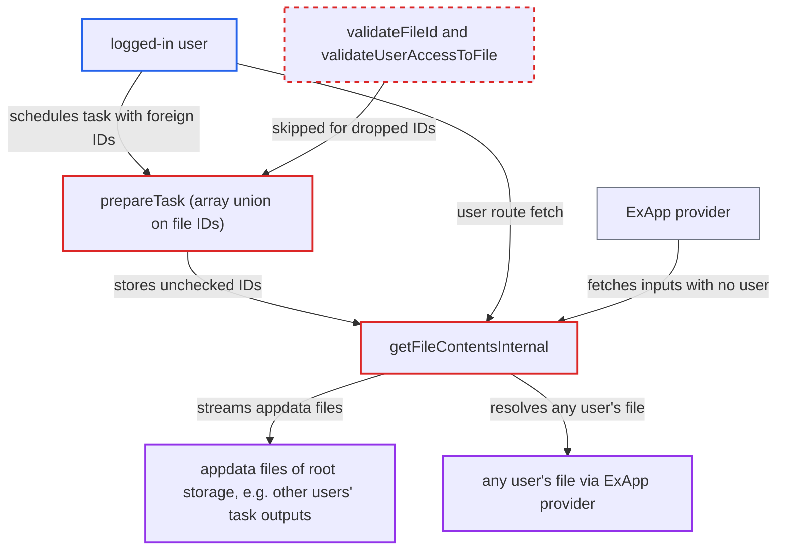

# TaskProcessing prepareTask array union skips file authorization, exposing others' files

| Field | Value |
|---|---|
| ID | `find_01TiHs4Xb4Ugh3C5FT6mTDHW` |
| Severity | **Medium** |
| Status | open |
| CWE | CWE-863 — Incorrect Authorization |
| Created | 2026-10-27T21:22:45.405443Z |
| Claude Security | https://claude.ai/security/findings/find_01TiHs4Xb4Ugh3C5FT6mTDHW |

## Description

A logged-in user can read other users' files by scheduling a task whose file list holds IDs they don't own. Through the user route they can read appdata files such as other users' task outputs. Through an ExApp provider they can read any user's file as processed output. It needs an installed app with a task shape that has a file-typed list slot after another file-typed slot. `prepareTask()` uses `$ids += $inputSlot`, an array union by key, so it skips authorization for the dropped IDs.

1. **attacker** schedules a task through `POST /ocs/v2.php/taskprocessing/schedule`. The task type's shape has a file-typed list slot after another file-typed slot. The attacker puts their own file IDs in the first slot and target IDs at the same keys in the list. ([`lib/private/TaskProcessing/Manager.php:1081-1090`](https://github.com/cx-benchmark/server/blob/6b6317280f8ed50277369c33cee070a643d29654/lib/private/TaskProcessing/Manager.php#L1081-L1090))
2. **`prepareTask()`** collects file IDs with `$ids += $inputSlot`. This is an array union by key, so list elements whose integer keys already exist in `$ids` are dropped. Only the attacker's own IDs reach `validateFileId()` and `validateUserAccessToFile()`. ([`lib/private/TaskProcessing/Manager.php:1741-1757`](https://github.com/cx-benchmark/server/blob/6b6317280f8ed50277369c33cee070a643d29654/lib/private/TaskProcessing/Manager.php#L1741-L1757))
3. **`EShapeType::validateInput()`** accepts the list items. It only requires the items to be numeric, so any ID passes shape validation. ([`lib/public/TaskProcessing/EShapeType.php:132-152`](https://github.com/cx-benchmark/server/blob/6b6317280f8ed50277369c33cee070a643d29654/lib/public/TaskProcessing/EShapeType.php#L132-L152))
4. **`scheduleTask()`** stores the task with the unchecked IDs still in its input. `extractFileIdsFromTask()` builds its list with `array_merge`, so the skipped IDs count as legitimate task files. ([`lib/private/TaskProcessing/Manager.php:1936-1962`](https://github.com/cx-benchmark/server/blob/6b6317280f8ed50277369c33cee070a643d29654/lib/private/TaskProcessing/Manager.php#L1936-L1962))
5. **`getFileContentsInternal()`** streams a file after checking only that its ID is in the task's file list. It then resolves the ID through `IRootFolder` with no check that the task's user may access that file. ([`core/Controller/TaskProcessingApiController.php:555-571`](https://github.com/cx-benchmark/server/blob/6b6317280f8ed50277369c33cee070a643d29654/core/Controller/TaskProcessingApiController.php#L555-L571))
6. **attacker** fetches the file through the user route `GET /taskprocessing/tasks/{taskId}/file/{fileId}`. The session-scoped `Root` will not resolve another user's home file. The appdata fallback returns any file in the root storage's `appdata_<instanceid>` tree, for example other users' task output files. ([`core/Controller/TaskProcessingApiController.php:472-486`](https://github.com/cx-benchmark/server/blob/6b6317280f8ed50277369c33cee070a643d29654/core/Controller/TaskProcessingApiController.php#L472-L486))
7. **ExApp provider** fetches the task's inputs through `GET /taskprocessing/tasks_provider/{taskId}/file/{fileId}`. This route uses the unscoped `getTask()`. A request with no user makes `Root` fall back to the first mount info's owner, so any user's file resolves. ([`core/Controller/TaskProcessingApiController.php:498-511`](https://github.com/cx-benchmark/server/blob/6b6317280f8ed50277369c33cee070a643d29654/core/Controller/TaskProcessingApiController.php#L498-L511))
8. **attacker** reads the provider's output with `GET /taskprocessing/task/{id}`. The provider processes the foreign file into the task output, which the attacker can read.

## Assessment

The attacker is any logged-in user. The task type's combined input shape must have a file-typed list slot after another file-typed slot, either a scalar slot that took key 0 or an earlier list. No core task type or provider in this repository has such a shape. An installed app can add one through the public `IProvider::getOptionalInputShape()` or a registered `ITaskType`. There are two routes to the data. The user route reads root-storage appdata files. The ExApp route has a provider read any user's file and return it as processed output. The ExApp route assumes an AppAPI session with no user, and AppAPI is not in this checkout. Synchronous providers re-check IDs in `fillInputFileData()` when they process the task, but this does not protect the user-route read.

Impact: The attacker can read data that file authorization should protect. This is raw appdata files such as other users' task outputs, and, through an ExApp provider, the content of any user's file as processed into task output. The report states no write access and no availability impact.

## Recommendation

(1) `prepareTask()` collects the file IDs to authorize with array union (`+=`). IDs in later file-typed list slots are dropped before the per-file access check, so a stored task can hold IDs nobody authorized.

Fix criteria: Every file ID in every file-typed input slot, required or optional, scalar or list, whatever its keys, passes `validateFileId()` and `validateUserAccessToFile()` before the task is stored. IDs are collected the same way `extractFileIdsFromTask()` collects them. Scheduling a task whose second file list holds a foreign or appdata file ID at a colliding key fails with 401.

(2) `getFileContentsInternal()` treats membership in `extractFileIdsFromTask()` as authorization. It resolves IDs through the global root folder and appdata fallback, so any unauthorized ID that reaches a stored task becomes readable.

Fix criteria: Before streaming a task input file, the server re-verifies that the task's user may access that file ID, on both the user and ExApp routes. Task output files are served only if they belong to that task's output. An input ID the task owner cannot access yields 404 or 401.

## Evidence

**https://github.com/cx-benchmark/server**

- [`lib/private/TaskProcessing/Manager.php:1741-1757`](https://github.com/cx-benchmark/server/blob/6b6317280f8ed50277369c33cee070a643d29654/lib/private/TaskProcessing/Manager.php#L1741-L1757)
- [`lib/private/TaskProcessing/Manager.php:1081-1090`](https://github.com/cx-benchmark/server/blob/6b6317280f8ed50277369c33cee070a643d29654/lib/private/TaskProcessing/Manager.php#L1081-L1090)
- [`lib/private/TaskProcessing/Manager.php:1936-1962`](https://github.com/cx-benchmark/server/blob/6b6317280f8ed50277369c33cee070a643d29654/lib/private/TaskProcessing/Manager.php#L1936-L1962)
- [`core/Controller/TaskProcessingApiController.php:555-571`](https://github.com/cx-benchmark/server/blob/6b6317280f8ed50277369c33cee070a643d29654/core/Controller/TaskProcessingApiController.php#L555-L571)
- [`core/Controller/TaskProcessingApiController.php:472-486`](https://github.com/cx-benchmark/server/blob/6b6317280f8ed50277369c33cee070a643d29654/core/Controller/TaskProcessingApiController.php#L472-L486)
- [`core/Controller/TaskProcessingApiController.php:498-511`](https://github.com/cx-benchmark/server/blob/6b6317280f8ed50277369c33cee070a643d29654/core/Controller/TaskProcessingApiController.php#L498-L511)
- [`lib/private/Files/Node/Root.php:443-466`](https://github.com/cx-benchmark/server/blob/6b6317280f8ed50277369c33cee070a643d29654/lib/private/Files/Node/Root.php#L443-L466)
- [`lib/private/Files/Node/Folder.php:375-404`](https://github.com/cx-benchmark/server/blob/6b6317280f8ed50277369c33cee070a643d29654/lib/private/Files/Node/Folder.php#L375-L404)
- [`lib/public/TaskProcessing/EShapeType.php:132-152`](https://github.com/cx-benchmark/server/blob/6b6317280f8ed50277369c33cee070a643d29654/lib/public/TaskProcessing/EShapeType.php#L132-L152)

