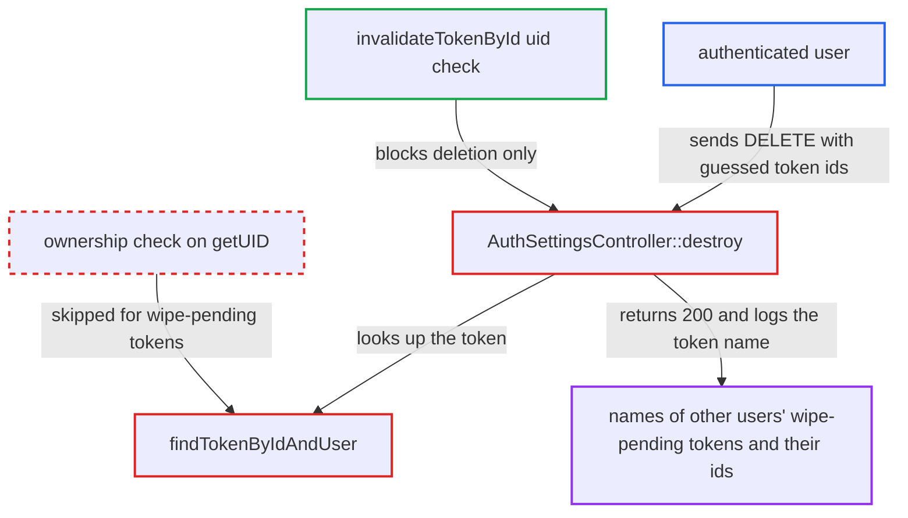

# Token owner check skipped for wipe-pending tokens in AuthSettingsController::destroy

| Field | Value |
|---|---|
| ID | `find_01Txz7FyJ8HeXZAuNrp5imwq` |
| Severity | **Medium** |
| Status | open |
| CWE | CWE-639 — Insecure direct object reference |
| Created | 2026-10-27T21:25:06.694855Z |
| Claude Security | https://claude.ai/security/findings/find_01Txz7FyJ8HeXZAuNrp5imwq |

## Description

Any logged-in user can find out which other users' app-password tokens are waiting for a remote wipe. They can also read the names those users gave the tokens, such as a phone model. Actually deleting or un-wiping the foreign token is blocked. The cause is `findTokenByIdAndUser()`, which skips its ownership check when the token is in the wipe state, and `destroy()` then uses that unchecked token.

1. **authenticated attacker** sends DELETE requests for successive token ids. The request goes to `DELETE /index.php/settings/personal/authtokens/{id}` and passes strict password confirmation with the attacker's own password in the `Authorization` header. ([`apps/settings/lib/Controller/AuthSettingsController.php:176-190`](https://github.com/cx-benchmark/server/blob/6b6317280f8ed50277369c33cee070a643d29654/apps/settings/lib/Controller/AuthSettingsController.php#L176-L190))
2. **the provider's `checkToken()`** throws `WipeTokenException` for a token marked for remote wipe. The exception carries the full token object, including its owner, id and name, whoever owns it. ([`lib/private/Authentication/Token/PublicKeyTokenProvider.php:197-204`](https://github.com/cx-benchmark/server/blob/6b6317280f8ed50277369c33cee070a643d29654/lib/private/Authentication/Token/PublicKeyTokenProvider.php#L197-L204))
3. **the helper `findTokenByIdAndUser()`** lets the exception pass without comparing owners. It only catches `ExpiredTokenException` before the `getUID()` comparison, so the check is never reached for wipe-pending tokens. ([`apps/settings/lib/Controller/AuthSettingsController.php:308-319`](https://github.com/cx-benchmark/server/blob/6b6317280f8ed50277369c33cee070a643d29654/apps/settings/lib/Controller/AuthSettingsController.php#L308-L319))
4. **the handler `destroy()`** catches the exception and carries on with `$e->getToken()`. This token object never passed the ownership check, but the handler uses its id and name anyway. ([`apps/settings/lib/Controller/AuthSettingsController.php:176-190`](https://github.com/cx-benchmark/server/blob/6b6317280f8ed50277369c33cee070a643d29654/apps/settings/lib/Controller/AuthSettingsController.php#L176-L190))
5. **the provider's `invalidateTokenById()`** silently does nothing for the foreign token. It re-checks the uid itself, so nothing is deleted and the remote wipe stays pending. ([`lib/private/Authentication/Token/PublicKeyTokenProvider.php:265-269`](https://github.com/cx-benchmark/server/blob/6b6317280f8ed50277369c33cee070a643d29654/lib/private/Authentication/Token/PublicKeyTokenProvider.php#L265-L269))
6. **the handler `destroy()`** publishes an activity entry with the foreign token's name and returns HTTP 200. The entry reads "You deleted app password {token} and cancelled its pending remote wipe" and appears in the attacker's own activity feed. Other users' tokens that are not wipe-pending return 404. ([`apps/settings/lib/Controller/AuthSettingsController.php:176-190`](https://github.com/cx-benchmark/server/blob/6b6317280f8ed50277369c33cee070a643d29654/apps/settings/lib/Controller/AuthSettingsController.php#L176-L190))

## Assessment

The attacker is any authenticated user who can pass strict password confirmation with their own password in the `Authorization` header. No victim action is needed. They send `DELETE /index.php/settings/personal/authtokens/{id}` for successive integer ids over the internet-facing web UI. A 200 means the id belongs to someone's wipe-pending token, and a 404 means it does not.

Impact: The attacker learns which token ids across the whole instance are pending remote wipe. They also read the device or session names the owners gave those tokens, through the attacker's own activity feed. Nothing is deleted or changed, apart from a spurious entry in the attacker's own activity feed. The report notes no availability impact.

## Recommendation

The ownership comparison in `findTokenByIdAndUser()` is skipped when `getTokenById()` throws `WipeTokenException`. `destroy()` then uses the unchecked token taken from the exception.

Fix criteria: Every token object `destroy()` uses, including those recovered from `WipeTokenException` or `ExpiredTokenException`, has a `getUID()` equal to the session user before any further use. A request for another user's token id returns 404 whatever the token's wipe state, and publishes no activity and does not reveal the token's name. To verify, call `DELETE /settings/personal/authtokens/{id}` with the id of another user's wipe-pending token. Confirm a 404 and no activity entry.

## Evidence

**https://github.com/cx-benchmark/server**

- [`apps/settings/lib/Controller/AuthSettingsController.php:176-190`](https://github.com/cx-benchmark/server/blob/6b6317280f8ed50277369c33cee070a643d29654/apps/settings/lib/Controller/AuthSettingsController.php#L176-L190)
- [`apps/settings/lib/Controller/AuthSettingsController.php:308-319`](https://github.com/cx-benchmark/server/blob/6b6317280f8ed50277369c33cee070a643d29654/apps/settings/lib/Controller/AuthSettingsController.php#L308-L319)
- [`lib/private/Authentication/Token/PublicKeyTokenProvider.php:197-204`](https://github.com/cx-benchmark/server/blob/6b6317280f8ed50277369c33cee070a643d29654/lib/private/Authentication/Token/PublicKeyTokenProvider.php#L197-L204)
- [`lib/private/Authentication/Token/PublicKeyTokenProvider.php:265-269`](https://github.com/cx-benchmark/server/blob/6b6317280f8ed50277369c33cee070a643d29654/lib/private/Authentication/Token/PublicKeyTokenProvider.php#L265-L269)

