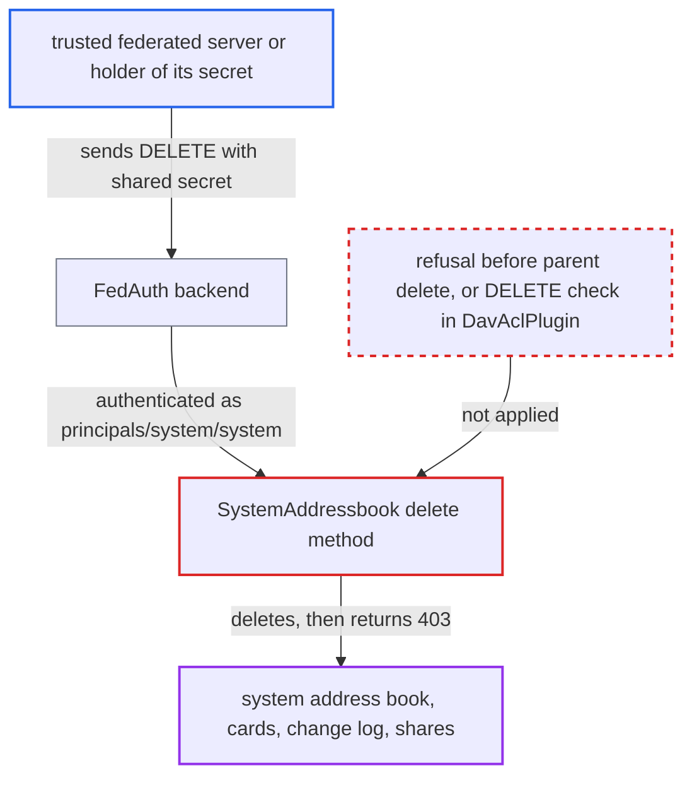

# Trusted federated server can delete the local system address book via DAV DELETE

| Field | Value |
|---|---|
| ID | `find_01MHEkNqZ3gNVq2Vm8TpipsQ` |
| Severity | **Medium** |
| Status | open |
| CWE | CWE-863 — Incorrect Authorization |
| Created | 2026-10-27T21:54:34.697751Z |
| Claude Security | https://claude.ai/security/findings/find_01MHEkNqZ3gNVq2Vm8TpipsQ |

## Description

A server on the instance's trusted-server list, or an attacker who has stolen its shared secret, can delete the local system address book over DAV. The attacker needs only that secret. The write-up shows that `SystemAddressbook::delete()` calls `parent::delete()` for federation peers and throws `Forbidden` only afterwards, so the client sees a 403 even though the data is already gone. The data can be regenerated, and nothing is disclosed.

1. **attacker with a trusted server's secret** sends a DELETE for the system address book. The request is `DELETE /remote.php/dav/addressbooks/system/system/system` with Basic credentials `system:` followed by the shared secret.
2. **the backend in `FedAuth`** authenticates the request as `principals/system/system`. The secret is checked against the trusted servers, and this backend runs ahead of `BearerAuth` and `Auth` on the main DAV server. ([`apps/federation/lib/DAV/FedAuth.php:24-47`](https://github.com/cx-benchmark/server/blob/6b6317280f8ed50277369c33cee070a643d29654/apps/federation/lib/DAV/FedAuth.php#L24-L47))
3. **Sabre's ACL on the home `addressbooks/system/system`** allows the delete on the parent. That principal owns the home, and the owner holds `{DAV:}unbind`. The report assumes sabre/dav 4.x here, and `DavAclPlugin` adds no DELETE check of its own. ([`apps/dav/lib/CardDAV/UserAddressBooks.php:136-147`](https://github.com/cx-benchmark/server/blob/6b6317280f8ed50277369c33cee070a643d29654/apps/dav/lib/CardDAV/UserAddressBooks.php#L136-L147))
4. **`UserAddressBooks`** routes the request to `SystemAddressbook`. The book whose principal is `principals/system/system` is built as a `SystemAddressbook`, so its overridden `delete()` runs. ([`apps/dav/lib/CardDAV/UserAddressBooks.php:90-101`](https://github.com/cx-benchmark/server/blob/6b6317280f8ed50277369c33cee070a643d29654/apps/dav/lib/CardDAV/UserAddressBooks.php#L90-L101))
5. **`SystemAddressbook::delete()`** calls `parent::delete()` and then throws `Forbidden`. `isFederation()` is true for any `system:<secret>` login whose secret matches a row in `trusted_servers`, so the deletion runs before the refusal. ([`apps/dav/lib/CardDAV/SystemAddressbook.php:329-334`](https://github.com/cx-benchmark/server/blob/6b6317280f8ed50277369c33cee070a643d29654/apps/dav/lib/CardDAV/SystemAddressbook.php#L329-L334))
6. **`AddressBook::delete()`** falls through to Sabre's delete and `CardDavBackend::deleteAddressBook()`. The system book row has no `owner-principal` key, so the share-unsubscribe branch is skipped. ([`apps/dav/lib/CardDAV/AddressBook.php:208-226`](https://github.com/cx-benchmark/server/blob/6b6317280f8ed50277369c33cee070a643d29654/apps/dav/lib/CardDAV/AddressBook.php#L208-L226))
7. **`CardDavBackend::deleteAddressBook()`** removes the cards, change log, book row and shares in one committed transaction. The transaction is already committed when `Forbidden` is thrown, so the client gets a 403 after the data is gone. ([`apps/dav/lib/CardDAV/CardDavBackend.php:423-458`](https://github.com/cx-benchmark/server/blob/6b6317280f8ed50277369c33cee070a643d29654/apps/dav/lib/CardDAV/CardDavBackend.php#L423-L458))

## Assessment

The attacker runs, or has compromised, a server on this instance's trusted-server list, so it knows that server's shared secret. No user has to do anything, and the attacker can repeat the request at will. Requests that are not from a federation peer are refused before anything is deleted.

Impact: The attacker deletes the local system address book: one card per account, its change log and its shares. The cached address books of other trusted servers under `principals/system/system` are deleted too. The next account change recreates the book empty, and only `occ dav:sync-system-addressbook` repopulates it. Until then the contacts menu, email-based sharee lookup and federated contact sync for other peers are degraded. No data is disclosed.

## Recommendation

(1) `SystemAddressbook::delete()` calls `parent::delete()` for federation peers and throws `Forbidden` only afterwards. The refusal therefore comes after the deletion has committed.

Fix criteria: A `DELETE` on the system address book by any principal, including one authenticated with a trusted-server shared secret, returns 403 and leaves the `addressbooks`, `cards` and `addressbookchanges` rows untouched. Verify by sending `DELETE /remote.php/dav/addressbooks/system/system/system` with `system:<shared_secret>` Basic credentials and confirming the book and its cards still exist.

(2) The trusted-server identity `principals/system/system` owns the `addressbooks/system/system` home. It therefore holds `{DAV:}write`, `{DAV:}unbind` and `{DAV:}bind` there, far more than the read-only sync its shared secret is meant to allow.

Fix criteria: Requests authenticated through `FedAuth` do not get unbind, bind or write privileges on the system address-book home, or on books they do not need to write. A DELETE or MKCOL under `addressbooks/system/system/` with trusted-server credentials is rejected by the ACL layer.

## Evidence

**https://github.com/cx-benchmark/server**

- [`apps/dav/lib/CardDAV/SystemAddressbook.php:329-334`](https://github.com/cx-benchmark/server/blob/6b6317280f8ed50277369c33cee070a643d29654/apps/dav/lib/CardDAV/SystemAddressbook.php#L329-L334)
- [`apps/dav/lib/CardDAV/SystemAddressbook.php:264-291`](https://github.com/cx-benchmark/server/blob/6b6317280f8ed50277369c33cee070a643d29654/apps/dav/lib/CardDAV/SystemAddressbook.php#L264-L291)
- [`apps/dav/lib/CardDAV/AddressBook.php:208-226`](https://github.com/cx-benchmark/server/blob/6b6317280f8ed50277369c33cee070a643d29654/apps/dav/lib/CardDAV/AddressBook.php#L208-L226)
- [`apps/dav/lib/CardDAV/CardDavBackend.php:423-458`](https://github.com/cx-benchmark/server/blob/6b6317280f8ed50277369c33cee070a643d29654/apps/dav/lib/CardDAV/CardDavBackend.php#L423-L458)
- [`apps/federation/lib/DAV/FedAuth.php:24-47`](https://github.com/cx-benchmark/server/blob/6b6317280f8ed50277369c33cee070a643d29654/apps/federation/lib/DAV/FedAuth.php#L24-L47)
- [`apps/dav/lib/CardDAV/UserAddressBooks.php:90-101`](https://github.com/cx-benchmark/server/blob/6b6317280f8ed50277369c33cee070a643d29654/apps/dav/lib/CardDAV/UserAddressBooks.php#L90-L101)
- [`apps/dav/lib/CardDAV/UserAddressBooks.php:136-147`](https://github.com/cx-benchmark/server/blob/6b6317280f8ed50277369c33cee070a643d29654/apps/dav/lib/CardDAV/UserAddressBooks.php#L136-L147)
- [`apps/dav/lib/Connector/Sabre/DavAclPlugin.php:95-118`](https://github.com/cx-benchmark/server/blob/6b6317280f8ed50277369c33cee070a643d29654/apps/dav/lib/Connector/Sabre/DavAclPlugin.php#L95-L118)

