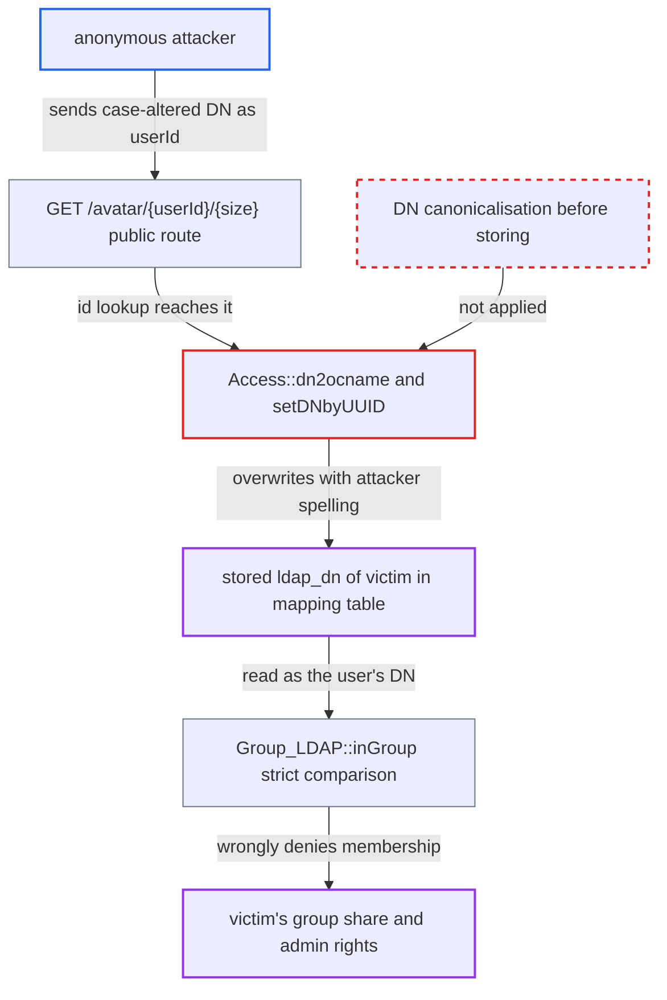

# Unauthenticated DN-shaped user IDs rewrite stored LDAP mapping DNs, breaking group checks

| Field | Value |
|---|---|
| ID | `find_0129TnTrdxEtTC9hW3Fw6dmZ` |
| Severity | **Medium** |
| Status | open |
| CWE | CWE-178 — Improper Handling of Case Sensitivity |
| Created | 2026-10-27T21:28:06.178074Z |
| Claude Security | https://claude.ai/security/findings/find_0129TnTrdxEtTC9hW3Fw6dmZ |

## Description

An anonymous visitor can make the LDAP user backend store a wrongly spelled DN for any LDAP user whose DN (64 characters or fewer) they know or can guess. The victim is then wrongly reported as outside their LDAP groups. This breaks group shares and, if `ldapAdminGroup` is set, LDAP-group admin rights. The cause is that `Access::dn2ocname()` saves the caller's DN spelling through `setDNbyUUID()`, and `Group_LDAP::inGroup()` compares DNs byte for byte.

1. **Anonymous attacker** requests an avatar using a case-altered DN as the user id. The attacker sends `GET /index.php/avatar/<case-altered DN>/64`, a public route that passes `userId` on to the user manager. ([`core/Controller/AvatarController.php:133-152`](https://github.com/cx-benchmark/server/blob/6b6317280f8ed50277369c33cee070a643d29654/core/Controller/AvatarController.php#L133-L152))
2. **core user manager** asks every backend whether the id exists, which reaches `User_LDAP::userExists()`. `OC\User\Manager::get()` passes whatever id the controller gave it, and `userExists()` forwards it to `userManager->exists($uid)`. ([`apps/user_ldap/lib/User_LDAP.php:330-348`](https://github.com/cx-benchmark/server/blob/6b6317280f8ed50277369c33cee070a643d29654/apps/user_ldap/lib/User_LDAP.php#L330-L348))
3. **`Manager::exists()`** treats the id as a DN and calls `Access::dn2username()` on the raw string. The id is handled this way when `ldap_explode_dn` can parse it. ([`apps/user_ldap/lib/User/Manager.php:234-260`](https://github.com/cx-benchmark/server/blob/6b6317280f8ed50277369c33cee070a643d29654/apps/user_ldap/lib/User/Manager.php#L234-L260))
4. **`Access::dn2username()`** accepts the string after only a suffix check and passes it to `dn2ocname()`. `isDNPartOfBase()` is a case-insensitive suffix test, so a differently cased DN passes. ([`apps/user_ldap/lib/Access.php:466-475`](https://github.com/cx-benchmark/server/blob/6b6317280f8ed50277369c33cee070a643d29654/apps/user_ldap/lib/Access.php#L466-L475))
5. **`Access::dn2ocname()`** misses the hash lookup, reads the entry from LDAP and overwrites the stored DN with the attacker's spelling. The hash of the altered string is unknown, but LDAP resolves the DN case-insensitively and the entry's UUID is already mapped, so `setDNbyUUID($fdn, $uuid)` stores `$fdn` without running `sanitizeDN()`. ([`apps/user_ldap/lib/Access.php:542-550`](https://github.com/cx-benchmark/server/blob/6b6317280f8ed50277369c33cee070a643d29654/apps/user_ldap/lib/Access.php#L542-L550))
6. **`setDNbyUUID()`** updates the victim's `ldap_dn` and `ldap_dn_hash` and the local name-to-DN cache. After this, `username2dn()` returns the attacker's spelling for the victim. ([`apps/user_ldap/lib/Mapping/AbstractMapping.php:182-207`](https://github.com/cx-benchmark/server/blob/6b6317280f8ed50277369c33cee070a643d29654/apps/user_ldap/lib/Mapping/AbstractMapping.php#L182-L207))
7. **`Group_LDAP::inGroup()`** reports the victim as not in their groups and caches the result. It compares the stored DN strictly with `in_array(..., true)` against member DNs that `sanitizeDN()` has lower-cased, so the spellings never match; the false result is cached for `ldapCacheTTL`. ([`apps/user_ldap/lib/Group_LDAP.php:69-166`](https://github.com/cx-benchmark/server/blob/6b6317280f8ed50277369c33cee070a643d29654/apps/user_ldap/lib/Group_LDAP.php#L69-L166))

## Assessment

The attacker is anonymous and needs no login and no action from the victim. They must know or guess the victim's LDAP DN, which must be 64 characters or fewer (`IUser::MAX_USERID_LENGTH`). The example route is `GET /index.php/avatar/<case-altered DN>/64`. Any other anonymous route that resolves a user id reaches the same code. Changing the letter case on each request avoids the `userExists<id>` cache, so the attacker can break the mapping again whenever it is restored.

Impact: The victim is reported as outside their LDAP groups. They cannot accept, move, leave or read group shares through the share APIs. They cannot share to their own groups when 'share with group members only' is on. They lose LDAP-group admin rights when the non-default `ldapAdminGroup` is set. Nothing is disclosed, and file access through group shares persists because `getUserGroups()` is not affected. The state is restored only when some flow maps the canonical DN again, such as listings, sharee search or background sync.

## Recommendation

(1) `Access::dn2ocname()` saves the DN spelling the caller supplied through `setDNbyUUID($fdn, ...)` without canonicalising it. Id lookups via `userExists` can therefore change the mapping table from untrusted input.

Fix criteria: A stored mapping DN is only ever the `sanitizeDN()`-canonical form of a DN returned by the directory. An id lookup with a differently spelled but equivalent DN leaves the stored `ldap_dn` unchanged. Either `$fdn` is canonicalised before `setDNbyUUID`, or the DN returned by the LDAP read is used instead of the input string. To check, request `/avatar/<UPPER-CASE DN>/64` for a mapped user. Confirm that `ldap_user_mapping.ldap_dn` is unchanged and that `Group_LDAP::inGroup()` still returns true for the user's groups.

(2) `Group_LDAP::inGroup()` and the membership caches compare DNs with a byte-for-byte `in_array(..., true)`. Any spelling difference between the mapped DN and the directory's DNs denies membership.

Fix criteria: Membership comparisons ignore DN spelling differences, with canonicalised forms compared on both sides. To check, use a mapping whose DN differs only in case from the directory's `member` values. `inGroup()` and `isAdmin()` must still return true.

## Evidence

**https://github.com/cx-benchmark/server**

- [`apps/user_ldap/lib/Access.php:542-550`](https://github.com/cx-benchmark/server/blob/6b6317280f8ed50277369c33cee070a643d29654/apps/user_ldap/lib/Access.php#L542-L550)
- [`apps/user_ldap/lib/User/Manager.php:234-260`](https://github.com/cx-benchmark/server/blob/6b6317280f8ed50277369c33cee070a643d29654/apps/user_ldap/lib/User/Manager.php#L234-L260)
- [`apps/user_ldap/lib/User_LDAP.php:330-348`](https://github.com/cx-benchmark/server/blob/6b6317280f8ed50277369c33cee070a643d29654/apps/user_ldap/lib/User_LDAP.php#L330-L348)
- [`apps/user_ldap/lib/Access.php:466-475`](https://github.com/cx-benchmark/server/blob/6b6317280f8ed50277369c33cee070a643d29654/apps/user_ldap/lib/Access.php#L466-L475)
- [`apps/user_ldap/lib/Mapping/AbstractMapping.php:182-207`](https://github.com/cx-benchmark/server/blob/6b6317280f8ed50277369c33cee070a643d29654/apps/user_ldap/lib/Mapping/AbstractMapping.php#L182-L207)
- [`apps/user_ldap/lib/Helper.php:228-273`](https://github.com/cx-benchmark/server/blob/6b6317280f8ed50277369c33cee070a643d29654/apps/user_ldap/lib/Helper.php#L228-L273)
- [`apps/user_ldap/lib/Group_LDAP.php:69-166`](https://github.com/cx-benchmark/server/blob/6b6317280f8ed50277369c33cee070a643d29654/apps/user_ldap/lib/Group_LDAP.php#L69-L166)
- [`apps/user_ldap/lib/Group_LDAP.php:1423-1432`](https://github.com/cx-benchmark/server/blob/6b6317280f8ed50277369c33cee070a643d29654/apps/user_ldap/lib/Group_LDAP.php#L1423-L1432)
- [`core/Controller/AvatarController.php:133-152`](https://github.com/cx-benchmark/server/blob/6b6317280f8ed50277369c33cee070a643d29654/core/Controller/AvatarController.php#L133-L152)

