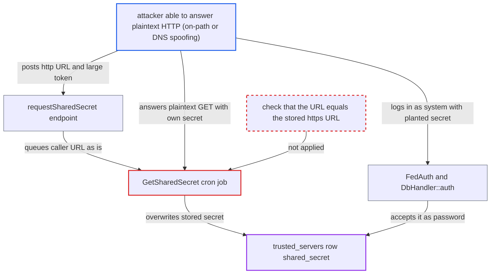

# Unauthenticated shared-secret exchange follows caller-chosen http:// scheme, letting on-path attacker plant trusted-server secret

| Field | Value |
|---|---|
| ID | `find_01C79dcY89Fjz1Usro9PSNbu` |
| Severity | **Medium** |
| Status | open |
| CWE | CWE-757 — Protocol downgrade |
| Created | 2026-10-27T21:30:47.172420Z |
| Claude Security | https://claude.ai/security/findings/find_01C79dcY89Fjz1Usro9PSNbu |

## Description

An attacker who can answer the victim's plaintext HTTP traffic to a trusted server (on-path, or by spoofing DNS for that host) can plant a shared secret on a Nextcloud server. That secret works as the federation `system` login to the system address book and breaks the real sync. The cause is `requestSharedSecret()`, which treats `http://` and `https://` as the same server, and `GetSharedSecret`, which fetches from the caller's URL.

1. **attacker** posts a trusted host's URL with an `http://` scheme and a large token to `/ocs/v2.php/cloud/shared-secret`. The endpoint `requestSharedSecret()` is `#[PublicPage]` and `#[NoCSRFRequired]`, so no login is needed. A token such as `zzzzzzzzzzzzzzzzz` passes the `strcmp($localToken, $token) > 0` guard. ([`apps/federation/lib/Controller/OCSAuthAPIController.php:95-125`](https://github.com/cx-benchmark/server/blob/6b6317280f8ed50277369c33cee070a643d29654/apps/federation/lib/Controller/OCSAuthAPIController.php#L95-L125))
2. **`isTrustedServer()`** accepts the `http://` URL as a trusted server. `normalizeUrl()` strips a leading `https://` or `http://` before hashing, so `http://trusted.example` matches the row stored as `https://trusted.example`. ([`apps/federation/lib/DbHandler.php:240-253`](https://github.com/cx-benchmark/server/blob/6b6317280f8ed50277369c33cee070a643d29654/apps/federation/lib/DbHandler.php#L240-L253))
3. **the handler `requestSharedSecret()`** queues a `GetSharedSecret` job with the caller's `$url` unchanged. The scheme the caller chose is kept, and the stored trusted URL is never consulted. ([`apps/federation/lib/Controller/OCSAuthAPIController.php:95-125`](https://github.com/cx-benchmark/server/blob/6b6317280f8ed50277369c33cee070a643d29654/apps/federation/lib/Controller/OCSAuthAPIController.php#L95-L125))
4. **the cron job `GetSharedSecret`** runs discovery and sends a GET to `<url>/ocs/.../shared-secret` over plaintext. The Nextcloud HTTP client does not restrict schemes, so the request goes out as `http://`. A real trusted server would answer the attacker's token with a 403. ([`apps/federation/lib/BackgroundJob/GetSharedSecret.php:82-155`](https://github.com/cx-benchmark/server/blob/6b6317280f8ed50277369c33cee070a643d29654/apps/federation/lib/BackgroundJob/GetSharedSecret.php#L82-L155))
5. **attacker** answers the plaintext request with a JSON body whose `ocs.data.sharedSecret` is a value they chose. Only someone who can intercept or spoof the host can do this. Over the stored `https://` URL with certificate verification they could not. ([`apps/federation/lib/BackgroundJob/GetSharedSecret.php:82-155`](https://github.com/cx-benchmark/server/blob/6b6317280f8ed50277369c33cee070a643d29654/apps/federation/lib/BackgroundJob/GetSharedSecret.php#L82-L155))
6. **the job `GetSharedSecret`** stores the returned secret through `addSharedSecret($target, ...)`. The URL hashes back to the real trusted server's row, so that row's `shared_secret` is overwritten. ([`apps/federation/lib/BackgroundJob/GetSharedSecret.php:82-155`](https://github.com/cx-benchmark/server/blob/6b6317280f8ed50277369c33cee070a643d29654/apps/federation/lib/BackgroundJob/GetSharedSecret.php#L82-L155))
7. **attacker** logs in to DAV as username `system` with the planted secret as password. `DbHandler::auth()` accepts any stored `shared_secret`, and `FedAuth` maps the login to `principals/system/system`. ([`apps/federation/lib/DbHandler.php:255-267`](https://github.com/cx-benchmark/server/blob/6b6317280f8ed50277369c33cee070a643d29654/apps/federation/lib/DbHandler.php#L255-L267))
8. **attacker** reads the system address book as the federation principal. `SystemAddressbook` returns every account's card with only `SCOPE_LOCAL` properties removed. ([`apps/dav/lib/CardDAV/SystemAddressbook.php:219-289`](https://github.com/cx-benchmark/server/blob/6b6317280f8ed50277369c33cee070a643d29654/apps/dav/lib/CardDAV/SystemAddressbook.php#L219-L289))

## Assessment

The attacker needs no account, because the endpoint is public. They must also be able to answer the victim's plaintext HTTP request to a trusted host, either by being on the network path or by spoofing DNS for that host. They need to know a trusted server's URL. The attack completes on the next cron run, when `GetSharedSecret` makes the request. The trusted server is stored with `https://` by default, since `updateProtocol()` uses that scheme. The request is not answerable by an attacker over `https://` with certificate verification, and the downgrade removes that protection.

Impact: The attacker gets a working login for the federation principal `principals/system/system`. With it they can read the system address book, which holds every non-guest account's federated or published-scope properties such as display name, email and phone. The real trusted server's secret is replaced, so the legitimate sync fails until an admin re-adds the server. Direct card writes are blocked because `SystemAddressbook::getACL()` strips `{DAV:}write`, and the report says no file data or user passwords are reached.

## Recommendation

`requestSharedSecret()` and `GetSharedSecret` use the caller's URL string, scheme included, for the outbound secret fetch. Authorization compares only a scheme-insensitive hash, so the exchange can be forced onto plaintext and the response is trusted as the peer's credential.

Fix criteria: The outbound shared-secret request goes to the URL stored in `trusted_servers` for the matched row, or the caller's URL must equal the stored one exactly, scheme included. It never goes to a caller-supplied variant. To verify, POST `url=http://<trusted>` for a server stored as `https://<trusted>`. No `http://` request must be made, and `shared_secret` must stay unchanged.

## Evidence

**https://github.com/cx-benchmark/server**

- [`apps/federation/lib/Controller/OCSAuthAPIController.php:95-125`](https://github.com/cx-benchmark/server/blob/6b6317280f8ed50277369c33cee070a643d29654/apps/federation/lib/Controller/OCSAuthAPIController.php#L95-L125)
- [`apps/federation/lib/BackgroundJob/GetSharedSecret.php:82-155`](https://github.com/cx-benchmark/server/blob/6b6317280f8ed50277369c33cee070a643d29654/apps/federation/lib/BackgroundJob/GetSharedSecret.php#L82-L155)
- [`apps/federation/lib/DbHandler.php:240-253`](https://github.com/cx-benchmark/server/blob/6b6317280f8ed50277369c33cee070a643d29654/apps/federation/lib/DbHandler.php#L240-L253)
- [`apps/federation/lib/DbHandler.php:255-267`](https://github.com/cx-benchmark/server/blob/6b6317280f8ed50277369c33cee070a643d29654/apps/federation/lib/DbHandler.php#L255-L267)
- [`apps/federation/lib/DAV/FedAuth.php:24-47`](https://github.com/cx-benchmark/server/blob/6b6317280f8ed50277369c33cee070a643d29654/apps/federation/lib/DAV/FedAuth.php#L24-L47)
- [`apps/dav/lib/CardDAV/SystemAddressbook.php:219-289`](https://github.com/cx-benchmark/server/blob/6b6317280f8ed50277369c33cee070a643d29654/apps/dav/lib/CardDAV/SystemAddressbook.php#L219-L289)
- [`apps/federation/lib/TrustedServers.php:53-70`](https://github.com/cx-benchmark/server/blob/6b6317280f8ed50277369c33cee070a643d29654/apps/federation/lib/TrustedServers.php#L53-L70)

