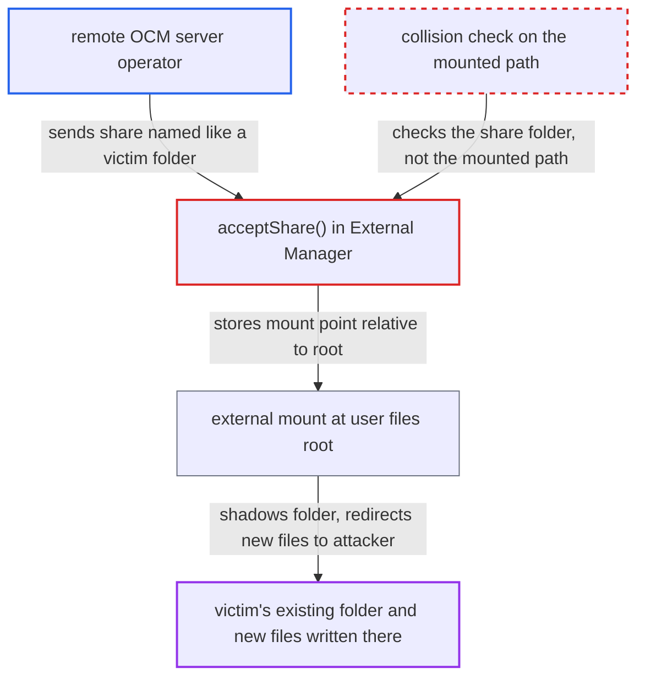

# Accepted federated share mounted at user root with wrong collision check, shadowing existing folder

| Field | Value |
|---|---|
| ID | `find_01NXHyHcMtvXaLVKWj2sjWng` |
| Severity | **Low** |
| Status | open |
| CWE | CWE-706 — Improper access control |
| Created | 2026-10-27T21:36:13.189205Z |
| Claude Security | https://claude.ai/security/findings/find_01NXHyHcMtvXaLVKWj2sjWng |

## Description

A remote server operator can hide one of a victim's own top-level folders, such as `Documents`, behind a federated share. Later files the victim or their sync clients put there go to the attacker's WebDAV storage. This needs the victim to accept the share and a non-root share folder. The cause is `acceptShare()`, which checks the name in the share folder but mounts the share at the user's files root.

1. **Remote attacker** sends a federated share whose `resourceName` matches a folder the victim has. The name is validated only as a plain file name, so the remote decides which top-level name the mount will take, for example `Documents`. ([`apps/federatedfilesharing/lib/OCM/CloudFederationProviderFiles.php:119-160`](https://github.com/cx-benchmark/server/blob/6b6317280f8ed50277369c33cee070a643d29654/apps/federatedfilesharing/lib/OCM/CloudFederationProviderFiles.php#L119-L160))
2. **Victim** accepts the share in the notification. This only leads to a collision when the victim's share folder is not `/`, either from an admin `share_folder` value or from the user's own setting. ([`apps/files_sharing/lib/Helper.php:52-83`](https://github.com/cx-benchmark/server/blob/6b6317280f8ed50277369c33cee070a643d29654/apps/files_sharing/lib/Helper.php#L52-L83))
3. **the method `acceptShare()`** asks the share folder node for a free name with `getNonExistingName()`. The name is stored as the mount point normalized to `/<name>`, so the share is placed at the user's files root rather than inside the share folder. ([`apps/files_sharing/lib/External/Manager.php:185-215`](https://github.com/cx-benchmark/server/blob/6b6317280f8ed50277369c33cee070a643d29654/apps/files_sharing/lib/External/Manager.php#L185-L215))
4. **the method `getNonExistingName()`** checks for a collision only under the share folder and returns a name relative to it. With `/Shared` as share folder it checks `/Shared/Documents`, finds nothing, and returns `Documents`. The real `Documents` folder at the root is never checked. ([`lib/private/Files/Node/Folder.php:433-473`](https://github.com/cx-benchmark/server/blob/6b6317280f8ed50277369c33cee070a643d29654/lib/private/Files/Node/Folder.php#L433-L473))
5. **the method `getMount()`** mounts the remote storage at `/<uid>/files/<name>`. No further collision check runs, so the mount lands on top of the victim's real folder. ([`apps/files_sharing/lib/External/MountProvider.php:47-60`](https://github.com/cx-benchmark/server/blob/6b6317280f8ed50277369c33cee070a643d29654/apps/files_sharing/lib/External/MountProvider.php#L47-L60))
6. **the mount manager `find()` and `getDirectoryContent`** send every path under that name to the remote storage and replace the real folder's listing entry with the mount. The victim's own folder disappears from the web UI, WebDAV and sync clients, and new files created there are written to the attacker's storage. ([`lib/private/Files/Mount/Manager.php:80-112`](https://github.com/cx-benchmark/server/blob/6b6317280f8ed50277369c33cee070a643d29654/lib/private/Files/Mount/Manager.php#L80-L112))

## Assessment

The attacker runs an internet-facing OCM server. Incoming federation is enabled by default, so the attacker can send the victim a federated share. The share's `resourceName` is set to the name of a folder the victim already has at the top level, such as `Documents` or `Photos`. The victim must click Accept. The victim's share folder must also not be `/`. That happens when an admin sets `share_folder`, or when the user sets their own share folder, which `sharing.allow_custom_share_folder` allows by default. With the default share folder `/` and no user setting, the code correctly picks `<name> (2)`.

Impact: The victim's own folder is hidden and unusable in the web UI, WebDAV and sync clients until the share is removed. Files the victim or their clients create or upload under that name are written to the attacker's remote storage. The attacker does not read the existing file contents, and there is no server-wide compromise. The original data stays in home storage and returns when the share is removed.

## Recommendation

`acceptShare()` checks that the name is unique inside the share folder, but stores a mount point relative to the user root. The location that actually gets mounted is never checked against the user's existing files or mounts.

Fix criteria: The stored mount point is the full path that is actually mounted, inside the configured share folder. The uniqueness check runs against that exact path, including existing mounts. To verify, set `share_folder` to a sub-folder and accept a remote share named like an existing top-level folder. The share must appear as `/<shareFolder>/<name>` or `<name> (2)`, and the original folder must stay listed and reachable.

## Evidence

**https://github.com/cx-benchmark/server**

- [`apps/files_sharing/lib/External/Manager.php:185-215`](https://github.com/cx-benchmark/server/blob/6b6317280f8ed50277369c33cee070a643d29654/apps/files_sharing/lib/External/Manager.php#L185-L215)
- [`lib/private/Files/Node/Folder.php:433-473`](https://github.com/cx-benchmark/server/blob/6b6317280f8ed50277369c33cee070a643d29654/lib/private/Files/Node/Folder.php#L433-L473)
- [`apps/files_sharing/lib/External/MountProvider.php:47-60`](https://github.com/cx-benchmark/server/blob/6b6317280f8ed50277369c33cee070a643d29654/apps/files_sharing/lib/External/MountProvider.php#L47-L60)
- [`lib/private/Files/View.php:1577-1672`](https://github.com/cx-benchmark/server/blob/6b6317280f8ed50277369c33cee070a643d29654/lib/private/Files/View.php#L1577-L1672)
- [`lib/private/Files/Mount/Manager.php:80-112`](https://github.com/cx-benchmark/server/blob/6b6317280f8ed50277369c33cee070a643d29654/lib/private/Files/Mount/Manager.php#L80-L112)
- [`apps/files_sharing/lib/Helper.php:52-83`](https://github.com/cx-benchmark/server/blob/6b6317280f8ed50277369c33cee070a643d29654/apps/files_sharing/lib/Helper.php#L52-L83)
- [`apps/federatedfilesharing/lib/OCM/CloudFederationProviderFiles.php:119-160`](https://github.com/cx-benchmark/server/blob/6b6317280f8ed50277369c33cee070a643d29654/apps/federatedfilesharing/lib/OCM/CloudFederationProviderFiles.php#L119-L160)

