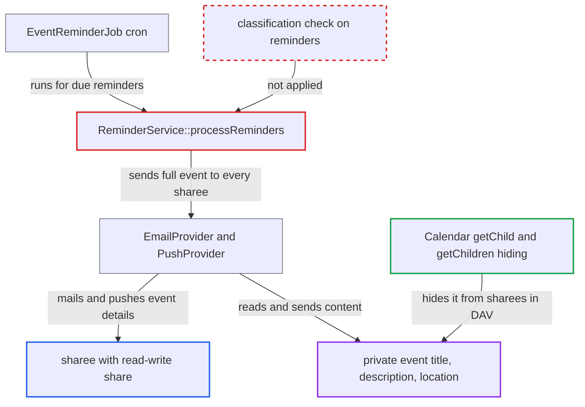

# Calendar reminders disclose CLASS:PRIVATE event details to calendar sharees

| Field | Value |
|---|---|
| ID | `find_018sJ7L8i34oY1HVaQJeH6VA` |
| Severity | **Low** |
| Status | open |
| CWE | CWE-200 — Information exposure |
| Created | 2026-10-27T21:30:47.242247Z |
| Claude Security | https://claude.ai/security/findings/find_018sJ7L8i34oY1HVaQJeH6VA |

## Description

A user who has been given read-write access to another user's calendar gets the owner's private events by e-mail and push notification. This covers the title, description and location of events marked `CLASS:PRIVATE` that have a reminder. It works with the default `sendEventRemindersToSharedUsers=yes`. `ReminderService::processReminders()` never checks the event's classification before sending.

1. **calendar owner** saves a `CLASS:PRIVATE` event with a `VALARM`. The alarm is of type EMAIL or DISPLAY/AUDIO, and the calendar is shared read-write with another user or group.
2. **cron job `EventReminderJob`** calls `ReminderService::processReminders()` for each due reminder. With `sendEventRemindersToSharedUsers` set to `yes` (the default), the recipient list comes from `getAllUsersWithWriteAccessToCalendar()`, then the owner is added. ([`apps/dav/lib/CalDAV/Reminder/ReminderService.php:126-163`](https://github.com/cx-benchmark/server/blob/6b6317280f8ed50277369c33cee070a643d29654/apps/dav/lib/CalDAV/Reminder/ReminderService.php#L126-L163))
3. **`getAllUsersWithWriteAccessToCalendar()`** expands the shares into recipients. Every non-read-only user share and every member of a group share is included. ([`apps/dav/lib/CalDAV/Reminder/ReminderService.php:539-575`](https://github.com/cx-benchmark/server/blob/6b6317280f8ed50277369c33cee070a643d29654/apps/dav/lib/CalDAV/Reminder/ReminderService.php#L539-L575))
4. **`ReminderService::processReminders()`** passes the full `VEvent` and the recipient list to the notification provider. Only a per-user mute filters the list. The object's classification is never consulted. ([`apps/dav/lib/CalDAV/Reminder/ReminderService.php:126-163`](https://github.com/cx-benchmark/server/blob/6b6317280f8ed50277369c33cee070a643d29654/apps/dav/lib/CalDAV/Reminder/ReminderService.php#L126-L163))
5. **`EmailProvider::send()`** mails each recipient the event details. The `SUMMARY` goes in the subject and heading. `LOCATION` and `DESCRIPTION` go in the body. ([`apps/dav/lib/CalDAV/Reminder/NotificationProvider/EmailProvider.php:137-162`](https://github.com/cx-benchmark/server/blob/6b6317280f8ed50277369c33cee070a643d29654/apps/dav/lib/CalDAV/Reminder/NotificationProvider/EmailProvider.php#L137-L162))
6. **`PushProvider::send()`** pushes a notification to each recipient. The notification parameters hold the private event's title, description, location and times. ([`apps/dav/lib/CalDAV/Reminder/NotificationProvider/PushProvider.php:55-110`](https://github.com/cx-benchmark/server/blob/6b6317280f8ed50277369c33cee070a643d29654/apps/dav/lib/CalDAV/Reminder/NotificationProvider/PushProvider.php#L55-L110))

## Assessment

The attacker is an authenticated user who holds a read-write share of the victim's calendar, either directly or through a group. The attacker sends no request. The leak happens when the owner saves a `CLASS:PRIVATE` event with a `VALARM` and the cron job `EventReminderJob` later processes the reminder. It needs the default `sendEventRemindersToSharedUsers=yes` and an owner who uses alarms on private events. The owner gets no sign that sharees receive the details.

Impact: The sharee learns the title, description, location and time of the owner's private events that have reminders. The DAV access-control layer and the activity stream deliberately hide these from sharees. The exposure is limited to events with alarms in calendars shared read-write. Nothing is modified and availability is not affected.

## Recommendation

Reminder delivery to calendar sharees ignores the calendar object's classification. The owner-only rule for `CLASS:PRIVATE` objects is enforced in the DAV layer but not when reminders are sent by e-mail or push.

Fix criteria: A reminder for an object classified PRIVATE reaches only the calendar owner, plus organizer and attendees as before. No sharee receives an e-mail or push notification with its summary, description or location. To verify, share a calendar read-write with a user or group and create a `CLASS:PRIVATE` event with EMAIL and DISPLAY alarms. Then run the reminder job. The sharees get no notification and the owner still does.

## Evidence

**https://github.com/cx-benchmark/server**

- [`apps/dav/lib/CalDAV/Reminder/ReminderService.php:126-163`](https://github.com/cx-benchmark/server/blob/6b6317280f8ed50277369c33cee070a643d29654/apps/dav/lib/CalDAV/Reminder/ReminderService.php#L126-L163)
- [`apps/dav/lib/CalDAV/Reminder/ReminderService.php:539-575`](https://github.com/cx-benchmark/server/blob/6b6317280f8ed50277369c33cee070a643d29654/apps/dav/lib/CalDAV/Reminder/ReminderService.php#L539-L575)
- [`apps/dav/lib/CalDAV/Reminder/NotificationProvider/EmailProvider.php:137-162`](https://github.com/cx-benchmark/server/blob/6b6317280f8ed50277369c33cee070a643d29654/apps/dav/lib/CalDAV/Reminder/NotificationProvider/EmailProvider.php#L137-L162)
- [`apps/dav/lib/CalDAV/Reminder/NotificationProvider/PushProvider.php:55-110`](https://github.com/cx-benchmark/server/blob/6b6317280f8ed50277369c33cee070a643d29654/apps/dav/lib/CalDAV/Reminder/NotificationProvider/PushProvider.php#L55-L110)
- [`apps/dav/lib/CalDAV/Calendar.php:292-345`](https://github.com/cx-benchmark/server/blob/6b6317280f8ed50277369c33cee070a643d29654/apps/dav/lib/CalDAV/Calendar.php#L292-L345)
- [`apps/dav/lib/CalDAV/Activity/Backend.php:441-446`](https://github.com/cx-benchmark/server/blob/6b6317280f8ed50277369c33cee070a643d29654/apps/dav/lib/CalDAV/Activity/Backend.php#L441-L446)

