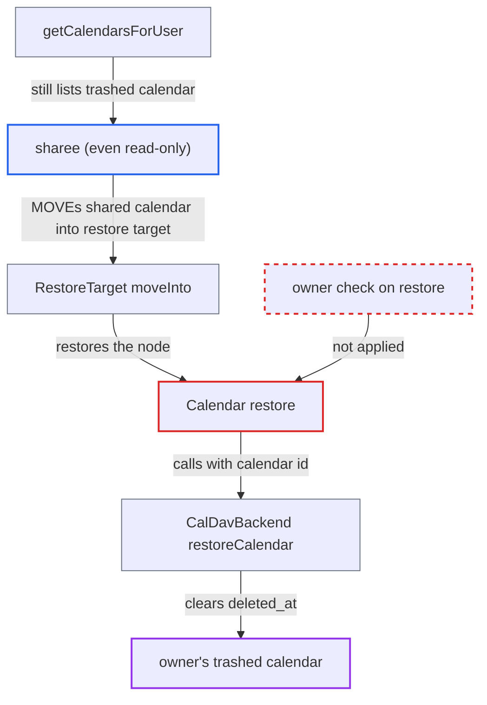

# Calendar sharee can restore the owner's trashed calendar via trashbin restore target

| Field | Value |
|---|---|
| ID | `find_01WMJFzUyMTZQCgqYGUy9n3a` |
| Severity | **Low** |
| Status | open |
| CWE | CWE-285 — Improper Authorization |
| Created | 2026-10-27T21:27:15.528168Z |
| Claude Security | https://claude.ai/security/findings/find_01WMJFzUyMTZQCgqYGUy9n3a |

## Description

Any user who has a share of a calendar, even read-only, can un-delete that calendar after its owner has moved it to the trashbin. This reverses a decision only the owner should make. It works only while the calendar is still in the trashbin, before the retention purge. `Calendar::restore()` and `restoreCalendar()` never check who is asking, and the sharee's calendar home still lists the trashed calendar.

1. **calendar owner** deletes the calendar, which only soft-deletes it. `deleted_at` is set and the shares stay in place. The shares are removed only when the calendar is deleted permanently. ([`apps/dav/lib/CalDAV/CalDavBackend.php:380-461`](https://github.com/cx-benchmark/server/blob/6b6317280f8ed50277369c33cee070a643d29654/apps/dav/lib/CalDAV/CalDavBackend.php#L380-L461))
2. **`getCalendarsForUser()`** keeps listing the trashed calendar for sharees. The shared branch ignores `deleted_at`, so the sharee's home still resolves `<uri>_shared_by_<owner>` to a `Calendar` node. ([`apps/dav/lib/CalDAV/CalDavBackend.php:380-461`](https://github.com/cx-benchmark/server/blob/6b6317280f8ed50277369c33cee070a643d29654/apps/dav/lib/CalDAV/CalDavBackend.php#L380-L461))
3. **sharee** sends a MOVE of that node into their own `trashbin/restore` collection. The request is `MOVE /remote.php/dav/calendars/<attacker>/<uri>_shared_by_<owner>` with a `Destination` under `calendars/<attacker>/trashbin/restore/`.
4. **Sabre ACL layer** lets the MOVE through. It checks only `{DAV:}read` on the source, which `Calendar::getACL()` grants to every sharee. It also checks unbind on the sharee's own `CalendarHome` and bind on the sharee's own `RestoreTarget`, and the sharee holds both. ([`apps/dav/lib/CalDAV/Calendar.php:182-197`](https://github.com/cx-benchmark/server/blob/6b6317280f8ed50277369c33cee070a643d29654/apps/dav/lib/CalDAV/Calendar.php#L182-L197))
5. **`RestoreTarget::moveInto`** restores the moved node. It restores any restorable source node moved into the restore collection. ([`apps/dav/lib/CalDAV/Trashbin/RestoreTarget.php:47-55`](https://github.com/cx-benchmark/server/blob/6b6317280f8ed50277369c33cee070a643d29654/apps/dav/lib/CalDAV/Trashbin/RestoreTarget.php#L47-L55))
6. **`Calendar::restore()`** calls `restoreCalendar()` with the calendar id. It does not check `isShared()` or the owner, unlike `delete()`, `updateShares()` and `propPatch()`. ([`apps/dav/lib/CalDAV/Calendar.php:427-430`](https://github.com/cx-benchmark/server/blob/6b6317280f8ed50277369c33cee070a643d29654/apps/dav/lib/CalDAV/Calendar.php#L427-L430))
7. **`restoreCalendar()`** clears `deleted_at` on the owner's calendar and fires `CalendarRestoredEvent`. It does not check the caller. The event creates activity entries and re-creates the owner's reminders. ([`apps/dav/lib/CalDAV/CalDavBackend.php:1003-1022`](https://github.com/cx-benchmark/server/blob/6b6317280f8ed50277369c33cee070a643d29654/apps/dav/lib/CalDAV/CalDavBackend.php#L1003-L1022))

## Assessment

The attacker is an authenticated DAV user who has any share of the calendar, and read-only is enough. The owner must already have deleted the calendar, and the retention purge must not have removed it yet. No setting or action by the owner is needed beyond the deletion. The report puts authenticated DAV users in scope.

Impact: The sharee un-deletes the owner's calendar. It reappears for the owner and all sharees, and it is no longer subject to the retention purge. Activity entries are written and the owner's reminders are re-created. The reach is limited to calendars already shared with the attacker. Nothing is disclosed beyond what the share already grants, and the owner can delete the calendar again or delete it permanently.

## Recommendation

(1) `Calendar::restore()` and the backend's `restoreCalendar()` do not check that the acting user owns the calendar. The MOVE path checks privileges only on the sharee's own collections and grants read on the source.

Fix criteria: Restoring a soft-deleted calendar is refused unless the requester is the calendar owner or the owner's calendar-proxy-write delegate. A MOVE of `<uri>_shared_by_<owner>` into `trashbin/restore` by a read-only or read-write sharee returns 403 and leaves `deleted_at` set. The owner's own MOVE still restores the calendar.

(2) The shared branch of `getCalendarsForUser()` ignores `deleted_at`. Trashed calendars therefore stay listed in sharees' calendar homes, which gives sharees a node they can restore.

Fix criteria: After the owner deletes a shared calendar, sharees get no node through which it can be restored. Check that the sharee's home either no longer resolves the trashed calendar or exposes it with no restore capability.

## Evidence

**https://github.com/cx-benchmark/server**

- [`apps/dav/lib/CalDAV/Calendar.php:427-430`](https://github.com/cx-benchmark/server/blob/6b6317280f8ed50277369c33cee070a643d29654/apps/dav/lib/CalDAV/Calendar.php#L427-L430)
- [`apps/dav/lib/CalDAV/Trashbin/RestoreTarget.php:47-55`](https://github.com/cx-benchmark/server/blob/6b6317280f8ed50277369c33cee070a643d29654/apps/dav/lib/CalDAV/Trashbin/RestoreTarget.php#L47-L55)
- [`apps/dav/lib/CalDAV/CalDavBackend.php:380-461`](https://github.com/cx-benchmark/server/blob/6b6317280f8ed50277369c33cee070a643d29654/apps/dav/lib/CalDAV/CalDavBackend.php#L380-L461)
- [`apps/dav/lib/CalDAV/CalDavBackend.php:1003-1022`](https://github.com/cx-benchmark/server/blob/6b6317280f8ed50277369c33cee070a643d29654/apps/dav/lib/CalDAV/CalDavBackend.php#L1003-L1022)
- [`apps/dav/lib/CalDAV/Calendar.php:182-197`](https://github.com/cx-benchmark/server/blob/6b6317280f8ed50277369c33cee070a643d29654/apps/dav/lib/CalDAV/Calendar.php#L182-L197)
- [`apps/dav/lib/CalDAV/Trashbin/DeletedCalendarObject.php:50-109`](https://github.com/cx-benchmark/server/blob/6b6317280f8ed50277369c33cee070a643d29654/apps/dav/lib/CalDAV/Trashbin/DeletedCalendarObject.php#L50-L109)

