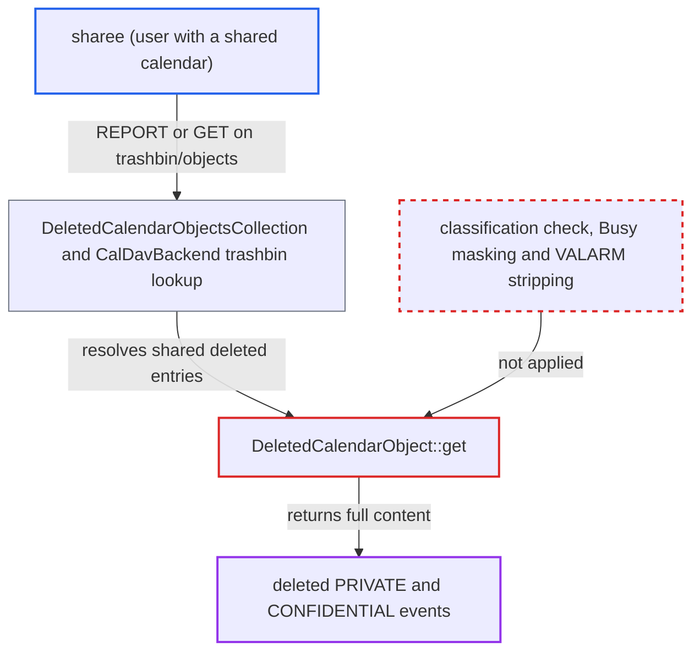

# Calendar trashbin exposes private and confidential events of shared calendars to sharees

| Field | Value |
|---|---|
| ID | `find_01KgZ5jGq3BrZgHvJKP7aTTo` |
| Severity | **Low** |
| Status | open |
| CWE | CWE-285 — Improper Authorization |
| Created | 2026-10-27T21:20:04.341373Z |
| Claude Security | https://claude.ai/security/findings/find_01KgZ5jGq3BrZgHvJKP7aTTo |

## Description

A user who has a calendar shared with them can read the full content of the owner's PRIVATE and CONFIDENTIAL events after the owner deletes them. This works while the events are in the trashbin, which is 30 days by default. The trashbin read path (`collectDeletedCalendarObjectsForPrincipal`, `findDeletedCalendarObjectForPrincipal` and `DeletedCalendarObject::get`) skips the classification and share-access rules that the live calendar applies. The leak is limited to calendars already shared with the attacker.

1. **calendar owner** deletes a PRIVATE or CONFIDENTIAL event. `deleteCalendarObject()` soft-deletes the event unless retention is set to `0`, and the default retention is 30 days, so the event goes to the trashbin. ([`apps/dav/lib/CalDAV/CalDavBackend.php:1767-1817`](https://github.com/cx-benchmark/server/blob/6b6317280f8ed50277369c33cee070a643d29654/apps/dav/lib/CalDAV/CalDavBackend.php#L1767-L1817))
2. **sharee** sends a calendar-query REPORT or a GET to `calendars/<sharee>/trashbin/objects`. The sharee's own principal is granted `{DAV:}read` on the trashbin, so the request is allowed. A GET can target a single `<id>.ics`. ([`apps/dav/lib/CalDAV/Trashbin/DeletedCalendarObjectsCollection.php:44-116`](https://github.com/cx-benchmark/server/blob/6b6317280f8ed50277369c33cee070a643d29654/apps/dav/lib/CalDAV/Trashbin/DeletedCalendarObjectsCollection.php#L44-L116))
3. **backend `CalDavBackend`** lists and resolves the deleted objects of every calendar shared with the sharee. `collectDeletedCalendarObjectsForPrincipal()` applies no classification filter, and `findDeletedCalendarObjectForPrincipal()` attaches the full `calendardata` for the entry. ([`apps/dav/lib/CalDAV/CalDavBackend.php:1236-1258`](https://github.com/cx-benchmark/server/blob/6b6317280f8ed50277369c33cee070a643d29654/apps/dav/lib/CalDAV/CalDavBackend.php#L1236-L1258))
4. **node `DeletedCalendarObject`** returns the stored event body unchanged from `get()`. It does not hide PRIVATE events, does not mask CONFIDENTIAL events as `Busy`, and does not strip VALARMs, although the live calendar does all three for sharees. ([`apps/dav/lib/CalDAV/Trashbin/DeletedCalendarObject.php:78-81`](https://github.com/cx-benchmark/server/blob/6b6317280f8ed50277369c33cee070a643d29654/apps/dav/lib/CalDAV/Trashbin/DeletedCalendarObject.php#L78-L81))

## Assessment

The attacker is an authenticated user who has a calendar shared with them. The share can be direct, through a group or circle, or through a delegator's share. The owner only has to delete a PRIVATE or CONFIDENTIAL event, which is a routine action. The attacker then sends a calendar-query REPORT (Depth 1) or a GET to `/remote.php/dav/calendars/<self>/trashbin/objects[/<id>.ics]`. The `calendar-data` property in the REPORT also returns the content. The Calendar web app's trashbin view will also show the events.

Impact: A sharee can read the full content of events the owner marked PRIVATE, and of CONFIDENTIAL events when the sharee has read-only access. That includes summary, description, location, attendees and alarms. The leak is limited to calendars already shared with the attacker and to events deleted within the retention window. The report names no effect on integrity or availability.

## Recommendation

The trashbin read path (`collectDeletedCalendarObjectsForPrincipal`, `findDeletedCalendarObjectForPrincipal`, `DeletedCalendarObject::get`) ignores object classification and share access level. This breaks the confidentiality policy that the live calendar enforces.

Fix criteria: A sharee (direct, group or proxy-delegated) cannot list or fetch PRIVATE objects from the trashbin of a calendar they do not own. CONFIDENTIAL objects are returned masked as `Busy` with VALARMs stripped, exactly as `CalendarObject::get()` does for read-only or public access. To verify, delete a `CLASS:PRIVATE` event and a `CLASS:CONFIDENTIAL` event as the owner. Then confirm that the sharee's calendar-query REPORT on `trashbin/objects` and GET of `<id>.ics` no longer return the private object. For the confidential one they must return only masked data.

## Evidence

**https://github.com/cx-benchmark/server**

- [`apps/dav/lib/CalDAV/Trashbin/DeletedCalendarObject.php:78-81`](https://github.com/cx-benchmark/server/blob/6b6317280f8ed50277369c33cee070a643d29654/apps/dav/lib/CalDAV/Trashbin/DeletedCalendarObject.php#L78-L81)
- [`apps/dav/lib/CalDAV/CalDavBackend.php:1236-1258`](https://github.com/cx-benchmark/server/blob/6b6317280f8ed50277369c33cee070a643d29654/apps/dav/lib/CalDAV/CalDavBackend.php#L1236-L1258)
- [`apps/dav/lib/CalDAV/CalDavBackend.php:2785-2809`](https://github.com/cx-benchmark/server/blob/6b6317280f8ed50277369c33cee070a643d29654/apps/dav/lib/CalDAV/CalDavBackend.php#L2785-L2809)
- [`apps/dav/lib/CalDAV/Trashbin/DeletedCalendarObjectsCollection.php:44-116`](https://github.com/cx-benchmark/server/blob/6b6317280f8ed50277369c33cee070a643d29654/apps/dav/lib/CalDAV/Trashbin/DeletedCalendarObjectsCollection.php#L44-L116)
- [`apps/dav/lib/CalDAV/Calendar.php:291-346`](https://github.com/cx-benchmark/server/blob/6b6317280f8ed50277369c33cee070a643d29654/apps/dav/lib/CalDAV/Calendar.php#L291-L346)
- [`apps/dav/lib/CalDAV/CalendarObject.php:43-62`](https://github.com/cx-benchmark/server/blob/6b6317280f8ed50277369c33cee070a643d29654/apps/dav/lib/CalDAV/CalendarObject.php#L43-L62)
- [`apps/dav/lib/CalDAV/CalDavBackend.php:1767-1817`](https://github.com/cx-benchmark/server/blob/6b6317280f8ed50277369c33cee070a643d29654/apps/dav/lib/CalDAV/CalDavBackend.php#L1767-L1817)

