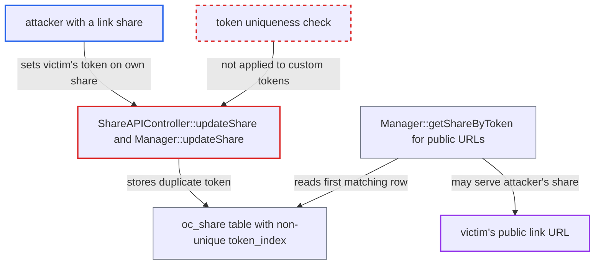

# Custom link-share token set without uniqueness check lets users hijack or squat other users' public links

| Field | Value |
|---|---|
| ID | `find_01C7frF2PHTJdLUMLu1Kh9Wg` |
| Severity | **Low** |
| Status | open |
| CWE | CWE-694 — Duplicate identifier |
| Created | 2026-10-27T21:27:05.593323Z |
| Claude Security | https://claude.ai/security/findings/find_01C7frF2PHTJdLUMLu1Kh9Wg |

## Description

A user who can create link shares can make another user's public link URL serve the attacker's own share instead. Visitors to the victim's URL get the attacker's content, and files they upload through it go to the attacker's folder. This needs custom share tokens enabled and a victim token the attacker knows or can guess. The cause is that `Manager::updateShare()` and `ShareAPIController::updateShare()` save a chosen `token` without checking that it is unused.

1. **attacker** learns or predicts the victim's link token. Public link tokens are exposed by nature, and a readable token the victim will pick can be guessed.
2. **attacker** sends a PUT to `/ocs/v2.php/apps/files_sharing/api/v1/shares/{ownId}` with `token` set to the victim's token. The handler `ShareAPIController::updateShare()` checks only that custom tokens are allowed and that `validateToken()` passes (1 to 32 characters of `[a-z0-9-]`), then calls `setToken()`. ([`apps/files_sharing/lib/Controller/ShareAPIController.php:1357-1365`](https://github.com/cx-benchmark/server/blob/6b6317280f8ed50277369c33cee070a643d29654/apps/files_sharing/lib/Controller/ShareAPIController.php#L1357-L1365))
3. **the manager `Manager::updateShare()`** passes the share to the provider without checking the token. It checks the password, Talk and expiration fields but never the token, and the uniqueness check in `generateToken()` is not run for custom tokens. ([`lib/private/Share20/Manager.php:711-763`](https://github.com/cx-benchmark/server/blob/6b6317280f8ed50277369c33cee070a643d29654/lib/private/Share20/Manager.php#L711-L763))
4. **the provider `DefaultShareProvider::update()`** writes the duplicate token into `oc_share`. The column has only the non-unique `token_index`, so the database accepts two rows with the same token. ([`lib/private/Share20/DefaultShareProvider.php:295-317`](https://github.com/cx-benchmark/server/blob/6b6317280f8ed50277369c33cee070a643d29654/lib/private/Share20/DefaultShareProvider.php#L295-L317))
5. **a visitor opening the victim's public URL** is served whichever share row `DefaultShareProvider::getShareByToken()` returns first. The query has no `ORDER BY`, so row order decides, for example the lower id when the engine reads `token_index` in primary-key order as InnoDB does. ([`lib/private/Share20/DefaultShareProvider.php:1094-1117`](https://github.com/cx-benchmark/server/blob/6b6317280f8ed50277369c33cee070a643d29654/lib/private/Share20/DefaultShareProvider.php#L1094-L1117))

## Assessment

The attacker is any user allowed to create link shares, on an instance where custom tokens are enabled. The setting `shareapi_allow_custom_tokens` defaults to `true` for the `FAMILY` and `PRIVATE` presets and is an admin toggle otherwise. The attacker needs the victim's token or a good guess of it. Whether the attacker's row wins depends on row order. Every public entry point resolves tokens through `Manager::getShareByToken()`: `/s/{token}`, public previews and public DAV. A link share also shadows a mail or federated share with the same token. If the first row is expired, `checkShare()` deletes it and throws instead of falling back to the other row.

Impact: The attacker controls what the instance serves under another user's public share URL. This allows content substitution or phishing, replaces the victim's password protection with the attacker's share settings, and sends files that visitors upload into the attacker's folder. The victim's link stops resolving to their share. Only links whose token the attacker knows or predicts are affected, and the victim's stored files are not read or changed.

## Recommendation

(1) `Manager::updateShare()` and its caller `ShareAPIController::updateShare()` save a caller-chosen token without checking that it is unused. This breaks the rule that a token identifies exactly one share, which `generateToken()` otherwise upholds.

Fix criteria: Changing a share's token to one already used by any share provider (link, mail, federated, circle, room) is refused, and the check sits in the manager so every caller is covered. To verify, set your own link share's token to another user's existing link token through the OCS update endpoint. The request must fail, and `/s/{token}` must still serve the original share.

(2) `oc_share.token` is indexed non-uniquely, so a missed or racing application-level check silently creates two shares with one token.

Fix criteria: The storage layer refuses a second share row carrying a token already in use, for token-bearing share types. To verify, run two concurrent token updates to the same value. At most one stored share may end up with that token.

## Evidence

**https://github.com/cx-benchmark/server**

- [`lib/private/Share20/Manager.php:711-763`](https://github.com/cx-benchmark/server/blob/6b6317280f8ed50277369c33cee070a643d29654/lib/private/Share20/Manager.php#L711-L763)
- [`apps/files_sharing/lib/Controller/ShareAPIController.php:1357-1365`](https://github.com/cx-benchmark/server/blob/6b6317280f8ed50277369c33cee070a643d29654/apps/files_sharing/lib/Controller/ShareAPIController.php#L1357-L1365)
- [`lib/private/Share20/DefaultShareProvider.php:295-317`](https://github.com/cx-benchmark/server/blob/6b6317280f8ed50277369c33cee070a643d29654/lib/private/Share20/DefaultShareProvider.php#L295-L317)
- [`core/Migrations/Version13000Date20170718121200.php:441-457`](https://github.com/cx-benchmark/server/blob/6b6317280f8ed50277369c33cee070a643d29654/core/Migrations/Version13000Date20170718121200.php#L441-L457)
- [`lib/private/Share20/DefaultShareProvider.php:1094-1117`](https://github.com/cx-benchmark/server/blob/6b6317280f8ed50277369c33cee070a643d29654/lib/private/Share20/DefaultShareProvider.php#L1094-L1117)
- [`lib/private/Share20/Manager.php:1341-1352`](https://github.com/cx-benchmark/server/blob/6b6317280f8ed50277369c33cee070a643d29654/lib/private/Share20/Manager.php#L1341-L1352)
- [`lib/private/Share20/Manager.php:1913-1951`](https://github.com/cx-benchmark/server/blob/6b6317280f8ed50277369c33cee070a643d29654/lib/private/Share20/Manager.php#L1913-L1951)
- [`core/AppInfo/ConfigLexicon.php:62-71`](https://github.com/cx-benchmark/server/blob/6b6317280f8ed50277369c33cee070a643d29654/core/AppInfo/ConfigLexicon.php#L62-L71)

