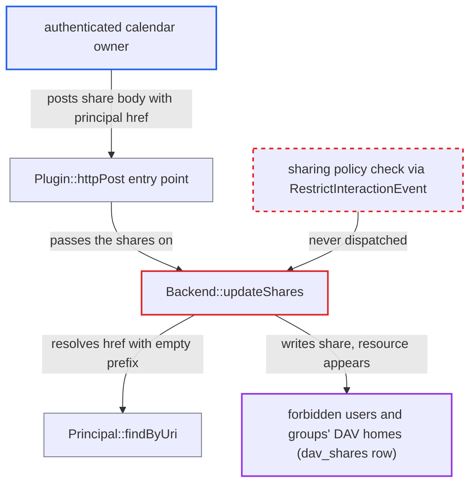

# DAV calendar and address book sharing bypasses admin sharing restrictions

| Field | Value |
|---|---|
| ID | `find_01MLpAKyTc2VW1FdeyDHVVVy` |
| Severity | **Low** |
| Status | open |
| CWE | CWE-863 — Improper Authorization |
| Created | 2026-10-27T21:22:45.336136Z |
| Claude Security | https://claude.ai/security/findings/find_01MLpAKyTc2VW1FdeyDHVVVy |

## Description

Any logged-in user who owns a calendar or address book can share it with users and groups the admin has forbidden, including groups they do not belong to. This only matters when an admin has turned on a sharing restriction. The DAV share code in `Backend::updateShares()` resolves the target with `Principal::findByUri()` and never applies the sharing policy, so the restriction is enforced only in the client.

1. **authenticated calendar owner** sends a share POST straight to the DAV endpoint. The body is an `{http://owncloud.org/ns}share` XML whose `href` is `principal:principals/groups/<gid>` or `principal:principals/users/<uid>`, so the client-side sharee search that honours the policy is never used. ([`apps/dav/lib/DAV/Sharing/Plugin.php:103-150`](https://github.com/cx-benchmark/server/blob/6b6317280f8ed50277369c33cee070a643d29654/apps/dav/lib/DAV/Sharing/Plugin.php#L103-L150))
2. **the handler `Plugin::httpPost()`** accepts the request after checking only the `{DAV:}write-acl` privilege. The owner of a non-birthday calendar holds that privilege, so the check passes for any user on their own calendar. ([`apps/dav/lib/CalDAV/Calendar.php:154-158`](https://github.com/cx-benchmark/server/blob/6b6317280f8ed50277369c33cee070a643d29654/apps/dav/lib/CalDAV/Calendar.php#L154-L158))
3. **the method `Backend::updateShares()`** resolves each client-supplied `href` with `findByUri($href, '')`. It passes the empty prefix `''`, so the `mailto:` branch that would apply `$restrictGroups` is skipped. ([`apps/dav/lib/DAV/Sharing/Backend.php:55-94`](https://github.com/cx-benchmark/server/blob/6b6317280f8ed50277369c33cee070a643d29654/apps/dav/lib/DAV/Sharing/Backend.php#L55-L94))
4. **the method `Principal::findByUri()`** returns the principal for any existing user or group. `allowGroupSharing()`, `sharingDisabledForUser()`, group membership and `hideFromCollaboration()` are never consulted. ([`apps/dav/lib/Connector/Sabre/Principal.php:435-482`](https://github.com/cx-benchmark/server/blob/6b6317280f8ed50277369c33cee070a643d29654/apps/dav/lib/Connector/Sabre/Principal.php#L435-L482))
5. **the method `Backend::updateShares()`** checks only `userExists` or `groupExists` and writes the `dav_shares` row. It never dispatches `RestrictInteractionEvent`, which is the check file sharing uses to refuse restricted shares. ([`apps/dav/lib/DAV/Sharing/Backend.php:55-94`](https://github.com/cx-benchmark/server/blob/6b6317280f8ed50277369c33cee070a643d29654/apps/dav/lib/DAV/Sharing/Backend.php#L55-L94))
6. **the method `CalDavBackend::getCalendarsForUser()`** adds the shared calendar to every target's DAV home. It takes every `dav_shares` row matching the user's principal or group memberships, and no acceptance step is needed. ([`apps/dav/lib/CalDAV/CalDavBackend.php:380-410`](https://github.com/cx-benchmark/server/blob/6b6317280f8ed50277369c33cee070a643d29654/apps/dav/lib/CalDAV/CalDavBackend.php#L380-L410))

## Assessment

The attacker is any authenticated user who owns a calendar or address book. The instance must have an admin-enabled restriction: only share with group members (with its exclude list), group sharing disabled, or the user placed in a sharing-excluded group. The attacker sends `POST /remote.php/dav/calendars/<self>/<cal>/` with `Content-Type: application/xml` and a share body that sets a `principal:principals/groups/<gid>` href. The same works for `principal:principals/users/<uid>`. No victim action is needed.

Impact: The attacker's calendars and address books, with attacker-chosen events, reminders and contacts, appear in the DAV homes of users and whole groups they are forbidden to share with. This breaks the separation between groups or tenants. Reading back the owner's `{http://owncloud.org/ns}invite` property shows whether a guessed uid or gid exists and its display name. The attacker gains no read access to the targets' own data.

## Recommendation

`Backend::updateShares()` creates `dav_shares` rows for any existing user or group principal without evaluating the instance sharing policy. It never dispatches `RestrictInteractionEvent`, and `Principal::findByUri()` applies group restrictions only to `mailto:` hrefs.

Fix criteria: Creating a calendar or address book share applies the same policy as file sharing. Users excluded from sharing cannot share. With group-members-only on, a user target must share a non-excluded group with the sharer. With group-members-only on, a group target must be a non-excluded group the sharer belongs to. Group targets are refused when group sharing is disabled. To verify, enable each restriction and send a share POST with `principal:principals/users/<outsider>` and `principal:principals/groups/<foreign-group>`. No `dav_shares` row may be created, and the target must not see the resource.

## Evidence

**https://github.com/cx-benchmark/server**

- [`apps/dav/lib/DAV/Sharing/Backend.php:55-94`](https://github.com/cx-benchmark/server/blob/6b6317280f8ed50277369c33cee070a643d29654/apps/dav/lib/DAV/Sharing/Backend.php#L55-L94)
- [`apps/dav/lib/Connector/Sabre/Principal.php:435-482`](https://github.com/cx-benchmark/server/blob/6b6317280f8ed50277369c33cee070a643d29654/apps/dav/lib/Connector/Sabre/Principal.php#L435-L482)
- [`apps/dav/lib/DAV/Sharing/Plugin.php:103-150`](https://github.com/cx-benchmark/server/blob/6b6317280f8ed50277369c33cee070a643d29654/apps/dav/lib/DAV/Sharing/Plugin.php#L103-L150)
- [`apps/dav/lib/CalDAV/Calendar.php:154-158`](https://github.com/cx-benchmark/server/blob/6b6317280f8ed50277369c33cee070a643d29654/apps/dav/lib/CalDAV/Calendar.php#L154-L158)
- [`core/Listener/RestrictInteractionListener.php:47-80`](https://github.com/cx-benchmark/server/blob/6b6317280f8ed50277369c33cee070a643d29654/core/Listener/RestrictInteractionListener.php#L47-L80)
- [`lib/private/Share20/Manager.php:251-274`](https://github.com/cx-benchmark/server/blob/6b6317280f8ed50277369c33cee070a643d29654/lib/private/Share20/Manager.php#L251-L274)
- [`apps/dav/lib/Command/MoveCalendar.php:154-165`](https://github.com/cx-benchmark/server/blob/6b6317280f8ed50277369c33cee070a643d29654/apps/dav/lib/Command/MoveCalendar.php#L154-L165)
- [`apps/dav/lib/CalDAV/CalDavBackend.php:380-410`](https://github.com/cx-benchmark/server/blob/6b6317280f8ed50277369c33cee070a643d29654/apps/dav/lib/CalDAV/CalDavBackend.php#L380-L410)
- [`apps/dav/lib/DAV/GroupPrincipalBackend.php:251-276`](https://github.com/cx-benchmark/server/blob/6b6317280f8ed50277369c33cee070a643d29654/apps/dav/lib/DAV/GroupPrincipalBackend.php#L251-L276)

