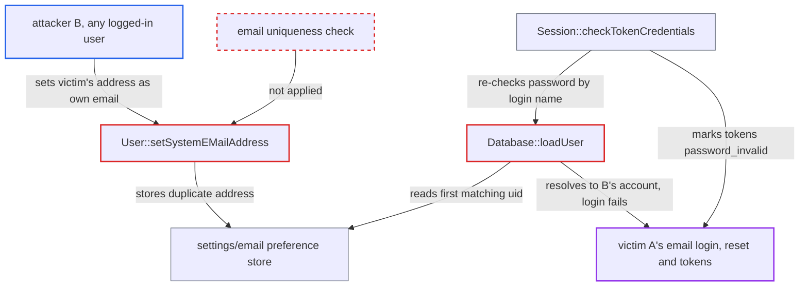

# Duplicate system email lets a user hijack another account's email login resolution and invalidate its tokens

| Field | Value |
|---|---|
| ID | `find_01N7mLmSQNScEifcmN9HWFKS` |
| Severity | **Low** |
| Status | open |
| CWE | CWE-694 — Duplicate identifier |
| Created | 2026-10-27T21:33:51.457265Z |
| Claude Security | https://claude.ai/security/findings/find_01N7mLmSQNScEifcmN9HWFKS |

## Description

A logged-in user can stop another user from logging in by email and can keep logging that user out. The attacker only has to set their own system email to the victim's address. The cause is `Database::loadUser()`, which resolves an email login name to the first account holding that address, and nothing keeps `settings/email` unique. The attacker cannot read or take over the victim's account.

1. **attacker B** sets their own system email to victim A's address. Self-edit of `email` is allowed by default, and `editUser` only applies `FILTER_VALIDATE_EMAIL`. ([`apps/provisioning_api/lib/Controller/UsersController.php:1464-1471`](https://github.com/cx-benchmark/server/blob/6b6317280f8ed50277369c33cee070a643d29654/apps/provisioning_api/lib/Controller/UsersController.php#L1464-L1471))
2. **`User::setSystemEMailAddress()`** stores the address in `settings/email`. It writes the lower-cased address without checking whether another account already uses it. ([`lib/private/User/User.php:151-170`](https://github.com/cx-benchmark/server/blob/6b6317280f8ed50277369c33cee070a643d29654/lib/private/User/User.php#L151-L170))
3. **`Database::loadUser()`** resolves A's email login name to the first uid returned for that address. The lookup has no ORDER BY, so the database's index order decides. On MySQL/MariaDB that is userid order. On PostgreSQL and SQLite it is roughly row-insertion order. ([`lib/private/User/Database.php:417-433`](https://github.com/cx-benchmark/server/blob/6b6317280f8ed50277369c33cee070a643d29654/lib/private/User/Database.php#L417-L433))
4. **`Database::checkPassword()`** checks A's password against B's hash. The password is verified against whichever account `loadUser()` resolved, so A's correct password fails. ([`lib/private/User/Database.php:360-374`](https://github.com/cx-benchmark/server/blob/6b6317280f8ed50277369c33cee070a643d29654/lib/private/User/Database.php#L360-L374))
5. **`Session::checkTokenCredentials()`** marks A's tokens as `password_invalid`. It re-checks each token at most every five minutes with the token's stored login name. Tokens created after an email login carry the email as their login name, so they now fail, and A's browser sessions and app passwords stop working. ([`lib/private/User/Session.php:712-760`](https://github.com/cx-benchmark/server/blob/6b6317280f8ed50277369c33cee070a643d29654/lib/private/User/Session.php#L712-L760))

## Assessment

The attacker is any authenticated low-privilege user on a default-configured instance who knows the victim's email address. They set it as their own system email in personal settings or with `PUT /ocs/v2.php/cloud/users/B` (`key=email`). The attack works only if the database returns the attacker's preference row first. On MySQL/MariaDB that happens when the attacker's uid sorts before the victim's. PostgreSQL and SQLite return rows roughly in insertion order. No victim action is needed. Besides the web login, the Basic-auth email fallback in `Session::logClientIn()` refuses once `getByEmail()` returns two users. Password reset by email in `LostController` also stops resolving.

Impact: The attacker can persistently block the victim's email-based login and password reset by email. They can also repeatedly log the victim out of browser sessions and desktop or mobile clients whose tokens carry the email login name. The attacker cannot read or take over the victim's account, because the password is always checked against the resolved account's own hash. The victim can still log in with their user ID, and the instance stays available to others.

## Recommendation

(1) `Database::loadUser()` resolves an email login name to the first of possibly several accounts with that `settings/email` value. A non-unique, user-controlled attribute is therefore used as an account identifier.

Fix criteria: When more than one account carries the given email, the backend resolves the login name to none of them and treats it as not found or ambiguous. `checkPassword`, `userExists`, `getRealUID` and `getUserNameFromLoginName` behave consistently. With two accounts sharing an email, neither password check resolves to the other account. The victim's tokens are no longer marked invalid by `checkTokenCredentials`.

(2) `User::setSystemEMailAddress()` and the self-service email editors accept an address that another account already uses, without verification.

Fix criteria: A system email already assigned to a different account is rejected, or it needs verification before it becomes a login identifier. A user who tries to set another user's email gets an error. The other user's email login keeps working.

(3) `Session::checkTokenCredentials()` re-verifies token passwords with the token's stored login name. That name may be an alias that later resolves to a different account.

Fix criteria: Re-verification is bound to the token's UID. For example, it checks the password against `$dbToken->getUID()`, or it confirms the resolved user equals the token's UID before trusting a failure. A colliding email no longer causes `markPasswordInvalid` on the victim's tokens.

## Evidence

**https://github.com/cx-benchmark/server**

- [`lib/private/User/Database.php:417-433`](https://github.com/cx-benchmark/server/blob/6b6317280f8ed50277369c33cee070a643d29654/lib/private/User/Database.php#L417-L433)
- [`lib/private/Config/UserConfig.php:515-566`](https://github.com/cx-benchmark/server/blob/6b6317280f8ed50277369c33cee070a643d29654/lib/private/Config/UserConfig.php#L515-L566)
- [`lib/private/User/Database.php:360-374`](https://github.com/cx-benchmark/server/blob/6b6317280f8ed50277369c33cee070a643d29654/lib/private/User/Database.php#L360-L374)
- [`lib/private/User/Session.php:712-760`](https://github.com/cx-benchmark/server/blob/6b6317280f8ed50277369c33cee070a643d29654/lib/private/User/Session.php#L712-L760)
- [`apps/provisioning_api/lib/Controller/UsersController.php:1464-1471`](https://github.com/cx-benchmark/server/blob/6b6317280f8ed50277369c33cee070a643d29654/apps/provisioning_api/lib/Controller/UsersController.php#L1464-L1471)
- [`lib/private/User/User.php:151-170`](https://github.com/cx-benchmark/server/blob/6b6317280f8ed50277369c33cee070a643d29654/lib/private/User/User.php#L151-L170)
- [`lib/private/User/Session.php:438-460`](https://github.com/cx-benchmark/server/blob/6b6317280f8ed50277369c33cee070a643d29654/lib/private/User/Session.php#L438-L460)

