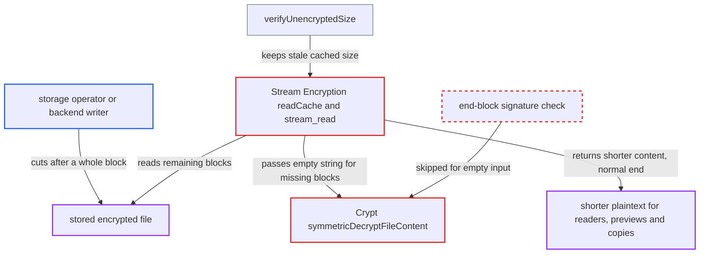

# Encrypted file truncated at a block boundary reads as a shorter file with no integrity error

| Field | Value |
|---|---|
| ID | `find_013wapkK1Eum35SCXk3sKA29` |
| Severity | **Low** |
| Status | open |
| CWE | CWE-354 — Improper Validation of Integrity Check Value |
| Created | 2026-10-27T21:30:24.550537Z |
| Claude Security | https://claude.ai/security/findings/find_013wapkK1Eum35SCXk3sKA29 |

## Description

Someone who controls the stored ciphertext can cut the end off an encrypted file, and Nextcloud then reads it as a shorter file with no integrity error. The attacker needs write access to the storage backend, such as an external-storage or object-store operator. Server-side encryption must also be enabled by an admin, and it is not on by default. The cause is that `readCache` and `symmetricDecryptFileContent` treat missing blocks as valid empty blocks and skip the signature check.

1. **storage-side attacker** cuts the encrypted file after a whole 8192-byte ciphertext block. The blocks that remain keep their positions and file version, so their signatures still verify.
2. **a reader of the file** opens it through the encryption wrapper, for example by download, preview, editor or copy. `verifyUnencryptedSize` recalculates the size only when the cached size looks implausible, and removing trailing blocks leaves it below the physical size, so the stale cached size stays. ([`lib/private/Files/Storage/Wrapper/Encryption.php:420-448`](https://github.com/cx-benchmark/server/blob/6b6317280f8ed50277369c33cee070a643d29654/lib/private/Files/Storage/Wrapper/Encryption.php#L420-L448))
3. **`readCache` in `Stream\Encryption`** takes the block count and the `end` marker from the cached `unencryptedSize` and asks for blocks that no longer exist. It never checks that `stream_read_block()` returned data, so at the early end of the file it passes `''` to `decrypt()`. ([`lib/private/Files/Stream/Encryption.php:459-472`](https://github.com/cx-benchmark/server/blob/6b6317280f8ed50277369c33cee070a643d29654/lib/private/Files/Stream/Encryption.php#L459-L472))
4. **`symmetricDecryptFileContent`** returns `''` for the empty input. The early return comes before `splitMetaData`, `hasSignature` and `checkSignature`, so the missing `end`-signed block is never checked. ([`apps/encryption/lib/Crypto/Crypt.php:443-475`](https://github.com/cx-benchmark/server/blob/6b6317280f8ed50277369c33cee070a643d29654/apps/encryption/lib/Crypto/Crypt.php#L443-L475))
5. **`stream_read`** advances `position` up to the cached size and then reports a normal end of file. The consumer gets a well-formed shorter plaintext and no exception. ([`lib/private/Files/Stream/Encryption.php:258-281`](https://github.com/cx-benchmark/server/blob/6b6317280f8ed50277369c33cee070a643d29654/lib/private/Files/Stream/Encryption.php#L258-L281))
6. **cross-storage copy or move** reads the truncated content and writes it as a new encrypted file. The new file is re-encrypted and freshly signed, so the cut becomes a valid file. ([`lib/private/Files/Storage/Wrapper/Encryption.php:740-750`](https://github.com/cx-benchmark/server/blob/6b6317280f8ed50277369c33cee070a643d29654/lib/private/Files/Storage/Wrapper/Encryption.php#L740-L750))

## Assessment

The attacker controls the stored ciphertext but not Nextcloud itself. Examples are an external-storage or object-store operator, or anyone with write access to the backend. No Nextcloud account is needed. An admin must have enabled server-side encryption, which ships with Nextcloud but is not enabled by default. The attacker cuts an encrypted file after any whole 8192-byte ciphertext block. The next routine read through the encryption wrapper then returns the shorter content. Such reads include a download, a preview, an editor, an app, `file_get_contents`, or a copy or move.

Impact: Trailing content of a stored file can be removed without the HMAC integrity error the module promises. Removal works only in whole plaintext blocks, 8096 bytes in binary encoding or 6072 in legacy base64. No attacker-chosen content can be inserted. A direct WebDAV GET sends the stale size as Content-Length, so HTTP clients see a length mismatch. Confidentiality is not affected.

## Recommendation

(1) A block that the recorded file size says must exist but cannot be read is treated as a validly decrypted empty block. `symmetricDecryptFileContent` returns `''` for empty input before any signature check, and `readCache` never checks that a block was actually read.

Fix criteria: Reading an encrypted file raises an integrity error whenever a block implied by the recorded unencrypted size is missing or short. The last block actually present must verify with its `end` position. To check, truncate an encrypted file on storage at a block boundary. Reading it through the wrapper must then fail with a signature or integrity exception instead of returning shorter content. A copy or move of it must not produce a new valid file.

(2) `verifyUnencryptedSize` catches the signature failure raised by `fixUnencryptedSize` and carries on with the stale cached size, so the read continues instead of failing.

Fix criteria: A failed `end` signature check on the last block during size recalculation makes the file unreadable, or makes the read fail, and does not fall back to the old size. To check, confirm that a file whose last block fails its `end` signature cannot be opened for reading without an integrity error.

## Evidence

**https://github.com/cx-benchmark/server**

- [`apps/encryption/lib/Crypto/Crypt.php:443-475`](https://github.com/cx-benchmark/server/blob/6b6317280f8ed50277369c33cee070a643d29654/apps/encryption/lib/Crypto/Crypt.php#L443-L475)
- [`lib/private/Files/Stream/Encryption.php:459-472`](https://github.com/cx-benchmark/server/blob/6b6317280f8ed50277369c33cee070a643d29654/lib/private/Files/Stream/Encryption.php#L459-L472)
- [`lib/private/Files/Stream/Encryption.php:258-281`](https://github.com/cx-benchmark/server/blob/6b6317280f8ed50277369c33cee070a643d29654/lib/private/Files/Stream/Encryption.php#L258-L281)
- [`lib/private/Files/Stream/Encryption.php:402-452`](https://github.com/cx-benchmark/server/blob/6b6317280f8ed50277369c33cee070a643d29654/lib/private/Files/Stream/Encryption.php#L402-L452)
- [`lib/private/Files/Storage/Wrapper/Encryption.php:420-448`](https://github.com/cx-benchmark/server/blob/6b6317280f8ed50277369c33cee070a643d29654/lib/private/Files/Storage/Wrapper/Encryption.php#L420-L448)
- [`lib/private/Files/Storage/Wrapper/Encryption.php:740-750`](https://github.com/cx-benchmark/server/blob/6b6317280f8ed50277369c33cee070a643d29654/lib/private/Files/Storage/Wrapper/Encryption.php#L740-L750)
- [`apps/encryption/appinfo/info.xml:17-18`](https://github.com/cx-benchmark/server/blob/6b6317280f8ed50277369c33cee070a643d29654/apps/encryption/appinfo/info.xml#L17-L18)

