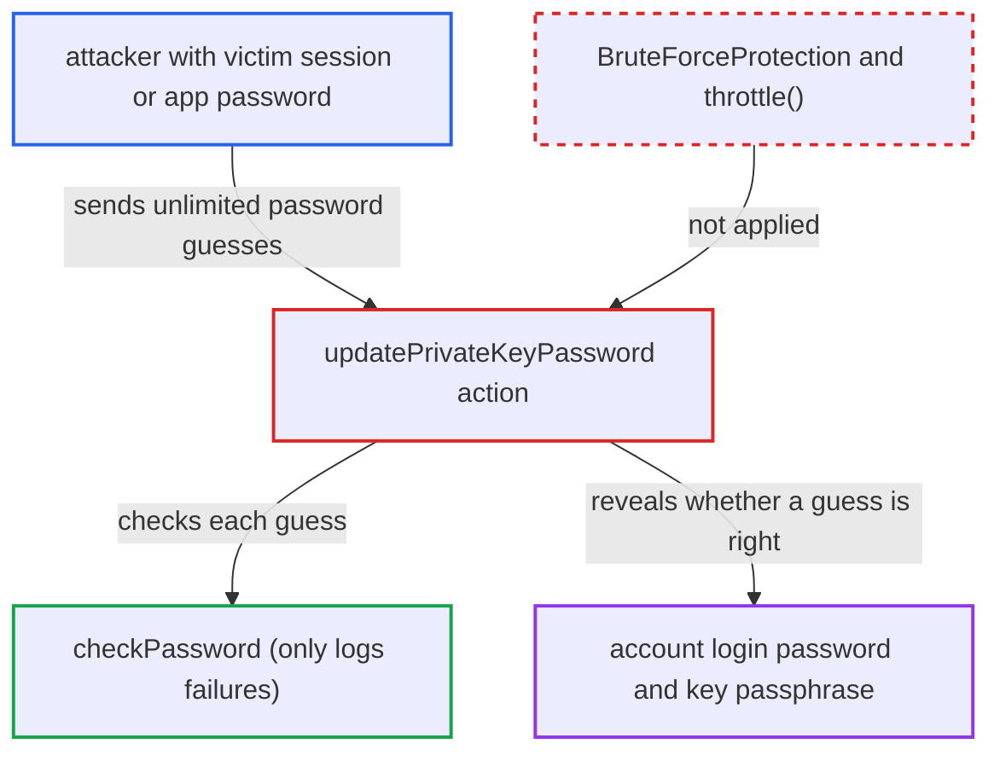

# Encryption private-key password endpoint is an unthrottled login-password oracle

| Field | Value |
|---|---|
| ID | `find_01Kh6MbVCDwBbatyb6yJpxdm` |
| Severity | **Low** |
| Status | open |
| CWE | CWE-307 — Improper Restriction of Excessive Authentication Attempts |
| Created | 2026-10-27T21:21:45.220836Z |
| Claude Security | https://claude.ai/security/findings/find_01Kh6MbVCDwBbatyb6yJpxdm |

## Description

Someone who holds a victim's logged-in session or app password, but not the login password, can guess that password without limit. The endpoint `updatePrivateKeyPassword` tells them at once whether a guess is right. It works only if an admin has enabled the `encryption` app, and it affects only the one account whose session or token is held. The action has no `#[BruteForceProtection]` attribute and never calls `throttle()`.

1. **attacker** obtains a victim's session or app password. This can be an unattended browser, script running in the origin, or a leaked device token. The attacker does not know the login password.
2. **attacker** POSTs candidate `newPassword` values to `/apps/encryption/ajax/updatePrivateKeyPassword`. With an app password the request needs Basic or Bearer auth and an `OCS-APIRequest` header, which passes the CSRF check. A browser session needs the CSRF token. ([`lib/private/AppFramework/Http/Request.php:436-438`](https://github.com/cx-benchmark/server/blob/6b6317280f8ed50277369c33cee070a643d29654/lib/private/AppFramework/Http/Request.php#L436-L438))
3. **the action `updatePrivateKeyPassword`** compares each guess with the account's login password. It calls `IUserManager::checkPassword` first by uid and then by the session `loginname`. It does this before any key lookup, so master-key mode is affected too. ([`apps/encryption/lib/Controller/SettingsController.php:56-76`](https://github.com/cx-benchmark/server/blob/6b6317280f8ed50277369c33cee070a643d29654/apps/encryption/lib/Controller/SettingsController.php#L56-L76))
4. **the action `updatePrivateKeyPassword`** answers with a different HTTP 400 message depending on the guess. A wrong login password gives `The current log-in password was not correct`. A right one with a wrong `oldPassword` gives `The old password was not correct`. ([`apps/encryption/lib/Controller/SettingsController.php:96-112`](https://github.com/cx-benchmark/server/blob/6b6317280f8ed50277369c33cee070a643d29654/apps/encryption/lib/Controller/SettingsController.php#L96-L112))
5. **`BruteForceMiddleware`** applies no delay or lockout. It only acts on methods with `BruteForceProtection` and on responses marked throttled. This endpoint has neither, and `checkPassword` only logs the failure. ([`lib/private/AppFramework/Middleware/Security/BruteForceMiddleware.php:49-104`](https://github.com/cx-benchmark/server/blob/6b6317280f8ed50277369c33cee070a643d29654/lib/private/AppFramework/Middleware/Security/BruteForceMiddleware.php#L49-L104))
6. **attacker** repeats guesses until the login password is found. Once the login password is known, the same endpoint can also be used to test the private-key passphrase.

## Assessment

The attacker has a victim's browser session (with the CSRF token) or one of the victim's app passwords, but not the login password. An app password works through Basic or Bearer auth plus an `OCS-APIRequest` header, with no browser session or CSRF token. An admin must have enabled the `encryption` app, which is not enabled by default. The attacker needs only low privileges, and the attack runs over the network.

Impact: The attacker recovers the account's cleartext login password at network speed, if it is guessable. A revocable session or token then becomes the full credential. They can pass throttled password-confirmation gates (`sudo`), create app passwords, change account settings, log in again after the token is revoked, and reuse the password elsewhere. The impact is limited to the one account whose session or token is held.

## Recommendation

`updatePrivateKeyPassword` re-checks the login password and the key passphrase but is not registered with the brute-force throttler. Wrong guesses are unlimited and each answer is distinguishable.

Fix criteria: Failed login-password and passphrase attempts on this action go through the brute-force throttler, as `changePersonalPassword` and `confirmPassword` do. Repeated wrong `newPassword` submissions from one client then meet growing delays and finally refusal. A successful check may reset the delay. To verify, send a series of wrong guesses and observe the throttle delay or a 429 response.

## Evidence

**https://github.com/cx-benchmark/server**

- [`apps/encryption/lib/Controller/SettingsController.php:56-76`](https://github.com/cx-benchmark/server/blob/6b6317280f8ed50277369c33cee070a643d29654/apps/encryption/lib/Controller/SettingsController.php#L56-L76)
- [`apps/encryption/lib/Controller/SettingsController.php:96-112`](https://github.com/cx-benchmark/server/blob/6b6317280f8ed50277369c33cee070a643d29654/apps/encryption/lib/Controller/SettingsController.php#L96-L112)
- [`lib/private/AppFramework/Middleware/Security/BruteForceMiddleware.php:49-104`](https://github.com/cx-benchmark/server/blob/6b6317280f8ed50277369c33cee070a643d29654/lib/private/AppFramework/Middleware/Security/BruteForceMiddleware.php#L49-L104)
- [`lib/private/User/Manager.php:228-237`](https://github.com/cx-benchmark/server/blob/6b6317280f8ed50277369c33cee070a643d29654/lib/private/User/Manager.php#L228-L237)
- [`apps/settings/lib/Controller/ChangePasswordController.php:47-59`](https://github.com/cx-benchmark/server/blob/6b6317280f8ed50277369c33cee070a643d29654/apps/settings/lib/Controller/ChangePasswordController.php#L47-L59)
- [`lib/private/AppFramework/Http/Request.php:436-438`](https://github.com/cx-benchmark/server/blob/6b6317280f8ed50277369c33cee070a643d29654/lib/private/AppFramework/Http/Request.php#L436-L438)
- [`core/shipped.json:61-108`](https://github.com/cx-benchmark/server/blob/6b6317280f8ed50277369c33cee070a643d29654/core/shipped.json#L61-L108)

