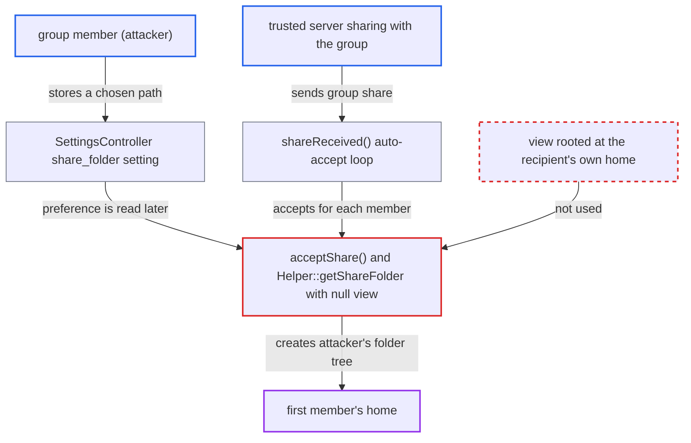

# Federated group auto-accept creates members' share folders in another member's home

| Field | Value |
|---|---|
| ID | `find_01HQZ9yobztP2bUbR6yUaFDG` |
| Severity | **Low** |
| Status | open |
| CWE | CWE-706 — Incorrect resource reference |
| Created | 2026-10-27T21:57:55.476399Z |
| Claude Security | https://claude.ai/security/findings/find_01HQZ9yobztP2bUbR6yUaFDG |

## Description

A local user in a group that receives federated group shares can make empty folders of their choosing appear in another group member's home, with no action by that member. They can also stop auto-accept and notifications for the later members of the group. It needs a trusted server to share with the group and the attacker not to be the first member by uid. The cause is `acceptShare()`, which creates the share folder through `Helper::getShareFolder(null, $user->getUID())` on the process-wide default view, not on the recipient's own view.

1. **Group member (attacker)** sets their own `share_folder` preference to a chosen path. `PUT /apps/files_sharing/settings/shareFolder` is open to any user, and the string is stored as given, for example `/Attacker/Chosen/Tree`. ([`apps/files_sharing/lib/Controller/SettingsController.php:35-39`](https://github.com/cx-benchmark/server/blob/6b6317280f8ed50277369c33cee070a643d29654/apps/files_sharing/lib/Controller/SettingsController.php#L35-L39))
2. **User on a trusted server** shares a folder with the group through `POST /ocm/shares`. The attacker may own that account or may simply wait for a routine group share. ([`apps/federatedfilesharing/lib/OCM/CloudFederationProviderFiles.php:226-252`](https://github.com/cx-benchmark/server/blob/6b6317280f8ed50277369c33cee070a643d29654/apps/federatedfilesharing/lib/OCM/CloudFederationProviderFiles.php#L226-L252))
3. **the handler `shareReceived()`** auto-accepts the share by calling `acceptShare()` for every group member in one request. Auto-accept is on by default (`yes`), and the loop runs over `$group->getUsers()`. ([`apps/federatedfilesharing/lib/OCM/CloudFederationProviderFiles.php:226-252`](https://github.com/cx-benchmark/server/blob/6b6317280f8ed50277369c33cee070a643d29654/apps/federatedfilesharing/lib/OCM/CloudFederationProviderFiles.php#L226-L252))
4. **the method `acceptShare()`** asks for the recipient's share folder with `Helper::getShareFolder(null, $user->getUID())`. It passes no view, although it has already set up the recipient's own home. ([`apps/files_sharing/lib/External/Manager.php:185-193`](https://github.com/cx-benchmark/server/blob/6b6317280f8ed50277369c33cee070a643d29654/apps/files_sharing/lib/External/Manager.php#L185-L193))
5. **the helper `Helper::getShareFolder`** reads the member's `share_folder` preference but checks and creates each path component on `Filesystem::getView()`. With a null view it uses the process-wide default view and runs `file_exists`, `is_dir` and `mkdir` on it. ([`apps/files_sharing/lib/Helper.php:52-83`](https://github.com/cx-benchmark/server/blob/6b6317280f8ed50277369c33cee070a643d29654/apps/files_sharing/lib/Helper.php#L52-L83))
6. **the setup code `SetupManager::oneTimeUserSetup()`** binds the default view to the first user set up in the request and never rebinds it. `Filesystem::initInternal()` returns early once `$defaultInstance` is set, so every later member's folders are created in the first member's home. ([`lib/private/Files/Filesystem.php:324-329`](https://github.com/cx-benchmark/server/blob/6b6317280f8ed50277369c33cee070a643d29654/lib/private/Files/Filesystem.php#L324-L329))
7. **the handler `shareReceived()`** returns a 500 and skips the remaining members if the folder is missing from the attacker's own home. `$folder->get()` throws `NotFoundException`, which is caught at line 246. Later members get no auto-accept and no notification. ([`apps/federatedfilesharing/lib/OCM/CloudFederationProviderFiles.php:226-252`](https://github.com/cx-benchmark/server/blob/6b6317280f8ed50277369c33cee070a643d29654/apps/federatedfilesharing/lib/OCM/CloudFederationProviderFiles.php#L226-L252))

## Assessment

The attacker is an ordinary local user in a group that receives federated group shares. They need no admin rights. They set their own `share_folder` through `PUT /apps/files_sharing/settings/shareFolder`. A trusted server must be configured, and a group share must arrive through `POST /ocm/shares`. The attacker must not be the first member by uid. The attacker may own the sharing account or wait for a routine share. Legitimate users with a custom share folder trigger the same misplacement by accident. By default, incoming group shares (`incoming_server2server_group_share_enabled`, default `no`) should be refused, but `shareReceived()` never checks that setting. Even if it did, the flaw still applies wherever an admin enables incoming group shares. The local-share path (`ShareTargetValidator.php:87`) passes the recipient's view and is not affected.

Impact: The attacker can create empty directory trees with names they choose inside another user's home, or inside writable mounts that user sees. That user does nothing to cause it. If the folder does not exist in the attacker's own home, auto-accept and notifications fail for every later group member. No file contents are read or changed.

## Recommendation

`acceptShare()` looks up and creates the recipient's share folder on the process-wide default view. In a request that sets up several users, that view belongs to the first user, so folders from one user's preference land in another user's home.

Fix criteria: Share-folder lookup and creation during federated accept run only on a view or node rooted at the recipient's own home. Test it by auto-accepting a trusted federated group share for a group of at least two members with different custom share folders. Each folder is created only in its owner's home. No folder appears in another member's home. Every member's share is accepted.

## Evidence

**https://github.com/cx-benchmark/server**

- [`apps/files_sharing/lib/External/Manager.php:185-193`](https://github.com/cx-benchmark/server/blob/6b6317280f8ed50277369c33cee070a643d29654/apps/files_sharing/lib/External/Manager.php#L185-L193)
- [`apps/files_sharing/lib/Helper.php:52-83`](https://github.com/cx-benchmark/server/blob/6b6317280f8ed50277369c33cee070a643d29654/apps/files_sharing/lib/Helper.php#L52-L83)
- [`lib/private/Files/SetupManager.php:309-341`](https://github.com/cx-benchmark/server/blob/6b6317280f8ed50277369c33cee070a643d29654/lib/private/Files/SetupManager.php#L309-L341)
- [`lib/private/Files/Filesystem.php:324-329`](https://github.com/cx-benchmark/server/blob/6b6317280f8ed50277369c33cee070a643d29654/lib/private/Files/Filesystem.php#L324-L329)
- [`apps/federatedfilesharing/lib/OCM/CloudFederationProviderFiles.php:226-252`](https://github.com/cx-benchmark/server/blob/6b6317280f8ed50277369c33cee070a643d29654/apps/federatedfilesharing/lib/OCM/CloudFederationProviderFiles.php#L226-L252)
- [`apps/files_sharing/lib/Controller/SettingsController.php:35-39`](https://github.com/cx-benchmark/server/blob/6b6317280f8ed50277369c33cee070a643d29654/apps/files_sharing/lib/Controller/SettingsController.php#L35-L39)

