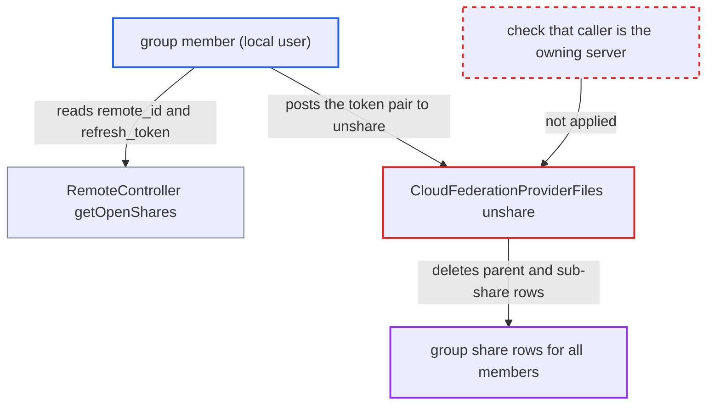

# Federated group share member can delete pending group share for all members via legacy unshare

| Field | Value |
|---|---|
| ID | `find_01EPdZKEGgrfkMWczLtMXfC7` |
| Severity | **Low** |
| Status | open |
| CWE | CWE-863 — Incorrect Authorization |
| Created | 2026-10-27T22:17:13.735722Z |
| Claude Security | https://claude.ai/security/findings/find_01EPdZKEGgrfkMWczLtMXfC7 |

## Description

A logged-in member of a local group that received a federated group share can delete that pending share for every member of the group. The owning server is not told. This works only before any member has accepted or declined. The cause is that `CloudFederationProviderFiles::unshare()` treats the `remote_id` and `refresh_token` pair as proof of being the share owner, although every group member can read that pair.

1. **group member** reads the share's `remote_id` and `refresh_token`. The pending group share is returned to every member, and its JSON includes both values. ([`apps/files_sharing/lib/Controller/RemoteController.php:61-66`](https://github.com/cx-benchmark/server/blob/6b6317280f8ed50277369c33cee070a643d29654/apps/files_sharing/lib/Controller/RemoteController.php#L61-L66))
2. **`ExternalShare::jsonSerialize()`** puts `remote_id` and `refresh_token` in the API response. These are the same values the server later accepts as proof of being the share owner. ([`apps/files_sharing/lib/External/ExternalShare.php:104-111`](https://github.com/cx-benchmark/server/blob/6b6317280f8ed50277369c33cee070a643d29654/apps/files_sharing/lib/External/ExternalShare.php#L104-L111))
3. **group member** posts the token to `POST /ocs/v2.php/cloud/shares/<remote_id>/unshare` on the local server. The route is `#[PublicPage]` and `#[NoCSRFRequired]` and checks no request signature, so the token pair is all it needs. ([`apps/federatedfilesharing/lib/Controller/RequestHandlerController.php:243-260`](https://github.com/cx-benchmark/server/blob/6b6317280f8ed50277369c33cee070a643d29654/apps/federatedfilesharing/lib/Controller/RequestHandlerController.php#L243-L260))
4. **`CloudFederationProviderFiles::unshare()`** looks up the share by `remote_id` and token, then calls `ExternalShareMapper::delete()`. Only the parent row exists at this point, so the lookup finds it. No check confirms that the caller is the owning server. ([`apps/federatedfilesharing/lib/OCM/CloudFederationProviderFiles.php:429-475`](https://github.com/cx-benchmark/server/blob/6b6317280f8ed50277369c33cee070a643d29654/apps/federatedfilesharing/lib/OCM/CloudFederationProviderFiles.php#L429-L475))
5. **`ExternalShareMapper::delete()`** deletes the parent row and every row whose `parent` is that id. The share disappears for the whole group, and the owning server still thinks it is active. ([`apps/files_sharing/lib/External/ExternalShareMapper.php:263-276`](https://github.com/cx-benchmark/server/blob/6b6317280f8ed50277369c33cee070a643d29654/apps/files_sharing/lib/External/ExternalShareMapper.php#L263-L276))

## Assessment

The attacker is an authenticated, low-privilege user on the receiving server. They must belong to a local group that received a federated group share from an owner on another server. The attack works only in the pending window, while no member has accepted or declined, so that only the parent row exists. The attacker calls `GET /ocs/v2.php/apps/files_sharing/api/v1/remote_shares/pending` to read the pair, then posts it to the local `/unshare` route. No other user needs to do anything.

Impact: The attacker removes the federated group share for all members of the group and denies them access to the shared resource. The owning server is not notified and cannot tell the share is gone. No data is disclosed. The damage is limited to that one group share's rows and its sub-shares.

## Recommendation

(1) `CloudFederationProviderFiles::unshare()` accepts the `refresh_token` and `remote_id` pair as proof that the caller is the owning server. Every recipient of a group share holds that pair, so a recipient can do an owner-only action that affects the other recipients.

Fix criteria: An unshare notification is honoured only when it demonstrably comes from the owning server. For example, it is an OCM signed request whose origin matches the stored `remote`, or it uses a secret that is never shown to recipients. The legacy unsigned `/unshare` route no longer deletes group parent rows on the token alone. Test: a group member posts the token pair to `/cloud/shares/{id}/unshare`, and the parent row and the other members' sub-shares remain. A genuine owner revocation still removes the share.

(2) `ExternalShareMapper::getShareByRemoteIdAndToken()` uses `findEntity`. It throws when the parent row and the sub-share rows share the same `remote_id` and `refresh_token`. The owner's legitimate unshare of a group share then silently fails once a member has accepted or declined.

Fix criteria: An owner-initiated unshare of a group share resolves deterministically to the parent row (`parent = -1`) and removes it together with its sub-shares. Test: after a member has accepted, a genuine owner unshare still removes the share for all members.

## Evidence

**https://github.com/cx-benchmark/server**

- [`apps/federatedfilesharing/lib/OCM/CloudFederationProviderFiles.php:429-475`](https://github.com/cx-benchmark/server/blob/6b6317280f8ed50277369c33cee070a643d29654/apps/federatedfilesharing/lib/OCM/CloudFederationProviderFiles.php#L429-L475)
- [`apps/federatedfilesharing/lib/Controller/RequestHandlerController.php:243-260`](https://github.com/cx-benchmark/server/blob/6b6317280f8ed50277369c33cee070a643d29654/apps/federatedfilesharing/lib/Controller/RequestHandlerController.php#L243-L260)
- [`apps/files_sharing/lib/External/ExternalShareMapper.php:263-276`](https://github.com/cx-benchmark/server/blob/6b6317280f8ed50277369c33cee070a643d29654/apps/files_sharing/lib/External/ExternalShareMapper.php#L263-L276)
- [`apps/files_sharing/lib/External/ExternalShare.php:104-111`](https://github.com/cx-benchmark/server/blob/6b6317280f8ed50277369c33cee070a643d29654/apps/files_sharing/lib/External/ExternalShare.php#L104-L111)
- [`apps/files_sharing/lib/External/Manager.php:142-178`](https://github.com/cx-benchmark/server/blob/6b6317280f8ed50277369c33cee070a643d29654/apps/files_sharing/lib/External/Manager.php#L142-L178)
- [`apps/files_sharing/lib/Controller/RemoteController.php:61-66`](https://github.com/cx-benchmark/server/blob/6b6317280f8ed50277369c33cee070a643d29654/apps/files_sharing/lib/Controller/RemoteController.php#L61-L66)

