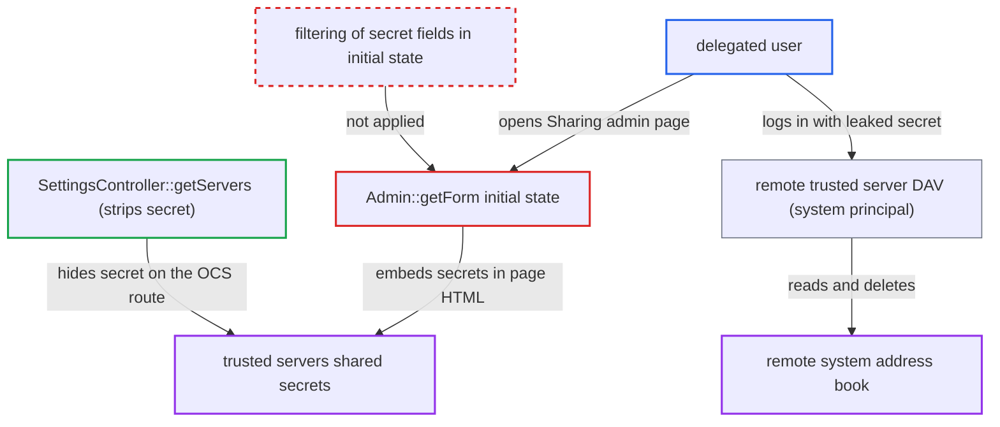

# Federation settings initial state leaks trusted-server shared secrets to delegated admins

| Field | Value |
|---|---|
| ID | `find_013KLf6feV4QEetm6ZuG3qQ1` |
| Severity | **Low** |
| Status | open |
| CWE | CWE-212 — Sensitive information exposure |
| Created | 2026-10-27T21:37:23.980091Z |
| Claude Security | https://claude.ai/security/findings/find_013KLf6feV4QEetm6ZuG3qQ1 |

## Description

A user in a group that an administrator has delegated the Trusted servers section to can read the shared secret of every trusted server. With a secret they can log in as this instance on each trusted remote server and read its system address book. The cause is `Admin::getForm()`, which puts the full `TrustedServers::getServers()` rows, secrets included, into the settings page.

1. **administrator** delegates the Trusted servers section to a group. `Admin` implements `IDelegatedSettings`, so `getAllowedAdminSettings()` returns the section for members of that group. ([`lib/private/Settings/Manager.php:324-341`](https://github.com/cx-benchmark/server/blob/6b6317280f8ed50277369c33cee070a643d29654/lib/private/Settings/Manager.php#L324-L341))
2. **delegated user** opens the Sharing admin section at `/settings/admin/sharing`. `formatSettings()` calls `getForm()` for each setting the user is allowed to see, which sets the initial state. ([`apps/settings/lib/Controller/CommonSettingsTrait.php:121-124`](https://github.com/cx-benchmark/server/blob/6b6317280f8ed50277369c33cee070a643d29654/apps/settings/lib/Controller/CommonSettingsTrait.php#L121-L124))
3. **the form `Admin::getForm()`** puts the unfiltered trusted-server rows into the `federation`/`adminSettings` initial state. `getServers()` returns the `DbHandler::getAllServer()` rows unchanged, and that query selects `shared_secret` and `sync_token` for every trusted server. ([`apps/federation/lib/Settings/Admin.php:34-40`](https://github.com/cx-benchmark/server/blob/6b6317280f8ed50277369c33cee070a643d29654/apps/federation/lib/Settings/Admin.php#L34-L40))
4. **delegated user** decodes `initial-state-federation-adminSettings` from the page HTML. This gives the `shared_secret` of each trusted server, with no victim action needed. ([`apps/federation/lib/DbHandler.php:105-113`](https://github.com/cx-benchmark/server/blob/6b6317280f8ed50277369c33cee070a643d29654/apps/federation/lib/DbHandler.php#L105-L113))
5. **delegated user** sends `Authorization: Basic system:<secret>` to `remote.php/dav/addressbooks/system/system/system` on a trusted remote server. The peer stores the same secret, and `DbHandler::auth()` accepts it as `principals/system/system`. ([`apps/federation/lib/DbHandler.php:255-267`](https://github.com/cx-benchmark/server/blob/6b6317280f8ed50277369c33cee070a643d29654/apps/federation/lib/DbHandler.php#L255-L267))
6. **trusted remote server** treats the request as coming from a trusted peer. `SystemAddressbook::isFederation()` matches the secret against its trusted-server rows, so the attacker can read the system address book and delete system-owned address books. ([`apps/dav/lib/CardDAV/SystemAddressbook.php:264-344`](https://github.com/cx-benchmark/server/blob/6b6317280f8ed50277369c33cee070a643d29654/apps/dav/lib/CardDAV/SystemAddressbook.php#L264-L344))

## Assessment

An administrator must have delegated the Trusted servers section to a group that the attacker belongs to. At least one trusted server must have completed the secret exchange. The attacker needs no other action from a victim. They only load the Sharing admin page and read the embedded initial state.

Impact: The attacker gets the server-to-server secrets of all trusted servers. They can use them to act as this instance on each remote server, where the report says they can read its system address book (the federated-scope cards of all accounts). The principal cannot write card contents. On this instance the gain is limited, because a delegated user can already get the system principal by adding their own server as trusted. The secret is also a hidden system-principal credential that adds no visible trusted-server entry and survives removal of the delegation. `sync_token` is exposed too, but it is not a credential.

Subsequent-system impact: Each trusted remote Nextcloud stores the identical secret and accepts it, so the attacker acts as this instance on servers whose operators never authorised them. They can read the remote system address book directly. They can also delete its system-owned address books through `SystemAddressbook::delete()`, which disrupts its Accounts book and its own federation sync; this assumes sabre/dav 4.x ACL semantics. Card contents cannot be written directly.

## Recommendation

`Admin::getForm()` sends full `trusted_servers` rows, including `shared_secret` and `sync_token`, to the browser as initial state. The section can be delegated to non-admin groups, so those users receive server-to-server credentials.

Fix criteria: Everything the Trusted servers section sends to the client, initial state included, holds only the non-secret fields `id`, `url` and `status`, as `SettingsController::getServers()` does. Load `/settings/admin/sharing` as a delegated user and as an admin. No `shared_secret` or `sync_token` value may appear in the HTML or in any XHR response. Secrets that were already exposed can be rotated.

## Evidence

**https://github.com/cx-benchmark/server**

- [`apps/federation/lib/Settings/Admin.php:34-40`](https://github.com/cx-benchmark/server/blob/6b6317280f8ed50277369c33cee070a643d29654/apps/federation/lib/Settings/Admin.php#L34-L40)
- [`apps/federation/lib/TrustedServers.php:102-107`](https://github.com/cx-benchmark/server/blob/6b6317280f8ed50277369c33cee070a643d29654/apps/federation/lib/TrustedServers.php#L102-L107)
- [`apps/federation/lib/DbHandler.php:105-113`](https://github.com/cx-benchmark/server/blob/6b6317280f8ed50277369c33cee070a643d29654/apps/federation/lib/DbHandler.php#L105-L113)
- [`apps/federation/lib/Controller/SettingsController.php:93-109`](https://github.com/cx-benchmark/server/blob/6b6317280f8ed50277369c33cee070a643d29654/apps/federation/lib/Controller/SettingsController.php#L93-L109)
- [`lib/private/Settings/Manager.php:324-341`](https://github.com/cx-benchmark/server/blob/6b6317280f8ed50277369c33cee070a643d29654/lib/private/Settings/Manager.php#L324-L341)
- [`apps/settings/lib/Controller/CommonSettingsTrait.php:121-124`](https://github.com/cx-benchmark/server/blob/6b6317280f8ed50277369c33cee070a643d29654/apps/settings/lib/Controller/CommonSettingsTrait.php#L121-L124)
- [`apps/federation/lib/Controller/OCSAuthAPIController.php:156-162`](https://github.com/cx-benchmark/server/blob/6b6317280f8ed50277369c33cee070a643d29654/apps/federation/lib/Controller/OCSAuthAPIController.php#L156-L162)
- [`apps/federation/lib/DbHandler.php:255-267`](https://github.com/cx-benchmark/server/blob/6b6317280f8ed50277369c33cee070a643d29654/apps/federation/lib/DbHandler.php#L255-L267)
- [`apps/dav/lib/CardDAV/SystemAddressbook.php:264-344`](https://github.com/cx-benchmark/server/blob/6b6317280f8ed50277369c33cee070a643d29654/apps/dav/lib/CardDAV/SystemAddressbook.php#L264-L344)

