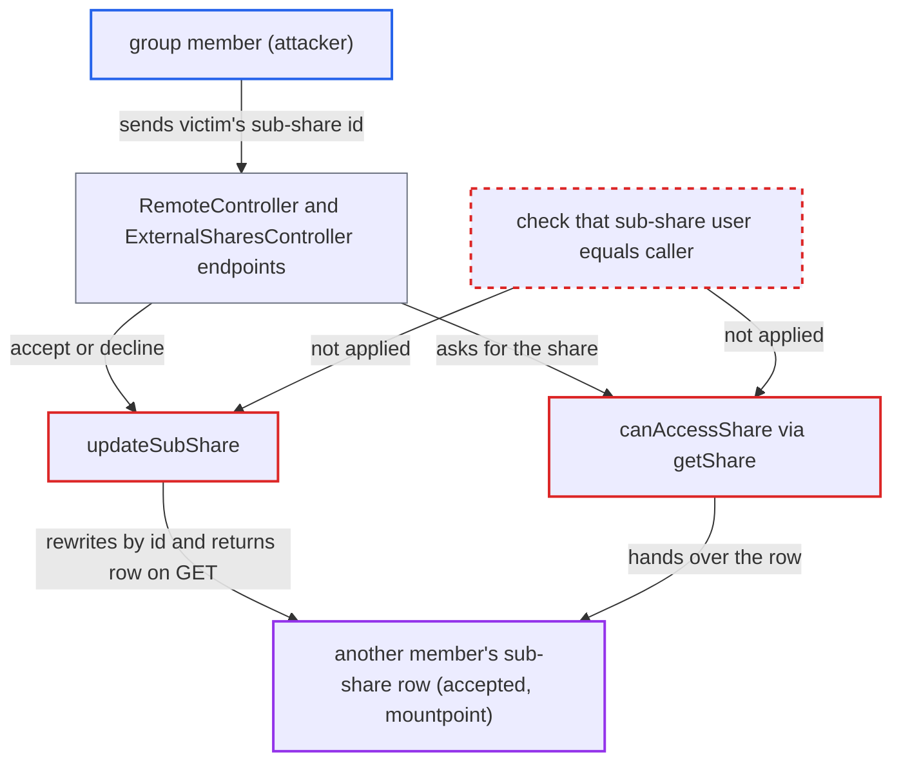

# Group member can accept, decline or read another member's federated group sub-share

| Field | Value |
|---|---|
| ID | `find_01H3UhQ341xzS5QxJJ2vgxjH` |
| Severity | **Low** |
| Status | open |
| CWE | CWE-639 — Insecure direct object reference |
| Created | 2026-10-27T21:36:13.259040Z |
| Claude Security | https://claude.ai/security/findings/find_01H3UhQ341xzS5QxJJ2vgxjH |

## Description

A logged-in member of a group that received a federated share can accept, decline or read another member's copy of that share. Accepting or declining mounts or unmounts the remote share in the victim's files. The attack needs the victim's sub-share id. `canAccessShare()` checks only group membership and never checks that the sub-share belongs to the caller.

1. **attacker (group member)** reads their own sub-share id from the list of remote shares. The row returned for the caller shows its `id` and `parent`, so the attacker learns the time base and server bits that the snowflake ids are built from. ([`apps/files_sharing/lib/External/ExternalShareMapper.php:169-211`](https://github.com/cx-benchmark/server/blob/6b6317280f8ed50277369c33cee070a643d29654/apps/files_sharing/lib/External/ExternalShareMapper.php#L169-L211))
2. **attacker** guesses ids close to their own and tests each with `GET /remote_shares/{id}`. With auto-accept at its default, one request creates every member's sub-share within milliseconds. Neighbouring ids are therefore likely, and a 200 response showing `user` set to the victim marks a hit. ([`apps/federatedfilesharing/lib/OCM/CloudFederationProviderFiles.php:226-242`](https://github.com/cx-benchmark/server/blob/6b6317280f8ed50277369c33cee070a643d29654/apps/federatedfilesharing/lib/OCM/CloudFederationProviderFiles.php#L226-L242))
3. **id generator `SnowflakeGenerator`** makes ids that can be enumerated. Only the millisecond and a small sequence counter vary within one second, so ids near a known one can be searched. ([`lib/private/Snowflake/SnowflakeGenerator.php:74-80`](https://github.com/cx-benchmark/server/blob/6b6317280f8ed50277369c33cee070a643d29654/lib/private/Snowflake/SnowflakeGenerator.php#L74-L80))
4. **the endpoints in `RemoteController` and `ExternalSharesController`** take the victim's id from the caller and pass it to `getShare()`. The accept and decline calls are `POST` and `DELETE` on `/remote_shares/pending/{id}` or on `/externalShares/{id}`. They need no admin rights, and the middleware only checks that federated sharing is enabled, which is the default. ([`apps/files_sharing/lib/Controller/RemoteController.php:77-177`](https://github.com/cx-benchmark/server/blob/6b6317280f8ed50277369c33cee070a643d29654/apps/files_sharing/lib/Controller/RemoteController.php#L77-L177))
5. **`canAccessShare()`** approves the victim's sub-share because the caller is in the parent's group. It loads the parent row and checks group membership at line 123. It never compares the sub-share's `user` with the caller. ([`apps/files_sharing/lib/External/Manager.php:101-129`](https://github.com/cx-benchmark/server/blob/6b6317280f8ed50277369c33cee070a643d29654/apps/files_sharing/lib/External/Manager.php#L101-L129))
6. **`acceptShare()` or `declineShare()`** passes the victim's row to `updateSubShare()`. On accept, the mount point name is built from the attacker's own share folder. On decline, the row is set back to pending. Neither checks who owns the row. ([`apps/files_sharing/lib/External/Manager.php:185-257`](https://github.com/cx-benchmark/server/blob/6b6317280f8ed50277369c33cee070a643d29654/apps/files_sharing/lib/External/Manager.php#L185-L257))
7. **`updateSubShare()`** saves the victim's row with the changed `accepted` and `mountpoint` values. It uses the passed entity as is when `parent` is not `-1`, and `QBMapper::update()` matches on `id` only. ([`apps/files_sharing/lib/External/Manager.php:142-178`](https://github.com/cx-benchmark/server/blob/6b6317280f8ed50277369c33cee070a643d29654/apps/files_sharing/lib/External/Manager.php#L142-L178))

## Assessment

The attacker is an authenticated, low-privilege user in a group that has received a federated share. Another member of that group is the victim. The attacker finds the victim's sub-share id by trying ids near their own, because ids are time-ordered and not secret. The `GET /remote_shares/{id}` call separates valid ids from invalid ones. Ids sit close together when the auto-accept loop created them, which is the default (`federatedTrustedShareAutoAccept` is `yes`, for a group share from a trusted server). Otherwise the attacker can enumerate a window of ids. The attacker can use `POST` or `DELETE` on `/apps/files_sharing/api/externalShares/{id}` or on `/ocs/v2.php/apps/files_sharing/api/v1/remote_shares/pending/{id}`. `GET .../remote_shares/{id}` also works.

Impact: The attacker can mount a remote share into the victim's file tree, even one the victim declined or unshared, under a name picked against the attacker's folder. The attacker can also unmount a share the victim accepted. The attacker can read the victim's sub-share record (`user`, `mountpoint`, `accepted`). Only sub-shares of groups the attacker belongs to are affected, and file contents are neither read nor written directly.

## Recommendation

(1) `canAccessShare()` lets any member of the parent group reach every per-user sub-share of a federated group share, not only their own. `getShare()` therefore returns other users' rows to the read, accept and decline endpoints.

Fix criteria: `getShare()` returns a row with `parent !== '-1'` only when its `user` equals the caller's uid. `GET`, `POST` and `DELETE` on `/remote_shares/{id}`, `/remote_shares/pending/{id}` and `/externalShares/{id}` with another member's sub-share id return not found and leave that row unchanged. The caller's own sub-share and the parent id still work.

(2) `updateSubShare()` changes whatever sub-share entity it is given and saves it by id only, without checking that the row belongs to the acting user.

Fix criteria: Accept and decline only ever change the acting user's own sub-share. Either an entity whose `user` differs from the acting user is refused, or the caller's row is always looked up via the parent. No code path can change `accepted` or `mountpoint` on a row whose `user` is someone else.

## Evidence

**https://github.com/cx-benchmark/server**

- [`apps/files_sharing/lib/External/Manager.php:101-129`](https://github.com/cx-benchmark/server/blob/6b6317280f8ed50277369c33cee070a643d29654/apps/files_sharing/lib/External/Manager.php#L101-L129)
- [`apps/files_sharing/lib/External/Manager.php:142-178`](https://github.com/cx-benchmark/server/blob/6b6317280f8ed50277369c33cee070a643d29654/apps/files_sharing/lib/External/Manager.php#L142-L178)
- [`apps/files_sharing/lib/External/Manager.php:185-257`](https://github.com/cx-benchmark/server/blob/6b6317280f8ed50277369c33cee070a643d29654/apps/files_sharing/lib/External/Manager.php#L185-L257)
- [`apps/files_sharing/lib/Controller/RemoteController.php:77-177`](https://github.com/cx-benchmark/server/blob/6b6317280f8ed50277369c33cee070a643d29654/apps/files_sharing/lib/Controller/RemoteController.php#L77-L177)
- [`apps/files_sharing/lib/Controller/ExternalSharesController.php:57-77`](https://github.com/cx-benchmark/server/blob/6b6317280f8ed50277369c33cee070a643d29654/apps/files_sharing/lib/Controller/ExternalSharesController.php#L57-L77)
- [`apps/files_sharing/lib/External/ExternalShareMapper.php:169-211`](https://github.com/cx-benchmark/server/blob/6b6317280f8ed50277369c33cee070a643d29654/apps/files_sharing/lib/External/ExternalShareMapper.php#L169-L211)
- [`apps/federatedfilesharing/lib/OCM/CloudFederationProviderFiles.php:226-242`](https://github.com/cx-benchmark/server/blob/6b6317280f8ed50277369c33cee070a643d29654/apps/federatedfilesharing/lib/OCM/CloudFederationProviderFiles.php#L226-L242)
- [`lib/private/Snowflake/SnowflakeGenerator.php:74-80`](https://github.com/cx-benchmark/server/blob/6b6317280f8ed50277369c33cee070a643d29654/lib/private/Snowflake/SnowflakeGenerator.php#L74-L80)

