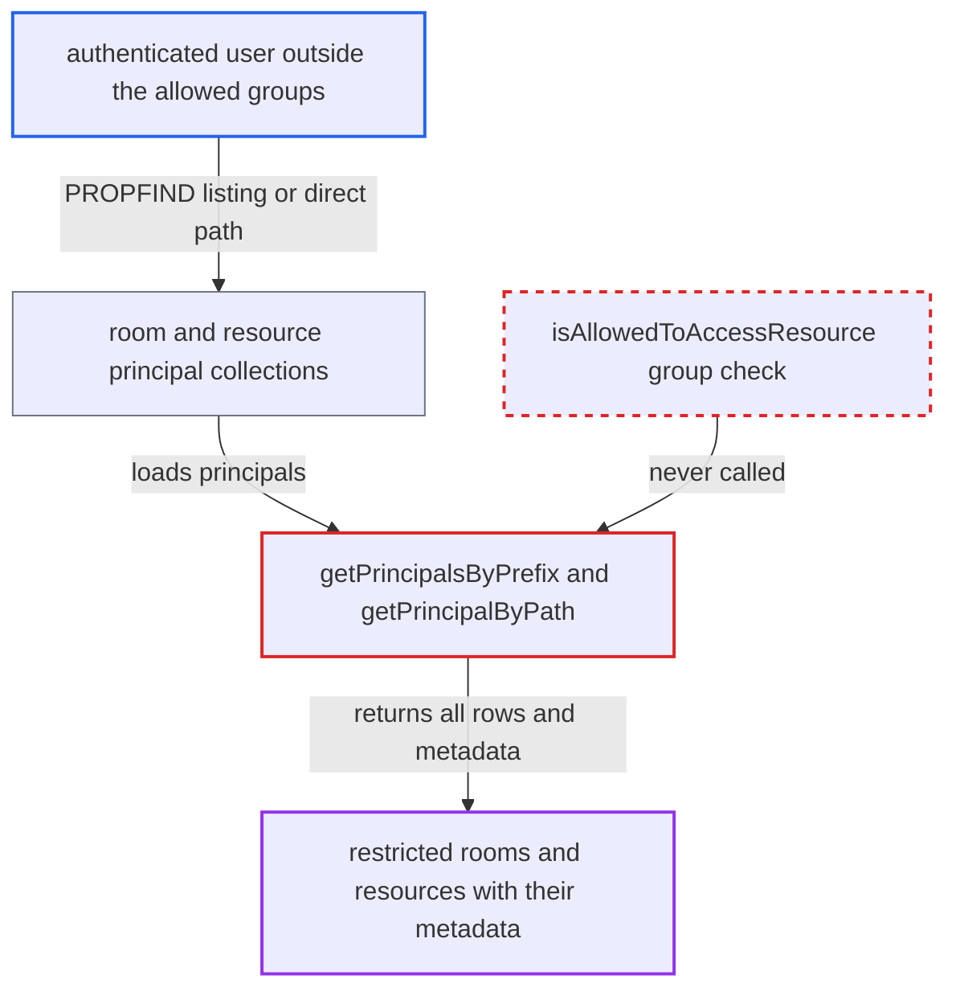

# Group-restricted rooms and resources enumerable via principal collection PROPFIND

| Field | Value |
|---|---|
| ID | `find_01Y9tFkk2EVHdzekNBauffvT` |
| Severity | **Low** |
| Status | open |
| CWE | CWE-200 — Information exposure |
| Created | 2026-10-27T21:32:43.466982Z |
| Claude Security | https://claude.ai/security/findings/find_01Y9tFkk2EVHdzekNBauffvT |

## Description

Any logged-in user can list rooms and resources that an admin restricted to certain groups. They get each one's URI, display name, e-mail address and metadata such as building address, capacity, features and vehicle details. This needs an admin to have set group restrictions, which is not the default. The cause is that `getPrincipalsByPrefix()` and `getPrincipalByPath()` never apply the group check `isAllowedToAccessResource()`.

1. **authenticated user** sends a PROPFIND with `Depth: 1` to `principals/calendar-rooms/` or `principals/calendar-resources/`. The user does not belong to the groups a room or resource is restricted to. `RootCollection` builds these two collections without `disableListing`, so the listing is allowed. ([`apps/dav/lib/RootCollection.php:93-100`](https://github.com/cx-benchmark/server/blob/6b6317280f8ed50277369c33cee070a643d29654/apps/dav/lib/RootCollection.php#L93-L100))
2. **the backend method `getPrincipalsByPrefix()`** returns every room or resource row with all metadata. It does not select `group_restrictions` and never calls the group check, so restricted principals are included. ([`apps/dav/lib/CalDAV/ResourceBooking/AbstractPrincipalBackend.php:70-105`](https://github.com/cx-benchmark/server/blob/6b6317280f8ed50277369c33cee070a643d29654/apps/dav/lib/CalDAV/ResourceBooking/AbstractPrincipalBackend.php#L70-L105))
3. **the child nodes `OCA\DAV\CalDAV\Principal\User`** grant read access to the caller. These nodes grant `{DAV:}read` to `{DAV:}authenticated`, so any logged-in user may read their properties. ([`apps/dav/lib/CalDAV/Principal/User.php:31-40`](https://github.com/cx-benchmark/server/blob/6b6317280f8ed50277369c33cee070a643d29654/apps/dav/lib/CalDAV/Principal/User.php#L31-L40))
4. **authenticated user** receives URI, display name, e-mail address and metadata of restricted rooms and resources. The same data is also returned for a direct PROPFIND on a guessed path such as `principals/calendar-rooms/<backend>-<id>`, because `getPrincipalByPath()` has no group check either. ([`apps/dav/lib/CalDAV/ResourceBooking/AbstractPrincipalBackend.php:121-150`](https://github.com/cx-benchmark/server/blob/6b6317280f8ed50277369c33cee070a643d29654/apps/dav/lib/CalDAV/ResourceBooking/AbstractPrincipalBackend.php#L121-L150))

## Assessment

The attacker is any authenticated user who is not in the groups a room or resource is restricted to. They send `PROPFIND /remote.php/dav/principals/calendar-rooms/` with `Depth: 1`, or the same on `principals/calendar-resources/`. The other route is a direct PROPFIND on a guessed principal path like `principals/calendar-rooms/<backend>-<id>`. The attack only yields data when an admin has configured group restrictions on some rooms or resources, which is not the default. The report notes that this relies on sabre/dav 4.x `AbstractPrincipalCollection` behaviour, and that the 3rdparty submodule was not in the checkout.

Impact: The attacker learns that restricted rooms and resources exist, and reads their names, e-mail addresses and metadata, which search deliberately hides from them. Booking them still fails, because `findByUri()` enforces the restriction, so there is no change to data and no loss of availability.

## Recommendation

The room and resource principal backend enforces `group_restrictions` only in search and lookup by URI. The listing in `getPrincipalsByPrefix()` and the direct lookup in `getPrincipalByPath()` return restricted principals and their metadata to any authenticated user.

Fix criteria: A user outside a room's or resource's allowed groups gets neither that principal nor its properties through any DAV path: collection listing, direct PROPFIND or principal-property-search. Group members and internal server-side scheduling still work. To check it, give a room a group restriction. As a non-member, confirm that `PROPFIND Depth: 1` on `principals/calendar-rooms/` omits it and that PROPFIND on its principal path returns 404. Confirm that a member still sees it.

## Evidence

**https://github.com/cx-benchmark/server**

- [`apps/dav/lib/CalDAV/ResourceBooking/AbstractPrincipalBackend.php:70-105`](https://github.com/cx-benchmark/server/blob/6b6317280f8ed50277369c33cee070a643d29654/apps/dav/lib/CalDAV/ResourceBooking/AbstractPrincipalBackend.php#L70-L105)
- [`apps/dav/lib/CalDAV/ResourceBooking/AbstractPrincipalBackend.php:121-150`](https://github.com/cx-benchmark/server/blob/6b6317280f8ed50277369c33cee070a643d29654/apps/dav/lib/CalDAV/ResourceBooking/AbstractPrincipalBackend.php#L121-L150)
- [`apps/dav/lib/RootCollection.php:93-100`](https://github.com/cx-benchmark/server/blob/6b6317280f8ed50277369c33cee070a643d29654/apps/dav/lib/RootCollection.php#L93-L100)
- [`apps/dav/lib/CalDAV/Principal/User.php:31-40`](https://github.com/cx-benchmark/server/blob/6b6317280f8ed50277369c33cee070a643d29654/apps/dav/lib/CalDAV/Principal/User.php#L31-L40)
- [`apps/dav/lib/CalDAV/ResourceBooking/AbstractPrincipalBackend.php:226-233`](https://github.com/cx-benchmark/server/blob/6b6317280f8ed50277369c33cee070a643d29654/apps/dav/lib/CalDAV/ResourceBooking/AbstractPrincipalBackend.php#L226-L233)
- [`apps/dav/lib/CalDAV/ResourceBooking/AbstractPrincipalBackend.php:478-499`](https://github.com/cx-benchmark/server/blob/6b6317280f8ed50277369c33cee070a643d29654/apps/dav/lib/CalDAV/ResourceBooking/AbstractPrincipalBackend.php#L478-L499)
- [`lib/public/Calendar/Room/IRoom.php:35-43`](https://github.com/cx-benchmark/server/blob/6b6317280f8ed50277369c33cee070a643d29654/lib/public/Calendar/Room/IRoom.php#L35-L43)

