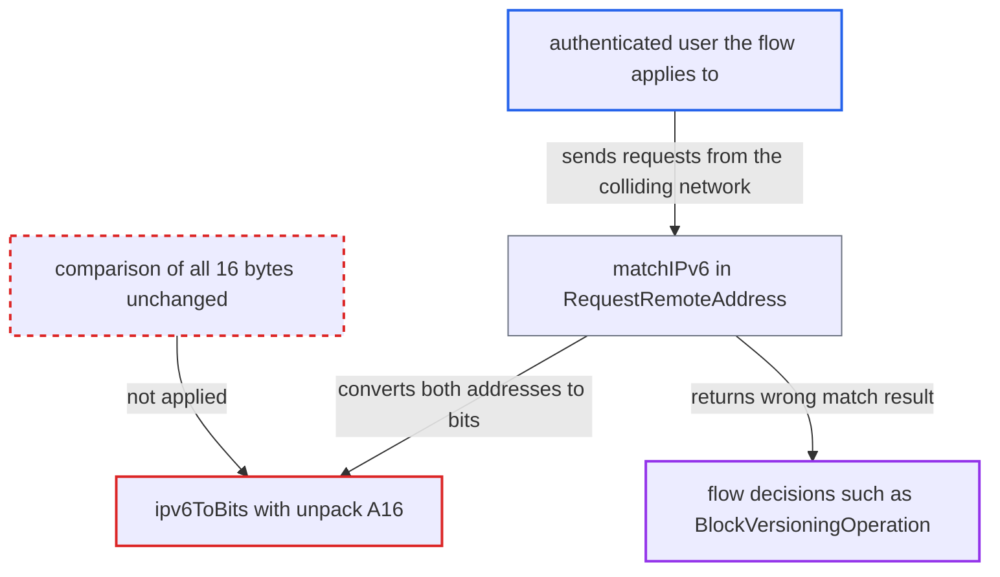

# IPv6 remote-address check drops trailing whitespace/NUL bytes, mis-matching configured ranges

| Field | Value |
|---|---|
| ID | `find_01CZ5YxgmfErVbvZsnLgxtCU` |
| Severity | **Low** |
| Status | open |
| CWE | CWE-697 — Incorrect Comparison |
| Created | 2026-10-27T21:29:04.577565Z |
| Claude Security | https://claude.ai/security/findings/find_01CZ5YxgmfErVbvZsnLgxtCU |

## Description

A logged-in user can make an IP-based workflow rule treat their request as inside or outside the configured IPv6 range, so the rule's action fires or is skipped against the admin's policy. This needs an admin-configured IPv6 condition whose range, or the attacker's own address, contains bytes 0x00, 0x20, 0x09, 0x0a or 0x0d at its end or in a trailing run. The cause is `ipv6ToBits()`, which uses `unpack('A16')` and strips those bytes before the comparison in `matchIPv6()`. The report does not trace any bypass beyond this.

1. **admin** configures a flow with an IPv6 condition. The condition uses a range that the byte stripping affects, for example `matchesIPv6 2001:db8::/48` or `2001:db8:abcd:20::/64`. ([`apps/workflowengine/lib/Check/RequestRemoteAddress.php:42-50`](https://github.com/cx-benchmark/server/blob/6b6317280f8ed50277369c33cee070a643d29654/apps/workflowengine/lib/Check/RequestRemoteAddress.php#L42-L50))
2. **attacker** sends ordinary requests from an address in the colliding network. An example is `2001:db8:20:2020:2020:2020:2020:2020` from the neighbouring /48, where the attacker chooses the interface identifier.
3. **the check `executeCheck()`** passes the client address and the configured range to `matchIPv6()`. The client address comes from `IRequest::getRemoteAddress()`, and the result is negated for `!matchesIPv6`. ([`apps/workflowengine/lib/Check/RequestRemoteAddress.php:42-50`](https://github.com/cx-benchmark/server/blob/6b6317280f8ed50277369c33cee070a643d29654/apps/workflowengine/lib/Check/RequestRemoteAddress.php#L42-L50))
4. **the function `ipv6ToBits()`** strips trailing 0x00, 0x20, 0x09, 0x0a and 0x0d bytes from the packed address. `unpack('A16', ...)` drops those bytes on PHP 8.3, and the bit string is then right-padded with `0` to 128, so those bytes become zero. ([`apps/workflowengine/lib/Check/RequestRemoteAddress.php:117-125`](https://github.com/cx-benchmark/server/blob/6b6317280f8ed50277369c33cee070a643d29654/apps/workflowengine/lib/Check/RequestRemoteAddress.php#L117-L125))
5. **the function `matchIPv6()`** compares the first `$bits` characters of the two altered bit strings. When stripped bytes lie inside the prefix, membership is decided for the wrong network. For example, `2001:db8:20::/48` is compared as `2001:db8::/48`. ([`apps/workflowengine/lib/Check/RequestRemoteAddress.php:102-112`](https://github.com/cx-benchmark/server/blob/6b6317280f8ed50277369c33cee070a643d29654/apps/workflowengine/lib/Check/RequestRemoteAddress.php#L102-L112))
6. **`RuleMatcher::check()`** returns the wrong boolean as the rule's condition result. Every flow that uses this check gets the wrong answer, so the operation fires or is skipped against policy. ([`apps/workflowengine/lib/Service/RuleMatcher.php:206-228`](https://github.com/cx-benchmark/server/blob/6b6317280f8ed50277369c33cee070a643d29654/apps/workflowengine/lib/Service/RuleMatcher.php#L206-L228))

## Assessment

An admin must have configured a flow whose IPv6 condition uses an affected range, for example `2001:db8::/48` or `2001:db8:abcd:20::/64`. The attacker needs an account the flow applies to. They also need a source address in the colliding network, with an interface identifier they can choose, such as `2020:2020:2020:2020`. Success depends on the configured range and on the attacker's network numbering. The check is a built-in one available to all flows. It is used by the `BlockVersioningOperation` of `files_versions` and, through the public `OCP\WorkflowEngine` API, by any operation an installed app registers, such as IP-conditioned file access-control flows. The check also does not verify that the client address is IPv6. An IPv4 client reaching `matchIPv6()` makes `unpack('A16')` fail on 4 bytes, which on PHP 8.3 degrades to an all-zero comparison. The report traced no bypass from this.

Impact: The attacker's request is judged as inside or outside the configured network when it is not. Version blocking in `BlockVersioningOperation` can be flipped, and IP-restricted flows registered by other apps can wrongly let the attacker through or wrongly deny legitimate users. Access stays within what the account's own file permissions allow apart from the IP condition.

## Recommendation

(1) `ipv6ToBits()` uses `unpack('A16')`, which drops trailing 0x00, 0x20, 0x09, 0x0a and 0x0d bytes of the packed address before zero padding. Both the client address and the configured range are therefore compared after a lossy change.

Fix criteria: The prefix comparison uses all 16 bytes returned by `inet_pton()` unchanged. `2001:db8:20:2020:2020:2020:2020:2020` does not match `2001:db8::/48`. `2001:db8:abcd::1234` does not match `2001:db8:abcd:20::/64`, while `2001:db8:abcd:20::1234` does. `2001:db8::a` does not match `2001:db8::/128`.

(2) `matchIPv6()` does not check that the client address parsed as a 16-byte IPv6 address before comparing. A client of another family or an unparsable address is compared as a degenerate bit string.

Fix criteria: A client address that is not IPv6 is never reported as inside an IPv6 range. The `!matchesIPv6` result is the exact negation of the `matchesIPv6` result. This is verified with an IPv4 client against `matchesIPv6 ::/1` style ranges.

## Evidence

**https://github.com/cx-benchmark/server**

- [`apps/workflowengine/lib/Check/RequestRemoteAddress.php:117-125`](https://github.com/cx-benchmark/server/blob/6b6317280f8ed50277369c33cee070a643d29654/apps/workflowengine/lib/Check/RequestRemoteAddress.php#L117-L125)
- [`apps/workflowengine/lib/Check/RequestRemoteAddress.php:102-112`](https://github.com/cx-benchmark/server/blob/6b6317280f8ed50277369c33cee070a643d29654/apps/workflowengine/lib/Check/RequestRemoteAddress.php#L102-L112)
- [`apps/workflowengine/lib/Check/RequestRemoteAddress.php:42-50`](https://github.com/cx-benchmark/server/blob/6b6317280f8ed50277369c33cee070a643d29654/apps/workflowengine/lib/Check/RequestRemoteAddress.php#L42-L50)
- [`apps/workflowengine/lib/Service/RuleMatcher.php:206-228`](https://github.com/cx-benchmark/server/blob/6b6317280f8ed50277369c33cee070a643d29654/apps/workflowengine/lib/Service/RuleMatcher.php#L206-L228)
- [`apps/files_versions/lib/BlockVersioningOperation.php:67-89`](https://github.com/cx-benchmark/server/blob/6b6317280f8ed50277369c33cee070a643d29654/apps/files_versions/lib/BlockVersioningOperation.php#L67-L89)
- [`apps/workflowengine/lib/Manager.php:916-929`](https://github.com/cx-benchmark/server/blob/6b6317280f8ed50277369c33cee070a643d29654/apps/workflowengine/lib/Manager.php#L916-L929)

