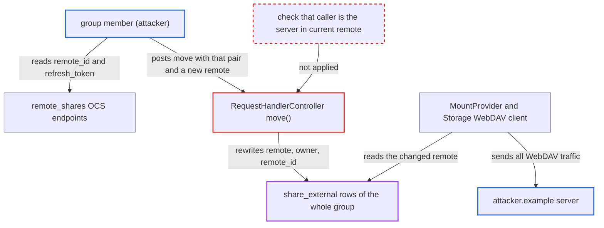

# Legacy federated share move endpoint lets any group member repoint all members' mounts

| Field | Value |
|---|---|
| ID | `find_01NsTFojW6HBXCp7ZV6oqxDU` |
| Severity | **Low** |
| Status | open |
| CWE | CWE-862 — Missing authorization |
| Created | 2026-10-27T21:48:03.966093Z |
| Claude Security | https://claude.ai/security/findings/find_01NsTFojW6HBXCp7ZV6oqxDU |

## Description

Any logged-in member of a local group that received a federated group share can point that share's mount, for every member of the group, at a server the attacker picks. The attacker needs only the share's `remote_id` and `refresh_token`, which the API gives to every member. The legacy `move()` handler in `RequestHandlerController` accepts that pair as proof of identity and never checks that the caller is the share's real remote server.

1. **the attacker (a group member)** reads the share's `remote_id` and `refresh_token` from the `remote_shares` API. `jsonSerialize()` includes both values in every `remote_shares` response, and the `#[NoAdminRequired]` endpoints return them to any logged-in member, including through `/pending`. ([`apps/files_sharing/lib/Controller/RemoteController.php:118-177`](https://github.com/cx-benchmark/server/blob/6b6317280f8ed50277369c33cee070a643d29654/apps/files_sharing/lib/Controller/RemoteController.php#L118-L177))
2. **the attacker** sends `POST /ocs/v2.php/cloud/shares/{id}/move` with the `token`, a `remote` such as `owner@attacker.example`, and optionally a new `remote_id`. The route is still registered and `move()` is `#[PublicPage]`/`#[NoCSRFRequired]`, so no login, signature, origin or rate-limit check applies. The only gate is `isS2SEnabled()`, which defaults to `yes`. ([`apps/federatedfilesharing/appinfo/routes.php:22`](https://github.com/cx-benchmark/server/blob/6b6317280f8ed50277369c33cee070a643d29654/apps/federatedfilesharing/appinfo/routes.php#L22))
3. **the handler `move()`** runs an UPDATE on `share_external` that sets `remote`, `owner` and `remote_id`. The UPDATE matches on `remote_id` and `refresh_token` only. It never checks that the caller is the server named in the row's current `remote`. ([`apps/federatedfilesharing/lib/Controller/RequestHandlerController.php:361-385`](https://github.com/cx-benchmark/server/blob/6b6317280f8ed50277369c33cee070a643d29654/apps/federatedfilesharing/lib/Controller/RequestHandlerController.php#L361-L385))
4. **`updateSubShare()`** has already copied the parent's `remote_id` and `refresh_token` into every member's sub-share. One pair therefore matches the parent row and all members' sub-shares, so one call rewrites them all. ([`apps/files_sharing/lib/External/Manager.php:142-166`](https://github.com/cx-benchmark/server/blob/6b6317280f8ed50277369c33cee070a643d29654/apps/files_sharing/lib/External/Manager.php#L142-L166))
5. **`MountProvider`** builds each member's mount from the stored `owner` and `remote`. The stored values now name the attacker's host. ([`apps/files_sharing/lib/External/MountProvider.php:47-78`](https://github.com/cx-benchmark/server/blob/6b6317280f8ed50277369c33cee070a643d29654/apps/files_sharing/lib/External/MountProvider.php#L47-L78))
6. **the storage class `External\\Storage`** sends WebDAV requests (PROPFIND, GET, PUT, MOVE) to the attacker's server. It takes the host from the stored remote and trusts that server's PROPFIND answer in `getPermissions()`. No victim action is needed. ([`apps/files_sharing/lib/External/Storage.php:93-150`](https://github.com/cx-benchmark/server/blob/6b6317280f8ed50277369c33cee070a643d29654/apps/files_sharing/lib/External/Storage.php#L93-L150))
7. **the real owner** cannot revoke the redirected share if the attacker also changed `remote_id`. `CloudFederationProviderFiles::unshare()` finds rows by `remote_id` plus token, so the owner's later `SHARE_UNSHARED` no longer matches. ([`apps/federatedfilesharing/lib/OCM/CloudFederationProviderFiles.php:474-494`](https://github.com/cx-benchmark/server/blob/6b6317280f8ed50277369c33cee070a643d29654/apps/federatedfilesharing/lib/OCM/CloudFederationProviderFiles.php#L474-L494))

## Assessment

The attacker is any authenticated user in a local group that received a federated group share, so such a share must already exist. They fetch `remote_id` and `refresh_token` from `GET /ocs/v2.php/apps/files_sharing/api/v1/remote_shares` or its `/pending` variant. They then call the `move` route. The effect shows on the next filesystem setup, with no action from the victims. A recipient of a user-type federated share can only redirect their own row. The route works because nothing in the repository sends a `move` notification any more, yet the route is still registered.

Impact: The attacker controls what every group member sees in that mount: listings, file content and claimed permissions. This holds even if the attacker only had read access. Files members later save into the mount go to the attacker's server. Members lose access to the real shared data, and the real owner can no longer revoke the share if `remote_id` was changed. The damage stays within the one federated share and its group, not the accounts or the server.

## Recommendation

`move()` treats `remote_id` and `refresh_token`, which every recipient can read, as proof that the caller is the owning remote server. It then rewrites `remote`, `owner` and `remote_id` on every matching row, so one group member can change the remote that other users' mounts trust.

Fix criteria: Only the server recorded in a row's current `remote` can change `remote`, `owner` or `remote_id`, for example through a verified OCM signature whose origin matches the stored remote. Alternatively the unused endpoint is removed. A local user who replays the request with a token and `remote_id` taken from `remote_shares` gets an error. No `share_external` row changes, and every member's mount still resolves to the original host.

## Evidence

**https://github.com/cx-benchmark/server**

- [`apps/federatedfilesharing/lib/Controller/RequestHandlerController.php:361-385`](https://github.com/cx-benchmark/server/blob/6b6317280f8ed50277369c33cee070a643d29654/apps/federatedfilesharing/lib/Controller/RequestHandlerController.php#L361-L385)
- [`apps/federatedfilesharing/appinfo/routes.php:22`](https://github.com/cx-benchmark/server/blob/6b6317280f8ed50277369c33cee070a643d29654/apps/federatedfilesharing/appinfo/routes.php#L22)
- [`apps/files_sharing/lib/External/ExternalShare.php:102-125`](https://github.com/cx-benchmark/server/blob/6b6317280f8ed50277369c33cee070a643d29654/apps/files_sharing/lib/External/ExternalShare.php#L102-L125)
- [`apps/files_sharing/lib/External/ExternalShareMapper.php:169-209`](https://github.com/cx-benchmark/server/blob/6b6317280f8ed50277369c33cee070a643d29654/apps/files_sharing/lib/External/ExternalShareMapper.php#L169-L209)
- [`apps/files_sharing/lib/Controller/RemoteController.php:118-177`](https://github.com/cx-benchmark/server/blob/6b6317280f8ed50277369c33cee070a643d29654/apps/files_sharing/lib/Controller/RemoteController.php#L118-L177)
- [`apps/files_sharing/lib/External/Manager.php:142-166`](https://github.com/cx-benchmark/server/blob/6b6317280f8ed50277369c33cee070a643d29654/apps/files_sharing/lib/External/Manager.php#L142-L166)
- [`apps/files_sharing/lib/External/MountProvider.php:47-78`](https://github.com/cx-benchmark/server/blob/6b6317280f8ed50277369c33cee070a643d29654/apps/files_sharing/lib/External/MountProvider.php#L47-L78)
- [`apps/files_sharing/lib/External/Storage.php:93-150`](https://github.com/cx-benchmark/server/blob/6b6317280f8ed50277369c33cee070a643d29654/apps/files_sharing/lib/External/Storage.php#L93-L150)
- [`apps/federatedfilesharing/lib/OCM/CloudFederationProviderFiles.php:474-494`](https://github.com/cx-benchmark/server/blob/6b6317280f8ed50277369c33cee070a643d29654/apps/federatedfilesharing/lib/OCM/CloudFederationProviderFiles.php#L474-L494)

