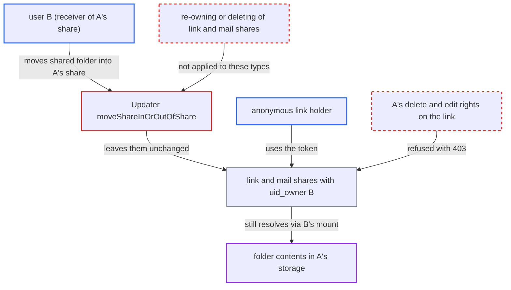

# Link and mail shares keep mover's ownership when shared folder moved into received share

| Field | Value |
|---|---|
| ID | `find_018daxdzHFx3aS8wv6fxVw87` |
| Severity | **Low** |
| Status | open |
| CWE | CWE-708 — Incorrect ownership assignment |
| Created | 2026-10-27T21:40:34.196334Z |
| Claude Security | https://claude.ai/security/findings/find_018daxdzHFx3aS8wv6fxVw87 |

## Description

A user who shares a folder by public link or mail can move it into a folder shared with them and keep control of those shares. The folder's real owner can then no longer delete or edit the link. If the owner's share forbids resharing, anonymous link holders still get listings and previews of that folder. The cause is `Updater::moveShareInOrOutOfShare()`, which only re-owns or deletes user, group and room shares.

1. **attacker (user B)** creates a public or mail share on their own folder. B has already received a folder from A with create permission. Share permission is also needed for the first consequence.
2. **attacker (user B)** moves the shared folder into A's received folder with a WebDAV MOVE. The move only needs create permission on the target and delete permission on the source.
3. **the hook handler `moveShareInOrOutOfShare()`** re-owns or deletes only user, group and room shares. It queries only `TYPE_USER`, `TYPE_GROUP` and `TYPE_ROOM` shares and skips every other type in its loop, so link and mail shares are left as they were. ([`apps/files_sharing/lib/Updater.php:67-136`](https://github.com/cx-benchmark/server/blob/6b6317280f8ed50277369c33cee070a643d29654/apps/files_sharing/lib/Updater.php#L67-L136))
4. **the share row** keeps `uid_owner = B` while the folder now sits in A's storage. `Share::getNode()` resolves the share through B's received mount, so the token still works. ([`lib/private/Share20/Share.php:135-162`](https://github.com/cx-benchmark/server/blob/6b6317280f8ed50277369c33cee070a643d29654/lib/private/Share20/Share.php#L135-L162))
5. **owner A** sees the link in the sharing sidebar but is refused when managing it. `canDeleteShare()` and `canEditShare()` accept only `uid_owner`, `uid_initiator` or owner-less mounts, so A gets a 403. ([`apps/files_sharing/lib/Controller/ShareAPIController.php:1595-1657`](https://github.com/cx-benchmark/server/blob/6b6317280f8ed50277369c33cee070a643d29654/apps/files_sharing/lib/Controller/ShareAPIController.php#L1595-L1657))
6. **anonymous link holder** requests previews and a listing of the folder. If A's share lacks `PERMISSION_SHARE`, `getPreview()` and `info()` do not check `isShareable()`, so they still serve content, including files added later. ([`apps/files_sharing/lib/Controller/PublicPreviewController.php:90-150`](https://github.com/cx-benchmark/server/blob/6b6317280f8ed50277369c33cee070a643d29654/apps/files_sharing/lib/Controller/PublicPreviewController.php#L90-L150))

## Assessment

The attacker is an ordinary user B who received a folder from A with create permission. For the owner-lockout consequence B also needs share permission on it. B creates a public link or mail share on their own folder, then moves it into A's folder. In the second consequence, A's share lacks `PERMISSION_SHARE` or resharing is disabled. B's user, group and room shares are then deleted, but the link and mail shares survive. The circle and deck shares are skipped too, as the FIXME at line 73 shows.

Impact: A loses control over a public link on A's own data. A cannot delete it, set a password or set an expiry. Where B has no reshare right, anonymous holders can still list and preview that one folder, including files added later. Writes are limited by the link's permissions masked by B's mount. The report notes no availability impact.

## Recommendation

`Updater::moveShareInOrOutOfShare()` re-owns or deletes only user, group and room shares when a node moves into or out of a received share. Link, mail (and circle/deck) shares keep the mover as `uid_owner`. They are not deleted when the receiving share forbids resharing.

Fix criteria: After any move into or out of a received share, every share of any type on the moved node and its subtree either has the new owner with permissions masked by the receiving share, or is deleted when the receiving share lacks share permission. Move a folder with a public link and a mail share into a received folder. The folder's owner must then be able to delete and edit both. With a receiving share that forbids resharing, both tokens must return 404 on every public endpoint, including preview and shareinfo.

## Evidence

**https://github.com/cx-benchmark/server**

- [`apps/files_sharing/lib/Updater.php:67-136`](https://github.com/cx-benchmark/server/blob/6b6317280f8ed50277369c33cee070a643d29654/apps/files_sharing/lib/Updater.php#L67-L136)
- [`apps/files_sharing/lib/Controller/ShareAPIController.php:1595-1657`](https://github.com/cx-benchmark/server/blob/6b6317280f8ed50277369c33cee070a643d29654/apps/files_sharing/lib/Controller/ShareAPIController.php#L1595-L1657)
- [`lib/private/Share20/DefaultShareProvider.php:737-755`](https://github.com/cx-benchmark/server/blob/6b6317280f8ed50277369c33cee070a643d29654/lib/private/Share20/DefaultShareProvider.php#L737-L755)
- [`lib/private/Share20/Share.php:135-162`](https://github.com/cx-benchmark/server/blob/6b6317280f8ed50277369c33cee070a643d29654/lib/private/Share20/Share.php#L135-L162)
- [`apps/files_sharing/lib/Controller/ShareController.php:266-268`](https://github.com/cx-benchmark/server/blob/6b6317280f8ed50277369c33cee070a643d29654/apps/files_sharing/lib/Controller/ShareController.php#L266-L268)
- [`apps/files_sharing/lib/Controller/PublicPreviewController.php:90-150`](https://github.com/cx-benchmark/server/blob/6b6317280f8ed50277369c33cee070a643d29654/apps/files_sharing/lib/Controller/PublicPreviewController.php#L90-L150)
- [`apps/files_sharing/lib/Controller/ShareInfoController.php:64-95`](https://github.com/cx-benchmark/server/blob/6b6317280f8ed50277369c33cee070a643d29654/apps/files_sharing/lib/Controller/ShareInfoController.php#L64-L95)
- [`lib/private/Share20/Manager.php:1454-1475`](https://github.com/cx-benchmark/server/blob/6b6317280f8ed50277369c33cee070a643d29654/lib/private/Share20/Manager.php#L1454-L1475)

