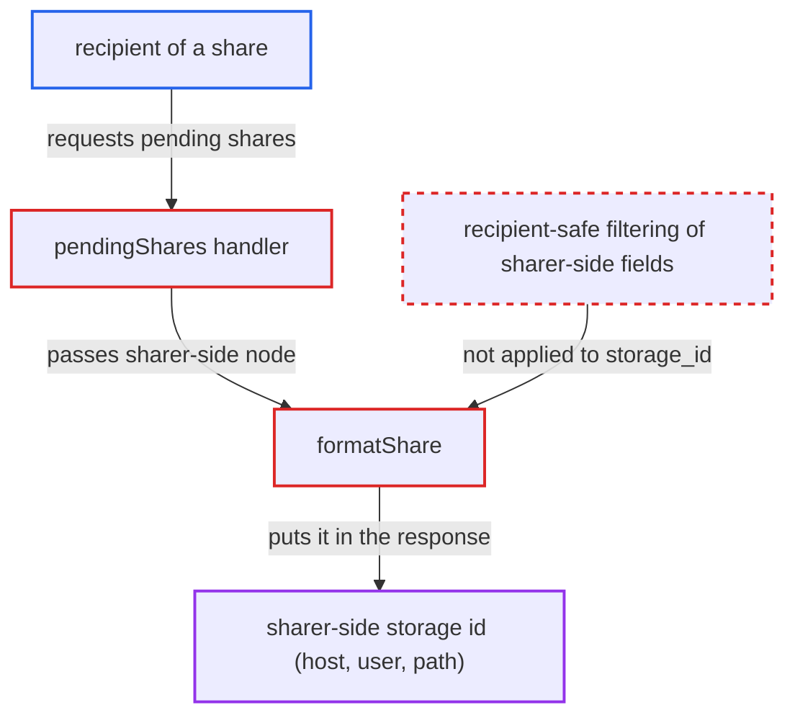

# Pending shares API discloses the sharer's backing storage id to recipients

| Field | Value |
|---|---|
| ID | `find_01SzVVi9xWd66ThQ1FTw4yH1` |
| Severity | **Low** |
| Status | open |
| CWE | CWE-497 — Information exposure |
| Created | 2026-10-27T22:02:06.580383Z |
| Claude Security | https://claude.ai/security/findings/find_01SzVVi9xWd66ThQ1FTw4yH1 |

## Description

A logged-in user who receives a share can read the sharer's backing storage id in the pending-shares response. For external storage this id can contain service usernames, hostnames, ports, share names and root paths, or a server filesystem path. The user only has to keep received shares pending, and the sharer must have shared an external-storage or re-shared item. The cause is `pendingShares()`, which formats the share from the sharer's node, so `formatShare()` emits `storage_id`.

1. **a sharer** shares an item that sits on an external-storage mount or a re-shared folder. The report says this condition is outside the recipient's control, and without it the leaked id holds nothing sensitive.
2. **the recipient** sets their own `default_accept` to `no`. Any user can change this setting for themselves, so every share they receive afterwards stays pending. ([`apps/files_sharing/lib/Controller/SettingsController.php:29-33`](https://github.com/cx-benchmark/server/blob/6b6317280f8ed50277369c33cee070a643d29654/apps/files_sharing/lib/Controller/SettingsController.php#L29-L33))
3. **`UserShareAcceptanceListener`** skips auto-accept for the new share. With `default_accept` set to `no`, the share stays in `STATUS_PENDING`. ([`apps/files_sharing/lib/Listener/UserShareAcceptanceListener.php:55-61`](https://github.com/cx-benchmark/server/blob/6b6317280f8ed50277369c33cee070a643d29654/apps/files_sharing/lib/Listener/UserShareAcceptanceListener.php#L55-L61))
4. **the recipient** calls `GET /ocs/v2.php/apps/files_sharing/api/v1/shares/pending`. The endpoint is marked `#[NoAdminRequired]` and returns every user and group share sent to the caller that is still pending or rejected. ([`apps/files_sharing/lib/Controller/ShareAPIController.php:1418-1435`](https://github.com/cx-benchmark/server/blob/6b6317280f8ed50277369c33cee070a643d29654/apps/files_sharing/lib/Controller/ShareAPIController.php#L1418-L1435))
5. **the handler `pendingShares()`** looks up the shared node in the sharer's user folder and passes it to `formatShare()`. A pending share is not mounted for the recipient, so the node comes from `getUserFolder($share->getSharedBy())`. Afterwards only `path` and `permissions` are overwritten. ([`apps/files_sharing/lib/Controller/ShareAPIController.php:1437-1451`](https://github.com/cx-benchmark/server/blob/6b6317280f8ed50277369c33cee070a643d29654/apps/files_sharing/lib/Controller/ShareAPIController.php#L1437-L1451))
6. **`formatShare()`** writes `storage_id`, `mount-type` and `file_parent` of the sharer-side node into the response. `storage_id` comes from `$node->getStorage()->getId()`, which for external storage embeds connection details such as `smb::<user>@<host>//<share>/<root>`. ([`apps/files_sharing/lib/Controller/ShareAPIController.php:215-225`](https://github.com/cx-benchmark/server/blob/6b6317280f8ed50277369c33cee070a643d29654/apps/files_sharing/lib/Controller/ShareAPIController.php#L215-L225))

## Assessment

The attacker is any authenticated user who receives a user or group share. They set `default_accept` to `no` with `PUT /apps/files_sharing/settings/defaultAccept`, so received shares stay pending. They then call `GET /ocs/v2.php/apps/files_sharing/api/v1/shares/pending`. The response is only sensitive if a sharer shares an item on an external-storage mount or a re-shared folder, which the attacker does not control.

Impact: The recipient learns configuration data they are not normally given. This covers external-storage hostnames, ports, service account usernames, share names and root paths, server filesystem paths for Local mounts, and the resharer's mount location. Passwords and file contents outside the share are not exposed, and nothing can be modified or disrupted.

## Recommendation

`pendingShares()` formats the share from a node resolved in the sharer's filesystem. `formatShare()` therefore puts the sharer-side `storage_id`, `mount-type` and `file_parent` into a response meant for the recipient.

Fix criteria: Entries returned by `GET /shares/pending` contain only recipient-safe information: no source storage id string, no sharer-side mount type and no sharer-side parent folder id. To verify, request `/shares/pending` as the recipient of a pending share whose item sits on an SMB, SFTP or Local external mount, and again for a pending re-share. Check that no backend user, host, path or resharer mount path appears in the response.

## Evidence

**https://github.com/cx-benchmark/server**

- [`apps/files_sharing/lib/Controller/ShareAPIController.php:1437-1451`](https://github.com/cx-benchmark/server/blob/6b6317280f8ed50277369c33cee070a643d29654/apps/files_sharing/lib/Controller/ShareAPIController.php#L1437-L1451)
- [`apps/files_sharing/lib/Controller/ShareAPIController.php:215-225`](https://github.com/cx-benchmark/server/blob/6b6317280f8ed50277369c33cee070a643d29654/apps/files_sharing/lib/Controller/ShareAPIController.php#L215-L225)
- [`apps/files_sharing/lib/Controller/ShareAPIController.php:1418-1435`](https://github.com/cx-benchmark/server/blob/6b6317280f8ed50277369c33cee070a643d29654/apps/files_sharing/lib/Controller/ShareAPIController.php#L1418-L1435)
- [`apps/files_sharing/lib/Controller/SettingsController.php:29-33`](https://github.com/cx-benchmark/server/blob/6b6317280f8ed50277369c33cee070a643d29654/apps/files_sharing/lib/Controller/SettingsController.php#L29-L33)
- [`apps/files_sharing/lib/Listener/UserShareAcceptanceListener.php:55-61`](https://github.com/cx-benchmark/server/blob/6b6317280f8ed50277369c33cee070a643d29654/apps/files_sharing/lib/Listener/UserShareAcceptanceListener.php#L55-L61)
- [`apps/files_external/lib/Lib/Storage/SMB.php:137-142`](https://github.com/cx-benchmark/server/blob/6b6317280f8ed50277369c33cee070a643d29654/apps/files_external/lib/Lib/Storage/SMB.php#L137-L142)
- [`apps/files_external/lib/Lib/Storage/SFTP.php:165-175`](https://github.com/cx-benchmark/server/blob/6b6317280f8ed50277369c33cee070a643d29654/apps/files_external/lib/Lib/Storage/SFTP.php#L165-L175)
- [`lib/private/Files/Storage/Local.php:84-86`](https://github.com/cx-benchmark/server/blob/6b6317280f8ed50277369c33cee070a643d29654/lib/private/Files/Storage/Local.php#L84-L86)
- [`apps/files_sharing/lib/SharedStorage.php:250-252`](https://github.com/cx-benchmark/server/blob/6b6317280f8ed50277369c33cee070a643d29654/apps/files_sharing/lib/SharedStorage.php#L250-L252)

