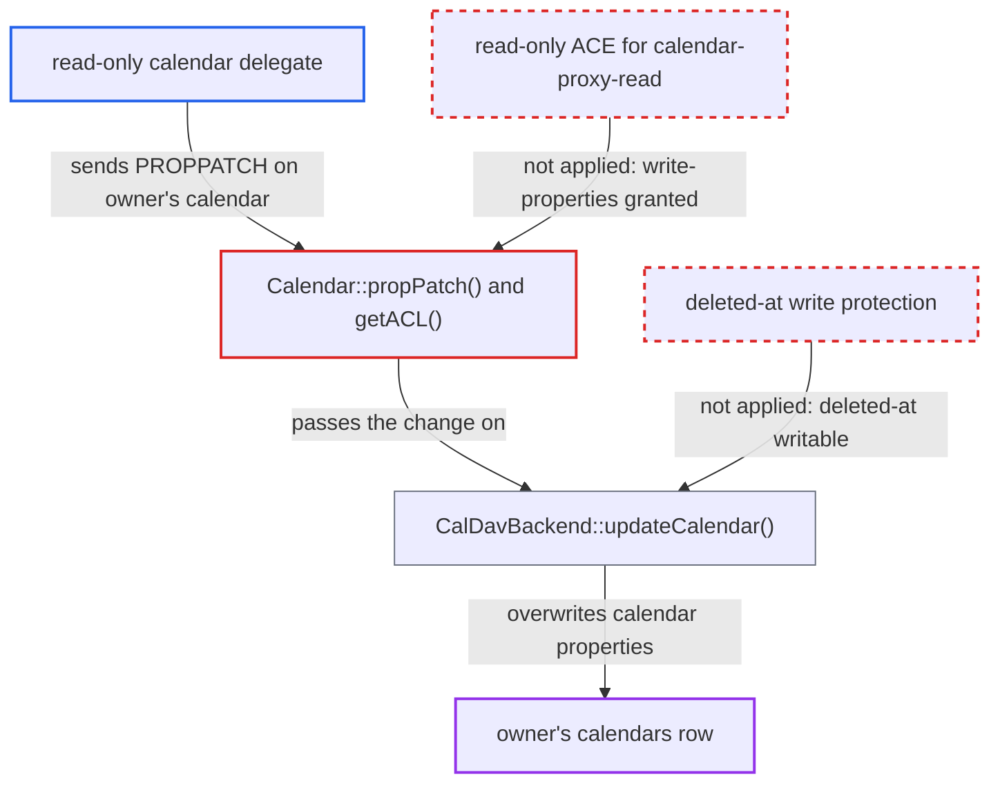

# Read-only calendar delegates can modify or soft-delete the delegator's calendars via PROPPATCH

| Field | Value |
|---|---|
| ID | `find_01CbwpLt6pcZJCBf7UtKPBFV` |
| Severity | **Low** |
| Status | open |
| CWE | CWE-266 — Incorrect Privilege Assignment |
| Created | 2026-10-27T21:33:51.525458Z |
| Claude Security | https://claude.ai/security/findings/find_01CbwpLt6pcZJCBf7UtKPBFV |

## Description

A user the owner made a read-only calendar delegate can still change the owner's calendars. They can rename or recolour a calendar, change its timezone, hide the owner's busy time, or move the whole calendar to the trash. The attacker needs only a login and a read delegation. The cause is that `Calendar::getACL()` gives `{DAV:}write-properties` to `<owner>/calendar-proxy-read`, and `Calendar::propPatch()` only blocks the backend write for shared calendars.

1. **calendar owner** adds another user as a read delegate. A `dav_cal_proxy` row with `PERMISSION_READ` makes that user a member of `<owner>/calendar-proxy-read`. ([`apps/dav/lib/Traits/PrincipalProxyTrait.php:61-86`](https://github.com/cx-benchmark/server/blob/6b6317280f8ed50277369c33cee070a643d29654/apps/dav/lib/Traits/PrincipalProxyTrait.php#L61-L86))
2. **read delegate** sends a PROPPATCH to the owner's calendar path. The request goes to `/remote.php/dav/calendars/<owner>/<calendar>/` and sets a property such as `{http://nextcloud.com/ns}deleted-at` or `schedule-calendar-transp`.
3. **`Calendar::getACL()`** grants write-properties to the read-only proxy principal. The ACE `{DAV:}write-properties` is added for `<owner>/calendar-proxy-read`, so the `DavAclPlugin` check passes. Sabre's own version gives that principal only `{DAV:}read`. ([`apps/dav/lib/CalDAV/Calendar.php:172-176`](https://github.com/cx-benchmark/server/blob/6b6317280f8ed50277369c33cee070a643d29654/apps/dav/lib/CalDAV/Calendar.php#L172-L176))
4. **`Calendar::propPatch()`** passes the change on to the backend. It skips the backend only when `isShared()` is true. The delegate uses the owner's own calendar home, where `isShared()` is false. ([`apps/dav/lib/CalDAV/Calendar.php:283-289`](https://github.com/cx-benchmark/server/blob/6b6317280f8ed50277369c33cee070a643d29654/apps/dav/lib/CalDAV/Calendar.php#L283-L289))
5. **`CalDavBackend::updateCalendar()`** writes the property into the owner's `calendars` row. It accepts every key of `$propertyMap`, including `{http://nextcloud.com/ns}deleted-at`, `calendar-timezone`, `displayname` and `calendar-color`, plus `schedule-calendar-transp`. ([`apps/dav/lib/CalDAV/CalDavBackend.php:891-930`](https://github.com/cx-benchmark/server/blob/6b6317280f8ed50277369c33cee070a643d29654/apps/dav/lib/CalDAV/CalDavBackend.php#L891-L930))

## Assessment

The attacker is an authenticated user whom the calendar owner added as a read delegate. The owner does this by setting `group-member-set` on their `calendar-proxy-read` principal, for example from Apple Calendar. The attacker then sends a PROPPATCH to `/remote.php/dav/calendars/<owner>/<calendar>/`, for example with `<nc:deleted-at>1700000000</nc:deleted-at>` or `<c:schedule-calendar-transp><c:transparent/></c:schedule-calendar-transp>`. No write delegation is needed. The report names no other way in.

Impact: A read-only delegate can change the owner's calendar metadata. They can rename or recolour it, change its timezone and default alarms, and make it `transparent` so the owner's events stop counting as busy in free-busy lookups. They can also set `deleted-at` to soft-delete the calendar. The owner can reverse the soft-delete within the retention window. The report finds no disclosure beyond what read delegation already allows.

## Recommendation

(1) `Calendar::getACL()` gives `{DAV:}write-properties` to `<owner>/calendar-proxy-read`, and `Calendar::propPatch()` only guards the shared-calendar case. Read delegates can therefore write backend calendar properties.

Fix criteria: A principal that is only a member of `<owner>/calendar-proxy-read` cannot change any backend-stored property of the delegator's calendars, including `deleted-at` and `schedule-calendar-transp`. A PROPPATCH from it on `calendars/<owner>/<cal>/` returns 403. The owner and `calendar-proxy-write` members keep their current abilities. Test: a read delegate sends PROPPATCH for `displayname` and `deleted-at`, and the `calendars` row is unchanged.

(2) `CalDavBackend::updateCalendar()` exposes the internal `deleted_at` column as a client-writable property through `$propertyMap`.

Fix criteria: `{http://nextcloud.com/ns}deleted-at` is read-only over PROPPATCH, and deletion and restoration happen only through the trashbin flow. Test: a PROPPATCH that sets it is rejected for every principal.

## Evidence

**https://github.com/cx-benchmark/server**

- [`apps/dav/lib/CalDAV/Calendar.php:172-176`](https://github.com/cx-benchmark/server/blob/6b6317280f8ed50277369c33cee070a643d29654/apps/dav/lib/CalDAV/Calendar.php#L172-L176)
- [`apps/dav/lib/CalDAV/Calendar.php:283-289`](https://github.com/cx-benchmark/server/blob/6b6317280f8ed50277369c33cee070a643d29654/apps/dav/lib/CalDAV/Calendar.php#L283-L289)
- [`apps/dav/lib/CalDAV/CalDavBackend.php:891-930`](https://github.com/cx-benchmark/server/blob/6b6317280f8ed50277369c33cee070a643d29654/apps/dav/lib/CalDAV/CalDavBackend.php#L891-L930)
- [`apps/dav/lib/Traits/PrincipalProxyTrait.php:61-86`](https://github.com/cx-benchmark/server/blob/6b6317280f8ed50277369c33cee070a643d29654/apps/dav/lib/Traits/PrincipalProxyTrait.php#L61-L86)

