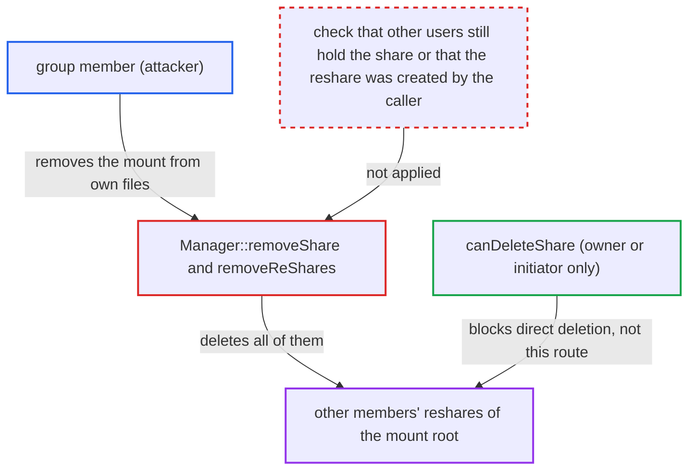

# Removing one member's federated group share deletes other members' reshares of it

| Field | Value |
|---|---|
| ID | `find_01P8QG3atKuw1Erw3su1gLun` |
| Severity | **Low** |
| Status | open |
| CWE | CWE-863 — Incorrect authorization |
| Created | 2026-10-27T21:36:13.324439Z |
| Claude Security | https://claude.ai/security/findings/find_01P8QG3atKuw1Erw3su1gLun |

## Description

Any member of a local group that received a federated group share can delete reshares made by other members. A reshare is a public link, a user, group or mail share, or an outgoing federated share. Only reshares of the mounted root folder are affected. The cause is `removeShare()`, which on one member's removal calls `removeReShares()` and deletes every reshare of the folder, whoever created it.

1. **Victim group member** reshares the mounted federated folder. The share's owner is set to the resharing member, so the attacker is neither its owner nor its initiator and has no sanctioned way to delete it. ([`lib/private/Share20/Manager.php:524-531`](https://github.com/cx-benchmark/server/blob/6b6317280f8ed50277369c33cee070a643d29654/lib/private/Share20/Manager.php#L524-L531))
2. **Attacker group member** deletes the mounted folder from their own files. This is done with `DELETE /remote.php/dav/files/<self>/<mount>` or in the web UI, and the attacker accepts the share first if needed. The mount root carries delete permission for every member, so the permission check passes. ([`lib/private/Files/View.php:243-270`](https://github.com/cx-benchmark/server/blob/6b6317280f8ed50277369c33cee070a643d29654/lib/private/Files/View.php#L243-L270))
3. **`View::rmdir()`** calls `External\Mount::removeMount()`, which calls `Manager::removeShare()`. For a path that is the mount root, `rmdir()` or `unlink()` go to `removeMount()`, which hands over to `removeShare()`. ([`lib/private/Files/View.php:243-270`](https://github.com/cx-benchmark/server/blob/6b6317280f8ed50277369c33cee070a643d29654/lib/private/Files/View.php#L243-L270))
4. **`removeShare()`** reads the root file id of the external storage and sets only the attacker's sub-share back to pending. The other members' sub-shares stay mounted. ([`apps/files_sharing/lib/External/Manager.php:371-436`](https://github.com/cx-benchmark/server/blob/6b6317280f8ed50277369c33cee070a643d29654/apps/files_sharing/lib/External/Manager.php#L371-L436))
5. **`removeShare()`** calls `removeReShares()` with that root file id, with no condition. Every member's sub-share copies the same token and remote, so all members' mounts resolve to the same storage and the same root file id. The victim's reshare therefore has a `file_source` equal to that id. ([`apps/files_sharing/lib/External/Storage.php:264-266`](https://github.com/cx-benchmark/server/blob/6b6317280f8ed50277369c33cee070a643d29654/apps/files_sharing/lib/External/Storage.php#L264-L266))
6. **`removeReShares()`** deletes every `share` row with that `file_source` and the matching `federated_reshares` rows. It does not filter by owner or initiator and does not check whether other users still hold the share. ([`apps/files_sharing/lib/External/Manager.php:371-436`](https://github.com/cx-benchmark/server/blob/6b6317280f8ed50277369c33cee070a643d29654/apps/files_sharing/lib/External/Manager.php#L371-L436))

## Assessment

The attacker is any authenticated member of a local group that received a federated group share. Another member (the victim) must have reshared the mounted folder as a link, user, group, mail or federated reshare. The attacker accepts the share if needed through `ExternalSharesController::create`. They then delete the mount through DAV or the web UI. They can accept the share again and repeat. The incoming-group-share admin setting does not prevent this. It defaults to off but is not enforced on the receive path, and admins may also turn it on. Declining a share through `ExternalSharesController::destroy` (`declineShare()`) does not reach `removeReShares()`.

Impact: The attacker deletes other users' reshares of the mounted folder, including public links with their passwords and expiry. Everyone those shares were given to loses access until the victim recreates them. No file contents are disclosed or modified, and reshares of items inside the mount are not affected.

## Recommendation

`removeShare()` deletes every reshare keyed only by the external storage's root file id, which is the same for every member of a federated group share. The deletion runs on one member's removal. It does not check whether other users still hold the share, and it is not limited to reshares the acting user created.

Fix criteria: When one member removes a federated group share, only reshares that member created are removed. Alternatively, the global cleanup waits until no accepted sub-share for the resource remains. To verify, mount one federated group share as two members. Have member A create a public link on the mount root, and have member B delete the mount via DAV. A's link must still exist and work.

## Evidence

**https://github.com/cx-benchmark/server**

- [`apps/files_sharing/lib/External/Manager.php:371-436`](https://github.com/cx-benchmark/server/blob/6b6317280f8ed50277369c33cee070a643d29654/apps/files_sharing/lib/External/Manager.php#L371-L436)
- [`apps/files_sharing/lib/External/Manager.php:142-175`](https://github.com/cx-benchmark/server/blob/6b6317280f8ed50277369c33cee070a643d29654/apps/files_sharing/lib/External/Manager.php#L142-L175)
- [`apps/files_sharing/lib/External/MountProvider.php:61-77`](https://github.com/cx-benchmark/server/blob/6b6317280f8ed50277369c33cee070a643d29654/apps/files_sharing/lib/External/MountProvider.php#L61-L77)
- [`apps/files_sharing/lib/External/Storage.php:264-266`](https://github.com/cx-benchmark/server/blob/6b6317280f8ed50277369c33cee070a643d29654/apps/files_sharing/lib/External/Storage.php#L264-L266)
- [`lib/private/Share20/Manager.php:524-531`](https://github.com/cx-benchmark/server/blob/6b6317280f8ed50277369c33cee070a643d29654/lib/private/Share20/Manager.php#L524-L531)
- [`lib/private/Files/View.php:243-270`](https://github.com/cx-benchmark/server/blob/6b6317280f8ed50277369c33cee070a643d29654/lib/private/Files/View.php#L243-L270)

