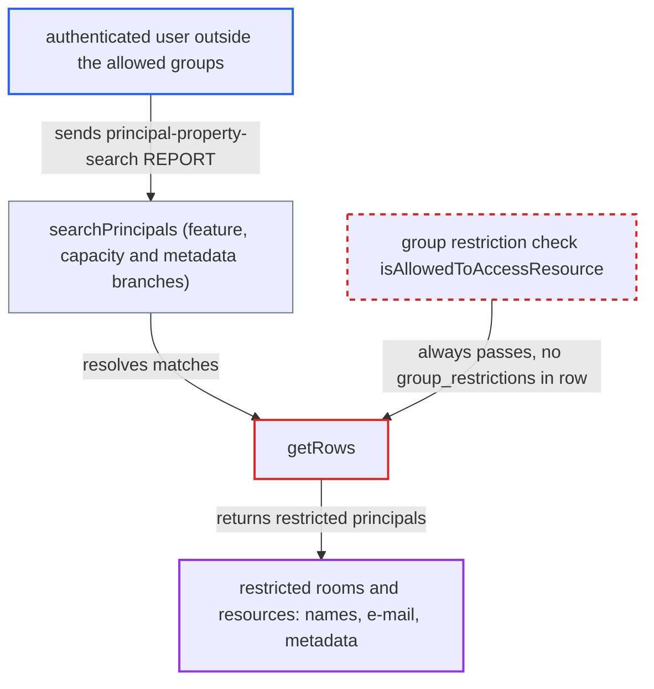

# Room/resource metadata principal search ignores group restrictions in getRows()

| Field | Value |
|---|---|
| ID | `find_01DjzVQmrSfw29iieCzeeuQB` |
| Severity | **Low** |
| Status | open |
| CWE | CWE-862 — Missing Authorization |
| Created | 2026-10-27T21:54:34.621601Z |
| Claude Security | https://claude.ai/security/findings/find_01DjzVQmrSfw29iieCzeeuQB |

## Description

Any logged-in user can find rooms and resources that are restricted to other groups. They learn the principal URIs, display names, e-mail addresses and metadata such as building, address, capacity, features and contact person. Nothing can be changed, and booking is still blocked. The cause is `getRows()` in `AbstractPrincipalBackend.php`: its rows never contain `group_restrictions`, so `isAllowedToAccessResource()` always allows them.

1. **authenticated user outside a room's allowed groups** sends a `principal-property-search` REPORT to `/remote.php/dav/principals/calendar-rooms/`. The search is on a property such as `{http://nextcloud.com/ns}room-features`, `room-seating-capacity` or a metadata key; `/principals/` with apply-to-principal-collection-set is an alternative target. ([`apps/dav/lib/Server.php:197-204`](https://github.com/cx-benchmark/server/blob/6b6317280f8ed50277369c33cee070a643d29654/apps/dav/lib/Server.php#L197-L204))
2. **`searchPrincipals()`** sends feature, capacity and metadata searches to `getRows()`. Only the `{http://sabredav.org/ns}email-address` and `{DAV:}displayname` branches check the restriction; the feature and capacity branches also pass an empty `$usersGroups`. ([`apps/dav/lib/CalDAV/ResourceBooking/AbstractPrincipalBackend.php:267-278`](https://github.com/cx-benchmark/server/blob/6b6317280f8ed50277369c33cee070a643d29654/apps/dav/lib/CalDAV/ResourceBooking/AbstractPrincipalBackend.php#L267-L278))
3. **`getRows()`** loads each match through `getPrincipalById()`. `getPrincipalById()` selects only `id, backend_id, resource_id, email, displayname`, so `group_restrictions` is never loaded into the principal arrays. ([`apps/dav/lib/CalDAV/ResourceBooking/AbstractPrincipalBackend.php:160-185`](https://github.com/cx-benchmark/server/blob/6b6317280f8ed50277369c33cee070a643d29654/apps/dav/lib/CalDAV/ResourceBooking/AbstractPrincipalBackend.php#L160-L185))
4. **`isAllowedToAccessResource()`** approves every row from `getRows()`. It returns `true` straight away when `$row['group_restrictions']` is not set, and that is always the case for these rows, so the `array_filter` call in `getRows()` removes nothing. ([`apps/dav/lib/CalDAV/ResourceBooking/AbstractPrincipalBackend.php:478-498`](https://github.com/cx-benchmark/server/blob/6b6317280f8ed50277369c33cee070a643d29654/apps/dav/lib/CalDAV/ResourceBooking/AbstractPrincipalBackend.php#L478-L498))
5. **the DAV server** returns the restricted principals with their properties. The principal nodes grant `{DAV:}read` to `{DAV:}authenticated`, so the REPORT response carries the display name, e-mail and metadata. ([`apps/dav/lib/CalDAV/Principal/User.php:31-40`](https://github.com/cx-benchmark/server/blob/6b6317280f8ed50277369c33cee070a643d29654/apps/dav/lib/CalDAV/Principal/User.php#L31-L40))

## Assessment

The attacker is any authenticated user who is not in the allowed groups of a restricted room or resource. No other privilege is needed. Rooms or resources with `group_restrictions`, set by an admin or a room backend, must exist. The attacker searches on `{http://nextcloud.com/ns}room-features`, `room-seating-capacity`, `resource-vehicle-seating-capacity` or any metadata key such as `room-building-address` or `resource-contact-person`. The request can go to `/principals/calendar-rooms/` or to `/principals/` with apply-to-principal-collection-set. The report assumes that sabre/dav 4.x `DAVACL\Plugin::principalSearch()` calls `searchPrincipals()` on each collection and then `getPropertiesForPath()` for each result. The `3rdparty` submodule was not checked out.

Impact: The attacker learns that restricted rooms and resources exist. They also learn their principal URIs, names, e-mail addresses and metadata (building, address, capacity, features, contact person). Nothing is modified, and booking still fails because `findByUri()` enforces the restriction.

## Recommendation

`getRows()` runs `isAllowedToAccessResource()` on principal arrays that have no `group_restrictions` value, so the group restriction is skipped for all metadata, feature and capacity searches. The feature and capacity branches also pass no user groups.

Fix criteria: A `principal-property-search` on any room or resource property (features, capacity, metadata keys) by a user outside a room's `group_restrictions` does not return that room's principal. The check uses the stored `group_restrictions` value and the requesting user's groups, including in the feature and capacity branches. Test with a restricted room and a user outside its groups searching by `room-features` and `room-seating-capacity`.

## Evidence

**https://github.com/cx-benchmark/server**

- [`apps/dav/lib/CalDAV/ResourceBooking/AbstractPrincipalBackend.php:365-391`](https://github.com/cx-benchmark/server/blob/6b6317280f8ed50277369c33cee070a643d29654/apps/dav/lib/CalDAV/ResourceBooking/AbstractPrincipalBackend.php#L365-L391)
- [`apps/dav/lib/CalDAV/ResourceBooking/AbstractPrincipalBackend.php:160-185`](https://github.com/cx-benchmark/server/blob/6b6317280f8ed50277369c33cee070a643d29654/apps/dav/lib/CalDAV/ResourceBooking/AbstractPrincipalBackend.php#L160-L185)
- [`apps/dav/lib/CalDAV/ResourceBooking/AbstractPrincipalBackend.php:478-498`](https://github.com/cx-benchmark/server/blob/6b6317280f8ed50277369c33cee070a643d29654/apps/dav/lib/CalDAV/ResourceBooking/AbstractPrincipalBackend.php#L478-L498)
- [`apps/dav/lib/CalDAV/ResourceBooking/AbstractPrincipalBackend.php:267-278`](https://github.com/cx-benchmark/server/blob/6b6317280f8ed50277369c33cee070a643d29654/apps/dav/lib/CalDAV/ResourceBooking/AbstractPrincipalBackend.php#L267-L278)
- [`apps/dav/lib/CalDAV/ResourceBooking/AbstractPrincipalBackend.php:221-257`](https://github.com/cx-benchmark/server/blob/6b6317280f8ed50277369c33cee070a643d29654/apps/dav/lib/CalDAV/ResourceBooking/AbstractPrincipalBackend.php#L221-L257)
- [`apps/dav/lib/Server.php:197-204`](https://github.com/cx-benchmark/server/blob/6b6317280f8ed50277369c33cee070a643d29654/apps/dav/lib/Server.php#L197-L204)
- [`apps/dav/lib/CalDAV/Principal/User.php:31-40`](https://github.com/cx-benchmark/server/blob/6b6317280f8ed50277369c33cee070a643d29654/apps/dav/lib/CalDAV/Principal/User.php#L31-L40)

