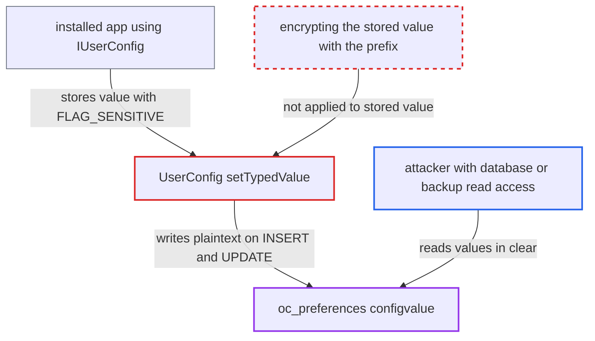

# Sensitive-flagged user config values stored in cleartext in oc_preferences

| Field | Value |
|---|---|
| ID | `find_01EH7cC25yd1NQjF2HTHwe6G` |
| Severity | **Low** |
| Status | open |
| CWE | CWE-312 — Cleartext storage |
| Created | 2026-10-27T21:51:11.015887Z |
| Claude Security | https://claude.ai/security/findings/find_01EH7cC25yd1NQjF2HTHwe6G |

## Description

Someone who can read the Nextcloud database, or a dump, backup or replica of it, can read per-user values that apps flagged `FLAG_SENSITIVE` in plain text. They do not need the instance `secret`. The cause is `setTypedValue()` in `UserConfig`, which saves the decrypted value instead of the encrypted one. Only keys an installed app flagged sensitive are affected.

1. **an installed app** stores a per-user value with `FLAG_SENSITIVE` through `IUserConfig::setValue*()`. The report says no code in this repository flags a user config value as sensitive. The values at risk come from installed apps, for example per-user tokens or integration credentials.
2. **the method `setTypedValue()`** marks the entry sensitive and then reassigns `$value` to `getDecryptedSensitiveValue()`. `setSensitive(true)` caches the plaintext in `decryptedValue`, so the getter returns the plaintext rather than the encrypted raw value. ([`lib/private/Config/UserConfig.php:1171-1182`](https://github.com/cx-benchmark/server/blob/6b6317280f8ed50277369c33cee070a643d29654/lib/private/Config/UserConfig.php#L1171-L1182))
3. **the class `UserConfigEntry`** keeps the plaintext cached and returns unprefixed values unchanged. Reads therefore work and raise no error, so the cleartext storage goes unnoticed. ([`lib/private/Config/UserConfigEntry.php:64-92`](https://github.com/cx-benchmark/server/blob/6b6317280f8ed50277369c33cee070a643d29654/lib/private/Config/UserConfigEntry.php#L64-L92))
4. **the INSERT in `setTypedValue()`** writes the plaintext `$value` to `configvalue` and sets `FLAG_SENSITIVE` in `flags`. The row looks protected because of its flag, but the stored value is not encrypted. ([`lib/private/Config/UserConfig.php:1215-1227`](https://github.com/cx-benchmark/server/blob/6b6317280f8ed50277369c33cee070a643d29654/lib/private/Config/UserConfig.php#L1215-L1227))
5. **the UPDATE in `setTypedValue()`** writes the plaintext `$value` again when the value changes. A row that was stored encrypted, for example through `updateSensitive(true)`, becomes cleartext on the next value change through `setValue*()`. ([`lib/private/Config/UserConfig.php:1281-1294`](https://github.com/cx-benchmark/server/blob/6b6317280f8ed50277369c33cee070a643d29654/lib/private/Config/UserConfig.php#L1281-L1294))
6. **the attacker** reads `oc_preferences` from the database or a dump, backup or replica. A query such as `SELECT configvalue FROM oc_preferences WHERE flags & 1` returns the sensitive values in clear.

## Assessment

The attacker must be able to read the Nextcloud database or one of its dumps, backups or replicas. They do not need `config.php` or the instance `secret`. An installed app must have stored per-user values with `FLAG_SENSITIVE` through `IUserConfig::setValue*()`. No victim action is needed.

Impact: The attacker reads the sensitive-flagged per-user values, such as tokens or integration credentials, in plain text. Only keys an app flagged sensitive are affected, and database read access is already required, so the loss is limited. The report names no effect on data integrity or availability.

## Recommendation

`UserConfig::setTypedValue()` saves `getDecryptedSensitiveValue()`, which is the plaintext, instead of the entry's encrypted raw value after marking it sensitive. This breaks the at-rest encryption that `FLAG_SENSITIVE` provides and that `updateSensitive()` and `AppConfig` still apply.

Fix criteria: A value written with `FLAG_SENSITIVE`, or onto a key already stored as sensitive, lands in `oc_preferences.configvalue` as `$UserConfigEncryption$` plus ciphertext, never as plaintext. This holds on both the INSERT and UPDATE paths. `getValue*()` still returns the plaintext. To verify, set a sensitive user value, then update it, and check after each step that the raw row starts with the prefix. A repair step re-encrypts existing rows that carry `FLAG_SENSITIVE` without the prefix.

## Evidence

**https://github.com/cx-benchmark/server**

- [`lib/private/Config/UserConfig.php:1171-1182`](https://github.com/cx-benchmark/server/blob/6b6317280f8ed50277369c33cee070a643d29654/lib/private/Config/UserConfig.php#L1171-L1182)
- [`lib/private/Config/UserConfig.php:1215-1227`](https://github.com/cx-benchmark/server/blob/6b6317280f8ed50277369c33cee070a643d29654/lib/private/Config/UserConfig.php#L1215-L1227)
- [`lib/private/Config/UserConfig.php:1281-1294`](https://github.com/cx-benchmark/server/blob/6b6317280f8ed50277369c33cee070a643d29654/lib/private/Config/UserConfig.php#L1281-L1294)
- [`lib/private/Config/UserConfigEntry.php:64-92`](https://github.com/cx-benchmark/server/blob/6b6317280f8ed50277369c33cee070a643d29654/lib/private/Config/UserConfigEntry.php#L64-L92)
- [`lib/private/Config/UserConfig.php:1397-1407`](https://github.com/cx-benchmark/server/blob/6b6317280f8ed50277369c33cee070a643d29654/lib/private/Config/UserConfig.php#L1397-L1407)
- [`lib/private/AppConfig.php:852-858`](https://github.com/cx-benchmark/server/blob/6b6317280f8ed50277369c33cee070a643d29654/lib/private/AppConfig.php#L852-L858)

