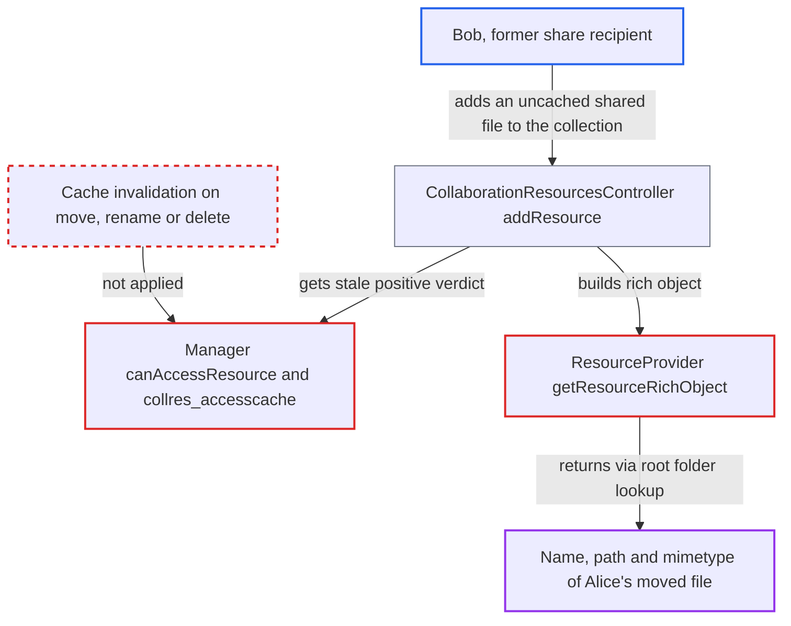

# Stale collaboration-resource access cache leaks metadata of files moved out of shares

| Field | Value |
|---|---|
| ID | `find_01FjBYgqEsC7Q3Gk6fxi426V` |
| Severity | **Low** |
| Status | open |
| CWE | CWE-863 — Incorrect authorization |
| Created | 2026-10-27T21:37:51.213077Z |
| Claude Security | https://claude.ai/security/findings/find_01FjBYgqEsC7Q3Gk6fxi426V |

## Description

A logged-in user who once had a file shared with them can keep learning that file's current name, storage path and mimetype after the owner moves it out of the shared folder. The same user can also rename collections or remove resources from them after an unshare. Contents are not exposed. The cause is that `Manager` trusts cached access verdicts, and the `file` provider clears them only on share create and delete events. Also, `ResourceProvider::getResourceRichObject()` looks nodes up through the root folder.

1. **Bob, a user with a folder share `S` from Alice** creates a collection on file `F` in `S`. The call is `POST /collaboration/resources/file/{F}`, and it caches a positive access verdict for Bob and `F`. ([`lib/private/Collaboration/Resources/Manager.php:259-280`](https://github.com/cx-benchmark/server/blob/6b6317280f8ed50277369c33cee070a643d29654/lib/private/Collaboration/Resources/Manager.php#L259-L280))
2. **Alice, the owner** moves `F` into a private folder. A move or rename fires none of the events that clear the cache, so Bob's cached `access=1` row stays. ([`apps/files/lib/Collaboration/Resources/Listener.php:30-39`](https://github.com/cx-benchmark/server/blob/6b6317280f8ed50277369c33cee070a643d29654/apps/files/lib/Collaboration/Resources/Listener.php#L30-L39))
3. **Bob** adds another uncached file of `S` to the collection with `POST .../collections/{C}`. Touching a file of a share owned by Alice makes `SharedStorage::init()` call `getUserFolder($owner)`, which sets up Alice's home mount in Bob's request. ([`apps/files_sharing/lib/SharedStorage.php:157-168`](https://github.com/cx-benchmark/server/blob/6b6317280f8ed50277369c33cee070a643d29654/apps/files_sharing/lib/SharedStorage.php#L157-L168))
4. **the controller `addResource`** builds the collection response from the cached verdict. `canAccessResource()` returns the stored verdict without asking the provider again, so `F` is still treated as accessible. ([`core/Controller/CollaborationResourcesController.php:113-132`](https://github.com/cx-benchmark/server/blob/6b6317280f8ed50277369c33cee070a643d29654/core/Controller/CollaborationResourcesController.php#L113-L132))
5. **the provider `getResourceRichObject()`** looks up `F` through `IRootFolder::getFirstNodeById()`. `Root::getByIdInPath` matches Alice's home mount, because it is already set up in the request, and finds the node. ([`lib/private/Files/Node/Root.php:403-458`](https://github.com/cx-benchmark/server/blob/6b6317280f8ed50277369c33cee070a643d29654/lib/private/Files/Node/Root.php#L403-L458))
6. **Bob** reads the response. The rich object for `F` gives its current `name`, its `path` in Alice's storage (for example `files/Private/salary.pdf`) and its `mimetype`. ([`apps/files/lib/Collaboration/Resources/ResourceProvider.php:34-76`](https://github.com/cx-benchmark/server/blob/6b6317280f8ed50277369c33cee070a643d29654/apps/files/lib/Collaboration/Resources/ResourceProvider.php#L34-L76))

## Assessment

The attacker is an ordinary logged-in user who has received a folder share from the owner and has cached a positive verdict for a file in it. The owner then moves the file out of the shared folder. The cached row stays until some share is created or deleted anywhere on the instance. The leak needs the owner's home mount to be set up in the request. Bob can do this by adding another not-yet-cached file of the still-shared folder to the collection in the same request. With `memcache.local` configured, the cached-path lookup at `Root.php:372-386` can do it too. Otherwise the lookup falls back to the requester's own mounts and the file is only omitted. The second gap does not need a move. After an unshare, collection rows keep `resource_type = ''`, so `invalidateAccessCacheForProvider()` does not clear them. The former recipient still passes `getCollection()` and can rename the collection or remove resources from it until its membership changes. The OCS routes are live whatever the `projects.enabled` value, which only hides the UI.

Impact: The attacker learns the current filename, mimetype and storage-internal path of a file in the owner's private tree that is no longer shared with them. While the stale row lives, the attacker can also follow later renames. Only metadata is returned, not contents. After an unshare the attacker can still rename collections and remove resources from them. The report rates the loss as limited.

## Recommendation

(1) `Manager` trusts cached positive verdicts indefinitely. The `file` provider clears them only on share create and delete, so a node that leaves a shared subtree by move, rename or delete keeps its cached access. `invalidateAccessCacheForProvider()` also never clears collection rows, which have `resource_type = ''`.

Fix criteria: After a file is moved, renamed or deleted, or any share changes, no user keeps a positive resource or collection verdict for something they can no longer reach. Collection rows that contain affected resources are cleared too, or the verdict is checked again through the provider. After the owner moves `F` out of `S`, the `addResource` and `listCollection` responses omit `F`. After an unshare, `renameCollection` returns 404.

(2) `ResourceProvider::getResourceRichObject()` resolves the node through the root folder instead of the requesting user's folder. Any wrong access verdict therefore discloses another user's file name and internal path.

Fix criteria: The rich object for a `file` resource is built only from a node reachable in the requesting user's own folder. When there is no such node, `ResourceException` is thrown and the resource is omitted. A stale cache row alone can no longer return the name or path of a file outside the user's folder, even when the owner's mounts are set up in the request.

## Evidence

**https://github.com/cx-benchmark/server**

- [`lib/private/Collaboration/Resources/Manager.php:259-280`](https://github.com/cx-benchmark/server/blob/6b6317280f8ed50277369c33cee070a643d29654/lib/private/Collaboration/Resources/Manager.php#L259-L280)
- [`apps/files/lib/Collaboration/Resources/Listener.php:30-39`](https://github.com/cx-benchmark/server/blob/6b6317280f8ed50277369c33cee070a643d29654/apps/files/lib/Collaboration/Resources/Listener.php#L30-L39)
- [`apps/files/lib/Collaboration/Resources/ResourceProvider.php:34-76`](https://github.com/cx-benchmark/server/blob/6b6317280f8ed50277369c33cee070a643d29654/apps/files/lib/Collaboration/Resources/ResourceProvider.php#L34-L76)
- [`lib/private/Files/Node/Root.php:403-458`](https://github.com/cx-benchmark/server/blob/6b6317280f8ed50277369c33cee070a643d29654/lib/private/Files/Node/Root.php#L403-L458)
- [`apps/files_sharing/lib/SharedStorage.php:157-168`](https://github.com/cx-benchmark/server/blob/6b6317280f8ed50277369c33cee070a643d29654/apps/files_sharing/lib/SharedStorage.php#L157-L168)
- [`lib/private/Collaboration/Resources/Manager.php:430-436`](https://github.com/cx-benchmark/server/blob/6b6317280f8ed50277369c33cee070a643d29654/lib/private/Collaboration/Resources/Manager.php#L430-L436)
- [`core/Controller/CollaborationResourcesController.php:113-132`](https://github.com/cx-benchmark/server/blob/6b6317280f8ed50277369c33cee070a643d29654/core/Controller/CollaborationResourcesController.php#L113-L132)

