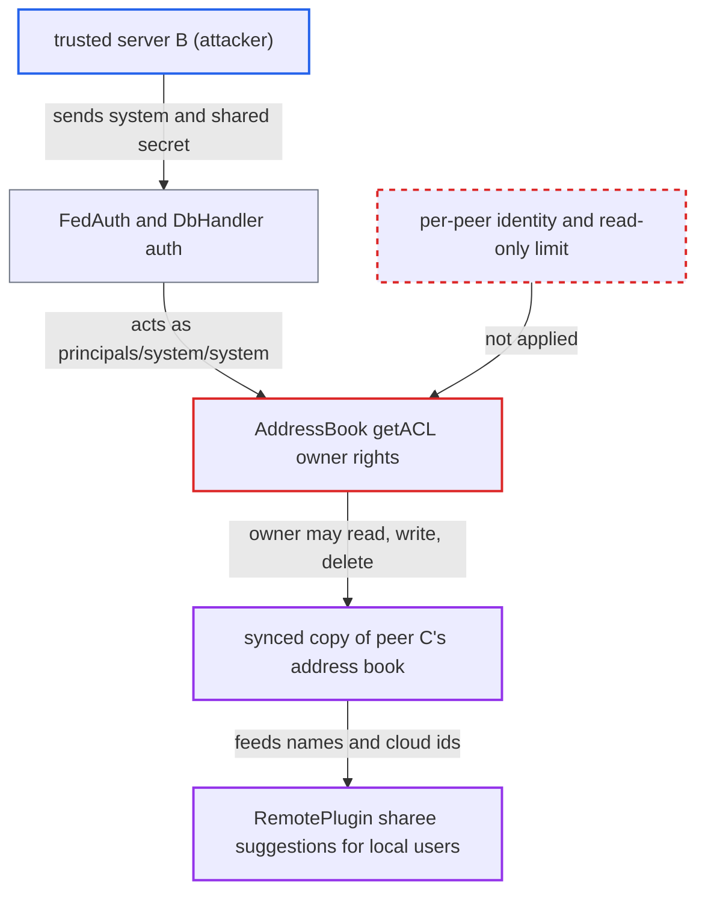

# Trusted server can read, alter and delete other trusted servers' synced address books

| Field | Value |
|---|---|
| ID | `find_01JEnhJvLtZyNjEgpSNmQdqm` |
| Severity | **Low** |
| Status | open |
| CWE | CWE-285 — Improper Authorization |
| Created | 2026-10-27T21:59:28.182166Z |
| Claude Security | https://claude.ai/security/findings/find_01JEnhJvLtZyNjEgpSNmQdqm |

## Description

A trusted server B can read, change and delete the copies of other trusted servers' address books that the victim Nextcloud instance A has synced. It needs the shared secret that B and A already share, and A must also trust a third server C. The cause is that `FedAuth` gives every trusted peer the same identity `principals/system/system`, and `AddressBook::getACL()` gives that identity write rights on the synced books.

1. **the sync code `SyncFederationAddressBooks`** mirrors each trusted peer's system address book into a local book owned by `principals/system/system`. The book's uri is the sha1 of the peer URL and its displayname is the peer URL, so C's copy sits at `addressbooks/system/system/<sha1(C url)>/`. ([`apps/federation/lib/SyncFederationAddressBooks.php:41-53`](https://github.com/cx-benchmark/server/blob/6b6317280f8ed50277369c33cee070a643d29654/apps/federation/lib/SyncFederationAddressBooks.php#L41-L53))
2. **trusted server B** sends a DAV request with Basic credentials `system:<secret>`. The secret is the one B shares with A, and the request goes to `remote.php/dav/addressbooks/system/system/<sha1(C url)>/`. ([`apps/federation/lib/DAV/FedAuth.php:24-47`](https://github.com/cx-benchmark/server/blob/6b6317280f8ed50277369c33cee070a643d29654/apps/federation/lib/DAV/FedAuth.php#L24-L47))
3. **`DbHandler::auth()`** accepts the password. It only checks that the password equals the `shared_secret` of some trusted server row, and it does not tell the caller which peer authenticated. ([`apps/federation/lib/DbHandler.php:255-268`](https://github.com/cx-benchmark/server/blob/6b6317280f8ed50277369c33cee070a643d29654/apps/federation/lib/DbHandler.php#L255-L268))
4. **`FedAuth`** maps B to `principals/system/system`. Every trusted peer gets this one principal, so B is treated as the owner of C's synced book. ([`apps/federation/lib/DAV/FedAuth.php:24-47`](https://github.com/cx-benchmark/server/blob/6b6317280f8ed50277369c33cee070a643d29654/apps/federation/lib/DAV/FedAuth.php#L24-L47))
5. **`AddressBook::getACL()`** grants the owner read, write, write-acl and write-properties. The synced copies are plain `AddressBook` nodes owned by that principal, with no `SystemAddressbook` filtering, so B gets full rights on C's copy. ([`apps/dav/lib/CardDAV/AddressBook.php:94-128`](https://github.com/cx-benchmark/server/blob/6b6317280f8ed50277369c33cee070a643d29654/apps/dav/lib/CardDAV/AddressBook.php#L94-L128))
6. **trusted server B** reads cards, uses PUT or DELETE on cards, deletes the whole book, shares it, or creates new books with MKCOL. The home `addressbooks/system/system` also grants the principal bind and unbind rights, so deleting and creating books is allowed too. ([`apps/dav/lib/CardDAV/UserAddressBooks.php:61-147`](https://github.com/cx-benchmark/server/blob/6b6317280f8ed50277369c33cee070a643d29654/apps/dav/lib/CardDAV/UserAddressBooks.php#L61-L147))
7. **`ContactsManager` and `RemotePlugin`** turn the altered cards into contacts-menu entries and federated share suggestions for every local user. The `FN`, `EMAIL` and `CLOUD` values of the cards are used, so a changed `CLOUD` value sends a share to an attacker-chosen cloud id. ([`lib/private/Collaboration/Collaborators/RemotePlugin.php:41-60`](https://github.com/cx-benchmark/server/blob/6b6317280f8ed50277369c33cee070a643d29654/lib/private/Collaboration/Collaborators/RemotePlugin.php#L41-L60))

## Assessment

The attacker runs, or holds the shared secret of, one trusted server B of the victim instance A. A must also trust a third server C, whose address book A has mirrored locally. The attacker sends the requests over the internet with `Authorization: Basic system:<secret>`. The requests are `PROPFIND` or `GET` to read, `PUT` or `DELETE` on cards, and `DELETE` on the whole book. The report also names sharing the book to local users with write-acl, and `MKCOL` of new books that are registered for all local users. No local user needs to act for the change itself. The report assumes sabre/dav 4.x ACL and `AddressBookHome` behaviour, because `3rdparty/` was not checked out.

Impact: B can read the federation-scoped profile data (names, e-mails, cloud ids) of C's users, although C never trusted B. B can also rewrite or delete A's copy of C's contacts. A rewritten `CLOUD` value makes A's users share files with the attacker's account while the suggestion still shows the original name. Deleting the book removes C's users from suggestions until the operator runs a full sync, because the incremental cron sync only re-adds cards that changed on C since the stored sync token.

## Recommendation

(1) Address books owned by `principals/system/system` give the owner write and write-acl rights. Every trusted peer authenticates as that owner, although peers only need read access to the local `system` book to sync.

Fix criteria: A request with a trusted-server shared secret cannot create, modify, share or delete cards or books under `addressbooks/system/system/`. Reading the local `system` book is the one allowed action. PUT, DELETE, MKCOL and POST (share) with such credentials against `addressbooks/system/system/<sha1>/` are refused and leave the data unchanged.

(2) All trusted peers share one DAV identity, so a peer cannot be limited to the data it is entitled to. It can read the synced copies of other peers' address books.

Fix criteria: A trusted server can only read the local instance's own system address book, as filtered by `SystemAddressbook::isFederation()`. Reading another peer's mirrored book with trusted-server credentials returns 403 or 404.

## Evidence

**https://github.com/cx-benchmark/server**

- [`apps/dav/lib/CardDAV/AddressBook.php:94-128`](https://github.com/cx-benchmark/server/blob/6b6317280f8ed50277369c33cee070a643d29654/apps/dav/lib/CardDAV/AddressBook.php#L94-L128)
- [`apps/federation/lib/DAV/FedAuth.php:24-47`](https://github.com/cx-benchmark/server/blob/6b6317280f8ed50277369c33cee070a643d29654/apps/federation/lib/DAV/FedAuth.php#L24-L47)
- [`apps/federation/lib/DbHandler.php:255-268`](https://github.com/cx-benchmark/server/blob/6b6317280f8ed50277369c33cee070a643d29654/apps/federation/lib/DbHandler.php#L255-L268)
- [`apps/federation/lib/SyncFederationAddressBooks.php:41-53`](https://github.com/cx-benchmark/server/blob/6b6317280f8ed50277369c33cee070a643d29654/apps/federation/lib/SyncFederationAddressBooks.php#L41-L53)
- [`apps/dav/lib/CardDAV/UserAddressBooks.php:61-147`](https://github.com/cx-benchmark/server/blob/6b6317280f8ed50277369c33cee070a643d29654/apps/dav/lib/CardDAV/UserAddressBooks.php#L61-L147)
- [`apps/dav/lib/CardDAV/ContactsManager.php:46-70`](https://github.com/cx-benchmark/server/blob/6b6317280f8ed50277369c33cee070a643d29654/apps/dav/lib/CardDAV/ContactsManager.php#L46-L70)
- [`lib/private/Collaboration/Collaborators/RemotePlugin.php:41-60`](https://github.com/cx-benchmark/server/blob/6b6317280f8ed50277369c33cee070a643d29654/lib/private/Collaboration/Collaborators/RemotePlugin.php#L41-L60)

