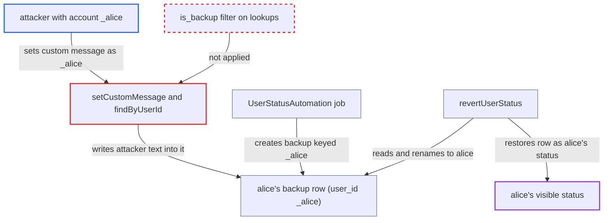

# User status backup rows keyed by `_`+uid collide with real accounts named `_<uid>`

| Field | Value |
|---|---|
| ID | `find_01J8mEpihmC8M5xFdfaz2ksU` |
| Severity | **Low** |
| Status | open |
| CWE | CWE-706 — Incorrect reference resolution |
| Created | 2026-10-27T21:20:04.406574Z |
| Claude Security | https://claude.ai/security/findings/find_01J8mEpihmC8M5xFdfaz2ksU |

## Description

A user whose account is named `_` plus another user's ID can overwrite that user's status message and emoji, and can block or delete their status. Everyone who views the victim then sees the attacker's text as the victim's own status. The attacker needs a `_<victim>` account, which an admin, a subadmin or an external backend can create. The cause is that backup status rows are keyed `'_' . $userId` in the same `user_id` column as real users, and `findByUserId` never filters on `is_backup`.

1. **attacker (subadmin, admin or external backend)** creates an account named `_alice`. `validateUserId` allows `_` at any position, including first, so the name is valid. A subadmin can do this through `addUser` with a chosen password. ([`lib/private/User/Manager.php:741-775`](https://github.com/cx-benchmark/server/blob/6b6317280f8ed50277369c33cee070a643d29654/lib/private/User/Manager.php#L741-L775))
2. **the dav job `UserStatusAutomation`** starts an automated status for `alice` and backs up her current status. `createBackupStatus` moves her row to `user_id = '_alice'`. This works only while `_alice` has no live row, because of the unique index on `user_id`. ([`apps/dav/lib/BackgroundJob/UserStatusAutomation.php:209-237`](https://github.com/cx-benchmark/server/blob/6b6317280f8ed50277369c33cee070a643d29654/apps/dav/lib/BackgroundJob/UserStatusAutomation.php#L209-L237))
3. **attacker** sends `PUT /ocs/v2.php/apps/user_status/api/v1/user_status/message/custom` as `_alice`. The controller passes the caller's own user ID, `_alice`, to `setCustomMessage`. ([`apps/user_status/lib/Controller/UserStatusController.php:131-144`](https://github.com/cx-benchmark/server/blob/6b6317280f8ed50277369c33cee070a643d29654/apps/user_status/lib/Controller/UserStatusController.php#L131-L144))
4. **the service `setCustomMessage`** loads the row with `user_id = '_alice'` and writes the attacker's icon and message into it. That row is `alice`'s backup, because `findByUserId` ignores `is_backup`. The row stays marked as a backup and keeps its id. ([`apps/user_status/lib/Service/StatusService.php:356-394`](https://github.com/cx-benchmark/server/blob/6b6317280f8ed50277369c33cee070a643d29654/apps/user_status/lib/Service/StatusService.php#L356-L394))
5. **the service `revertUserStatus`** deletes `alice`'s automated status and renames the `_alice` row to `alice`. The attacker's message is now `alice`'s visible status. ([`apps/user_status/lib/Service/StatusService.php:553-582`](https://github.com/cx-benchmark/server/blob/6b6317280f8ed50277369c33cee070a643d29654/apps/user_status/lib/Service/StatusService.php#L553-L582))

## Assessment

The attacker needs an account named `_` plus the victim's user ID. A subadmin can create it through `addUser` even for a victim outside their groups. Otherwise an admin or an external backend must have assigned the name. For the main attack, `_<victim>` must have no status row when the victim's automated out-of-office or availability status starts. The attacker can check this by polling `GET /statuses/_<victim>`. The report notes these preconditions are outside the attacker's control. Two other outcomes exist. If `_<victim>` already has a live row, the victim's backup fails on the unique index and `setUserStatus` aborts the automation. Also, the victim's own status-setting calls run `removeBackupUserStatus('alice')`, which deletes `_alice`'s live row.

Impact: The attacker can make the status message and emoji they chose show as another user's own status to everyone, which is a limited integrity loss that can be used for social engineering. While holding a live row, they can also stop the victim's automated DND or out-of-office status from being applied. The status data read through `_<victim>` was already public. No files, credentials or privileges are exposed.

## Recommendation

Backup rows share the `user_id` namespace with real user IDs through an `_` prefix that `validateUserId` does not reserve. `findByUserId` and the other single-user lookups and deletes do not constrain on `is_backup`.

Fix criteria: A live-status lookup, update or delete for any user ID never matches a backup row, and a backup lookup never matches a live row. For example, every query constrains on `is_backup`, or backups are keyed by the real user ID in a separate column or table so that no real user ID can collide. To verify, create `alice` and `_alice`, put `alice` into out-of-office, set a custom message as `_alice`, and end the out-of-office period. `alice`'s restored status must be her own. `_alice`'s status must be unaffected.

## Evidence

**https://github.com/cx-benchmark/server**

- [`apps/user_status/lib/Db/UserStatusMapper.php:118-126`](https://github.com/cx-benchmark/server/blob/6b6317280f8ed50277369c33cee070a643d29654/apps/user_status/lib/Db/UserStatusMapper.php#L118-L126)
- [`apps/user_status/lib/Db/UserStatusMapper.php:206-216`](https://github.com/cx-benchmark/server/blob/6b6317280f8ed50277369c33cee070a643d29654/apps/user_status/lib/Db/UserStatusMapper.php#L206-L216)
- [`lib/private/User/Manager.php:741-775`](https://github.com/cx-benchmark/server/blob/6b6317280f8ed50277369c33cee070a643d29654/lib/private/User/Manager.php#L741-L775)
- [`apps/user_status/lib/Migration/Version0001Date20200602134824.php:77`](https://github.com/cx-benchmark/server/blob/6b6317280f8ed50277369c33cee070a643d29654/apps/user_status/lib/Migration/Version0001Date20200602134824.php#L77)
- [`apps/user_status/lib/Service/StatusService.php:356-394`](https://github.com/cx-benchmark/server/blob/6b6317280f8ed50277369c33cee070a643d29654/apps/user_status/lib/Service/StatusService.php#L356-L394)
- [`apps/user_status/lib/Service/StatusService.php:553-582`](https://github.com/cx-benchmark/server/blob/6b6317280f8ed50277369c33cee070a643d29654/apps/user_status/lib/Service/StatusService.php#L553-L582)
- [`apps/dav/lib/BackgroundJob/UserStatusAutomation.php:209-237`](https://github.com/cx-benchmark/server/blob/6b6317280f8ed50277369c33cee070a643d29654/apps/dav/lib/BackgroundJob/UserStatusAutomation.php#L209-L237)
- [`apps/user_status/lib/Service/StatusService.php:454-464`](https://github.com/cx-benchmark/server/blob/6b6317280f8ed50277369c33cee070a643d29654/apps/user_status/lib/Service/StatusService.php#L454-L464)
- [`apps/user_status/lib/Controller/UserStatusController.php:131-144`](https://github.com/cx-benchmark/server/blob/6b6317280f8ed50277369c33cee070a643d29654/apps/user_status/lib/Controller/UserStatusController.php#L131-L144)
- [`apps/provisioning_api/lib/Controller/UsersController.php:528-620`](https://github.com/cx-benchmark/server/blob/6b6317280f8ed50277369c33cee070a643d29654/apps/provisioning_api/lib/Controller/UsersController.php#L528-L620)

