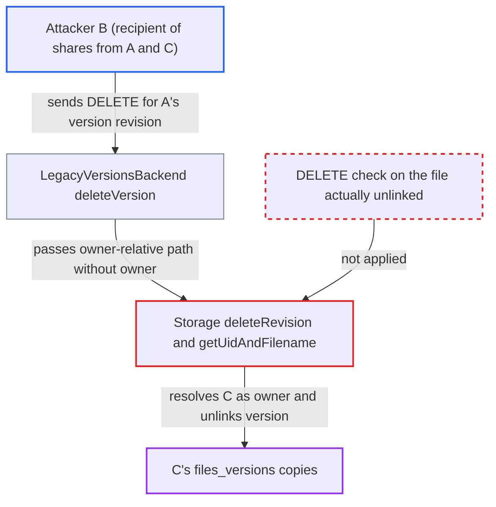

# Version deletion resolves owner from sharee's view, deleting other users' version files

| Field | Value |
|---|---|
| ID | `find_01KsehKxb23KPNGB9i5yDQzA` |
| Severity | **Low** |
| Status | open |
| CWE | CWE-863 — Incorrect authorization |
| Created | 2026-10-27T21:30:09.800432Z |
| Claude Security | https://claude.ai/security/findings/find_01KsehKxb23KPNGB9i5yDQzA |

## Description

A logged-in user who has a share with delete permission from one user and a read-only share from another can permanently delete the second user's file version history. Only old versions are lost. The cause is `Storage::deleteRevision()`, which works out the owner again from a path in the caller's own file tree, and the permission check in `LegacyVersionsBackend::deleteVersion()` covers a different file.

1. **Attacker B** moves the mount point of A's share and puts C's read-only shared file at A's owner-relative path. Recipients can freely move received-share mount points, so B can make `/F/x.txt` in B's tree resolve to C's file.
2. **Attacker B** lists C's version revision ids and forges the same revision T on A's file. B reads the ids with `PROPFIND /dav/versions/B/versions/<C-fileid>`, then sends a `PUT` with `X-OC-Mtime: T` and a second `PUT` on A's file, because file mtimes set the revision id.
3. **Attacker B** sends `DELETE /dav/versions/B/versions/<A-fileid>/T`. Any authenticated user can reach this WebDAV delete, and `{fileId}` is resolved through B's own folder, so received shares from any owner can be addressed. ([`apps/files_versions/lib/Sabre/VersionFile.php:65-71`](https://github.com/cx-benchmark/server/blob/6b6317280f8ed50277369c33cee070a643d29654/apps/files_versions/lib/Sabre/VersionFile.php#L65-L71))
4. **the backend `LegacyVersionsBackend::deleteVersion()`** checks DELETE permission on A's shared file only, then passes the owner-relative version path to `Storage::deleteRevision()`. The permission check covers the share the version was listed from, and the owner is not passed along. ([`apps/files_versions/lib/Versions/LegacyVersionsBackend.php:227-238`](https://github.com/cx-benchmark/server/blob/6b6317280f8ed50277369c33cee070a643d29654/apps/files_versions/lib/Versions/LegacyVersionsBackend.php#L227-L238))
5. **the method `Storage::deleteRevision()`** resolves the owner of the path in B's session view and unlinks the version file. `getUidAndFilename()` calls `Filesystem::getOwner()`, which finds C's file at that path, so `/C/files_versions/<C-path>.vT` is unlinked with no further permission check. ([`apps/files_versions/lib/Storage.php:296-302`](https://github.com/cx-benchmark/server/blob/6b6317280f8ed50277369c33cee070a643d29654/apps/files_versions/lib/Storage.php#L296-L302))

## Assessment

The attacker is an authenticated user B with no special role. B needs a share from user A with DELETE permission and a read-only share from victim user C. B moves A's share mount away from the original folder and puts C's shared file at A's owner-relative path (for example `/F/x.txt`) in B's own tree. B also forges a version of A's file with the same revision id, using `X-OC-Mtime` or `{DAV:}lastmodified` to set the file mtime. Requests go through the WebDAV versions endpoint.

Impact: B permanently deletes version files of another user C, on whose file B has only read access. Repeating this per revision wipes C's full version history for any file C shared read-only with B. C's current file content is untouched and no data is disclosed, so the loss is limited to historical copies.

## Recommendation

(1) `Storage::deleteRevision()` rebuilds the owning user from a path string interpreted in the session user's file view, although the caller already knows the owner from `IVersion::getUser()`. A path collision in the attacker's own tree can therefore redirect the unlink to a third user's `files_versions`.

Fix criteria: The version file removed belongs to the exact owner and file the `IVersion` object was produced for. `deleteRevision()` or its caller works on `$version->getUser()` and `$version->getVersionPath()` directly, as `rollback()` does, and never calls `Filesystem::getOwner()` on an owner-relative path. To verify, place a differently-owned share at the owner-relative path in the attacker's tree and send `DELETE` on the version. Only the listed share owner's `.v<rev>` file must be removed.

(2) The DELETE permission check in `LegacyVersionsBackend::deleteVersion()` is done on a different node than the one whose storage is modified.

Fix criteria: Authorization and the destructive operation target the same owner and file pair. Deleting a version fails or does nothing unless the current user has DELETE permission on the very file whose version file is unlinked.

## Evidence

**https://github.com/cx-benchmark/server**

- [`apps/files_versions/lib/Storage.php:296-302`](https://github.com/cx-benchmark/server/blob/6b6317280f8ed50277369c33cee070a643d29654/apps/files_versions/lib/Storage.php#L296-L302)
- [`apps/files_versions/lib/Storage.php:96-120`](https://github.com/cx-benchmark/server/blob/6b6317280f8ed50277369c33cee070a643d29654/apps/files_versions/lib/Storage.php#L96-L120)
- [`apps/files_versions/lib/Versions/LegacyVersionsBackend.php:227-238`](https://github.com/cx-benchmark/server/blob/6b6317280f8ed50277369c33cee070a643d29654/apps/files_versions/lib/Versions/LegacyVersionsBackend.php#L227-L238)
- [`apps/files_versions/lib/Versions/LegacyVersionsBackend.php:53-74`](https://github.com/cx-benchmark/server/blob/6b6317280f8ed50277369c33cee070a643d29654/apps/files_versions/lib/Versions/LegacyVersionsBackend.php#L53-L74)
- [`apps/files_versions/lib/Sabre/VersionFile.php:65-71`](https://github.com/cx-benchmark/server/blob/6b6317280f8ed50277369c33cee070a643d29654/apps/files_versions/lib/Sabre/VersionFile.php#L65-L71)
- [`apps/files_versions/lib/Sabre/VersionRoot.php:61-76`](https://github.com/cx-benchmark/server/blob/6b6317280f8ed50277369c33cee070a643d29654/apps/files_versions/lib/Sabre/VersionRoot.php#L61-L76)
- [`apps/files_versions/lib/Storage.php:344-364`](https://github.com/cx-benchmark/server/blob/6b6317280f8ed50277369c33cee070a643d29654/apps/files_versions/lib/Storage.php#L344-L364)

